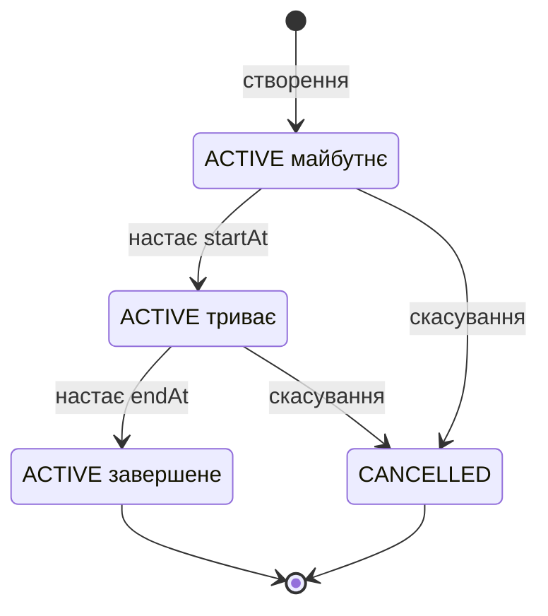
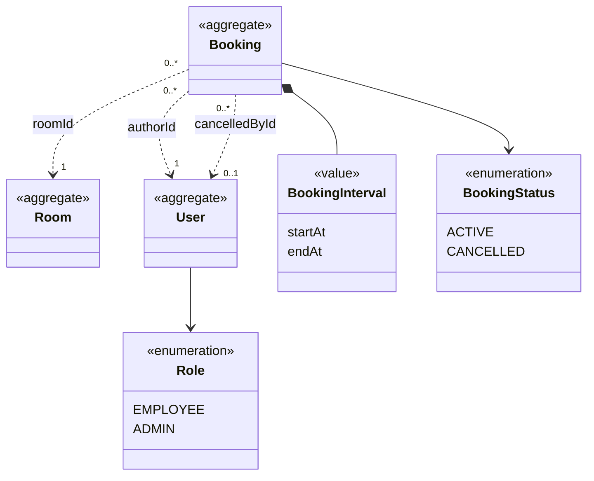

# Етап 2. Доменна модель

Модель має три агрегати (Room, Booking, User) і один об'єкт-значення (BookingInterval). Більшість правил стосується одного бронювання й перевіряється в коді домену. Три умови охоплюють кілька записів: відсутність перетинів (INV-08), деактивація кімнати лише без незавершених бронювань (INV-09) і наявність хоча б одного активного ADMIN (INV-14). Перші дві за NFR-03 має тримати СУБД. Механізм визначимо на етапі 3, а тут зафіксовано самі правила й операції, що можуть їх порушити.

## Сутності й атрибути

### Room

| Атрибут | Тип | Правила | Джерело |
|---|---|---|---|
| `id` | Long | Видає СУБД, не змінюється | A-13 |
| `name` | String | Зберігається після trim, від 1 до 100 символів. Унікальна за ключем порівняння (INV-11) | FR-19, A-06, A-14 |
| `floor` | int | Ціле від -5 до 100 | FR-19, A-14 |
| `capacity` | int | Ціле від 1 до 1000 | FR-19, A-14 |
| `equipment` | String | Необов'язкове, до 500 символів, вільний текст | FR-19 |
| `active` | boolean | Нова кімната активна. Змінюється операціями `activateRoom` і `deactivateRoom`; `updateRoom` його не чіпає | FR-19...FR-22 |

### Booking

| Атрибут | Тип | Правила | Джерело |
|---|---|---|---|
| `id` | Long | Видає СУБД, не змінюється | A-13 |
| `roomId` | Long | Посилання на Room. Обов'язкове, не змінюється | FR-09 |
| `authorId` | Long | Посилання на User. Береться із сесії, значення у вхідних даних ігнорується. Не змінюється | FR-09 |
| `title` | String | Зберігається після trim, від 1 до 200 символів (INV-01) | FR-10 |
| `startAt`, `endAt` | LocalDateTime | Місцевий час офісу без зсуву (D-01). Разом утворюють BookingInterval. Не змінюються | FR-11 |
| `status` | BookingStatus | ACTIVE або CANCELLED | FR-17, FR-18 |
| `createdAt` | Instant | Ставить сервер у момент створення | A-21 |
| `cancelledAt` | Instant | Порожнє, поки статус ACTIVE (INV-07) | FR-18, A-08 |
| `cancelledById` | Long | Посилання на User. Порожнє, поки статус ACTIVE (INV-07) | FR-18, A-08 |

Не зберігаються дата бронювання (дата `startAt`), тривалість і фаза (TR-05). Слот (15-хвилинна клітинка) не є сутністю: для всіх правил вистачає інтервалу `[startAt, endAt)`.

### User

| Атрибут | Тип | Правила | Джерело |
|---|---|---|---|
| `id` | Long | Видає СУБД, не змінюється | A-13 |
| `username` | String | Від 3 до 64 символів: латиниця, цифри, крапка, підкреслення, дефіс. Унікальне за ключем порівняння (INV-13) | FR-23, A-14, A-15 |
| `displayName` | String | Після trim від 1 до 100 символів. Показується як автор бронювання | FR-04, A-14 |
| `passwordHash` | String | Лише хеш. Політика паролів: етап 6 | NFR-06 |
| `role` | Role | EMPLOYEE або ADMIN, рівно одна | FR-02 |
| `enabled` | boolean | Деактивований користувач увійти не може | FR-23 |

Якщо Q-01 вирішиться на користь каталогу, `passwordHash` зникне, а джерело `role` і `enabled` доведеться визначити окремо. Назва User збігається із зарезервованим словом PostgreSQL і з класом Spring Security, тому імена класу й таблиці визначимо на етапах 3 і 4.

### Допоміжні типи

| Тип | Зміст | Призначення |
|---|---|---|
| BookingInterval | `startAt`, `endAt` | Напіввідкритий інтервал `[startAt, endAt)`. Знає свою дату, тривалість і перетин з іншим інтервалом. Параметрів і поточного часу не знає |
| BookingTimePolicy | Параметри правил, Clock | Перевіряє INV-03...INV-05, FR-13 і FR-14 для нового інтервалу. Окремий від BookingInterval, бо йому потрібні параметри й поточний час |
| BookingPhase | UPCOMING, IN_PROGRESS, FINISHED | Обчислюється з інтервалу й `now` (TR-05), не зберігається |

## Параметри правил

| Параметр | Значення | Де діє |
|---|---|---|
| `officeZone` | Europe/Kyiv | TR-01 |
| `workDayStart`, `workDayEnd` | 08:00, 20:00 | INV-03 |
| `slotGrid` | 15 хвилин | INV-04, TR-04 |
| `minDuration`, `maxDuration` | 15 хвилин, 4 години | INV-05 |
| `horizonDays` | 90 | TR-04 |

Значення задаються в конфігурації (A-04; відображення: етап 6). Нове значення діє на нові бронювання, збережені не переглядаються (A-16).

## Інваріанти

| ID | Інваріант | Джерело | Чим гарантується |
|---|---|---|---|
| INV-01 | Назва зустрічі після trim має від 1 до 200 символів | FR-10 | Домен. Граничні випадки з FR-10 |
| INV-02 | `startAt` < `endAt`, обидва значення мають одну календарну дату | FR-11 | Домен і CHECK у СУБД (параметрів не містить) |
| INV-03 | На момент створення: `workDayStart` ≤ час `startAt` і час `endAt` ≤ `workDayEnd` | FR-11 | Домен. Приклади з FR-11 |
| INV-04 | На момент створення: кількість хвилин від початку доби для `startAt` і `endAt` кратна `slotGrid`, секунд і часток секунди немає | FR-11 | Домен. Приклади з FR-11 |
| INV-05 | На момент створення: `minDuration` ≤ `endAt` - `startAt` ≤ `maxDuration` | FR-11 | Домен. Приклади з FR-11 |
| INV-06 | Після створення єдина допустима зміна бронювання: ACTIVE → CANCELLED із заповненням `cancelledAt` і `cancelledById`. Решта полів не змінюється, зворотного переходу немає | FR-17, FR-18 | Домен: єдиний метод зміни Booking, скасування. Тест: операцій зміни часу чи назви в API немає |
| INV-07 | `status` = CANCELLED тоді й лише тоді, коли `cancelledAt` і `cancelledById` задані | FR-18, A-08 | Домен і CHECK у СУБД |
| INV-08 | Для кожної кімнати будь-які два різні ACTIVE-бронювання `a` і `b` задовольняють `a.endAt` ≤ `b.startAt` або `b.endAt` ≤ `a.startAt` | FR-12, NFR-03(а) | СУБД, обов'язково. Тест із NFR-03 |
| INV-09 | Якщо кімната неактивна, у ній немає ACTIVE-бронювань із `endAt` > `now` | FR-15, FR-21, NFR-03(б) | СУБД і послідовне виконання операцій по кімнаті (етап 3). Тест із NFR-03(б) |
| INV-10 | Кожне бронювання посилається на існуючі кімнату й користувачів (`roomId`, `authorId`, `cancelledById`). Кімнати й користувачі не видаляються | A-06, A-20 | СУБД (зовнішні ключі) |
| INV-11 | Назва кімнати унікальна за ключем порівняння (A-15) | FR-19, A-06 | СУБД (унікальний індекс). Тест: приклад із FR-19 |
| INV-12 | Поверх, місткість і обладнання лежать у межах A-14 і FR-19 | FR-19 | Домен. CHECK у СУБД: етап 3 |
| INV-13 | `username` унікальний за ключем порівняння (A-15). Роль рівно одна | FR-02, FR-23 | СУБД (унікальний індекс) |
| INV-14 | У системі завжди є хоча б один активний ADMIN | FR-23, A-19 | Застосунок: операції над ADMIN виконуються послідовно (етап 3). Декларативним обмеженням СУБД це не виразити. Тест: паралельна деактивація двох останніх ADMIN дає один успіх |

Уточнення до етапу 1. Там сказано, що однодобовість випливає з робочих годин. Це вірно лише разом з максимальною тривалістю: 19:00 одного дня й 08:00 наступного обидва лежать у робочих годинах, а відсікає такий інтервал обмеження в 4 години. Параметри змінні (A-16), тому правило винесене в INV-02 окремо.

## Правила роботи з часом

### D-01. Форма зберігання інтервалу бронювання

**Контекст.** Правила FR-11...FR-14 сформульовані в годиннику офісу: «з 08:00 до 20:00», «кратно 15 хвилинам», «за 90 днів». Europe/Kyiv має літній час, тому місцевий час і момент часу не завжди відповідають один одному.

**Варіанти.**
- A. `startAt` і `endAt` як Instant (UTC). Кожне правило спершу перетворює значення в місцевий час, а вибірка «на дату» перетворює дату на пару моментів.
- B. `startAt` і `endAt` як LocalDateTime в `officeZone`, без зсуву. Моменти аудиту лишаються Instant.
- C. Три атрибути: дата, час початку, час кінця. Однодобовість забезпечена структурою.

**Вибір.** B.

**Причина.** Правила FR-11...FR-14 застосовуються до значень напряму. «90 днів» рахується календарними днями, а вибірка за датою не залежить від того, що в добу переходу 23 або 25 годин. Вікно 08:00-20:00 не перетинається з переходом на літній час (розділ нижче), тож кожному місцевому часові з вікна відповідає рівно один момент і втрат інформації немає. Якщо правила зони колись зміняться, збережене «10:00» лишиться «10:00», а Instant показав би таке бронювання зсунутим. C відкинуто: однодобовість і так перевіряє INV-02, а діапазон для перевірки перетину довелося б щоразу складати з трьох частин.

**Наслідки.** Поточний час береться з Clock і перетворюється в місцевий (TR-03). Формат у API визначимо на етапі 5, типи стовпців на етапі 3.

**Ціна.** Значення без зони не описують себе самі, код і БД покладаються на одну зону. Кілька офісів у різних зонах (поза межами) вимагали б зони на кімнаті й міграції даних. Правило «інтервал у місцевому часі, аудит в Instant» суперечить звичці зберігати все в UTC, тож його треба закріпити тестами TR-02 і TR-06.

### Правила обчислення

| ID | Правило | Перевірка |
|---|---|---|
| TR-01 | Усі правила з годинами, датами й межами доби обчислюються в `officeZone`. Зона JVM, сесії БД і браузера на результат не впливає (NFR-07) | Весь набір тестів проходить при зоні JVM UTC і America/Los_Angeles: ті самі моменти мають там іншу календарну дату, і помилка із зоною проявиться |
| TR-02 | Інтервал бронювання зберігається й обробляється як місцевий час офісу (D-01). `createdAt` і `cancelledAt` зберігаються як Instant і показуються після перетворення в `officeZone` | Бронювання з `startAt` 10:00 читається як 10:00 за будь-якої зони JVM і сесії БД |
| TR-03 | Поточний момент береться лише з Clock і перетворюється в місцевий час офісу. Прямих викликів системного часу в домені й сервісах немає | Тести підставляють фіксований Clock. Відсутність прямих викликів перевіряє архітектурний тест (етап 4) |
| TR-04 | «Сьогодні» означає дату поточного місцевого часу. Початок поточного слота: поточний місцевий час, округлений вниз до `slotGrid`. FR-13: `startAt` не раніше початку поточного слота. FR-14: дата `startAt` не пізніше «сьогодні» + `horizonDays` календарних днів | Приклади FR-13 і FR-14 з етапу 1. Додатково Clock на 01:00 за Києвом, коли в UTC ще попередня дата: «сьогодні» має бути датою за Києвом |
| TR-05 | Фаза бронювання: UPCOMING при `now` < `startAt`, IN_PROGRESS при `startAt` ≤ `now` < `endAt`, FINISHED при `endAt` ≤ `now`. Незавершене бронювання: ACTIVE і `endAt` > `now` (A-02) | О 11:00:00 бронювання 10:00-11:00 завершене, а 11:00-12:00 триває |
| TR-06 | Результат TR-04, TR-05 і INV-03 однаковий у доби переходу на літній і зимовий час | Тест обходить переходи за правилами зони з JDK на 5 років уперед і перевіряє, що жоден не потрапляє в робочі години. Окремий набір із Clock біля 25 жовтня 2026 перевіряє TR-04 і TR-05 |

### Перехід на літній і зимовий час

Для Києва годинники 29 березня 2026 року о 03:00 перевели вперед на 04:00, а найближчий зворотний перехід припадає на 25 жовтня 2026 року, коли о 04:00 час повернуть на 03:00. Обидва переходи лежать далеко від 08:00-20:00. Восени місцевий час 03:30 настає двічі, навесні не настає зовсім, але з 08:00 до 20:00 кожному місцевому часові відповідає рівно один момент. Тому порівняння місцевих значень у TR-04 і TR-05 дає правильний результат у будь-яку добу, а варіант B із D-01 не втрачає інформації. Так лишається, поки правила зони не посунуть перехід у робочі години (A-18).

**R-01** (передаю в реєстр етапу 7). Правила зони можуть змінитися, а JDK зі старими даними tzdata про це не знатиме. Тоді перехід може потрапити в робочі години, а «зараз» розійдеться з годинником офісу на годину. Імовірність: низька. Вплив: помилкові відмови чи дозволи навколо переходу. Захід: тест TR-06 і оновлення JDK у складі звичайних оновлень (етап 6).

## Життєвий цикл бронювання

Збережений статус має два значення. Фази ACTIVE-бронювання обчислюються з інтервалу й `now` (TR-05), тому фонового завдання, що «завершує» бронювання, не потрібно. Незавершене бронювання можна скасувати (FR-17), і лише такі бронювання блокують деактивацію кімнати (INV-09).

Скасувати можна з UPCOMING і IN_PROGRESS (A-02). З FINISHED і CANCELLED переходів немає (INV-06).

### Операції, що змінюють стан

| Операція (хто) | Передумови | Ефект | Відмови |
|---|---|---|---|
| `createBooking` (EMPLOYEE, ADMIN) | INV-01...INV-05; `startAt` не раніше початку поточного слота (FR-13); дата `startAt` не пізніше «сьогодні» + `horizonDays` (FR-14); кімната існує й активна (FR-15); перетину немає (INV-08) | status ACTIVE, `authorId` поточного користувача, `createdAt` = `now` | `INVALID_INPUT`, `INVALID_TIME`, `ROOM_NOT_FOUND`, `ROOM_INACTIVE`, `SLOT_TAKEN` |
| `cancelBooking` (автор або ADMIN) | Бронювання існує; ініціатор автор або ADMIN; бронювання незавершене (TR-05) | status CANCELLED, `cancelledAt` = `now`, `cancelledById` поточного користувача | `BOOKING_NOT_FOUND`, `NOT_PERMITTED`, `BOOKING_FINISHED` |
| `createRoom`, `updateRoom` (ADMIN) | INV-11, INV-12; для `updateRoom` кімната існує | create: `active` = true. update: змінює лише `name`, `floor`, `capacity`, `equipment`, бронювань не чіпає (FR-20) | `INVALID_INPUT`, `ROOM_NAME_TAKEN`, `ROOM_NOT_FOUND` |
| `deactivateRoom` (ADMIN) | Кімната існує; незавершених ACTIVE-бронювань немає (INV-09) | `active` = false | `ROOM_NOT_FOUND`, `ROOM_HAS_UNFINISHED_BOOKINGS` |
| `activateRoom` (ADMIN) | Кімната існує | `active` = true | `ROOM_NOT_FOUND` |
| `createUser` (ADMIN) | INV-13, поля за A-14 | `enabled` = true | `INVALID_INPUT`, `USERNAME_TAKEN` |
| `changeUserRole`, `disableUser` (ADMIN) | Користувач існує; після зміни лишається активний ADMIN (INV-14) | Змінює `role` або ставить `enabled` = false. Бронювання користувача не чіпаються (A-09) | `USER_NOT_FOUND`, `LAST_ADMIN` |
| `enableUser`, `resetPassword` (ADMIN) | Користувач існує; для `resetPassword` пароль відповідає політиці (етап 6) | `enabled` = true або новий `passwordHash` | `USER_NOT_FOUND`, `INVALID_INPUT` |

Відсутня автентифікація або недостатня роль відхиляються раніше за будь-яку з цих перевірок (NFR-06). Для ролі це `NOT_PERMITTED`. Назви причин робочі, коди й відповідність HTTP-статусам визначить етап 5. FR-16 вимагає розрізняти чотири причини: час (`INVALID_TIME`), перетин (`SLOT_TAKEN`), неактивну кімнату (`ROOM_INACTIVE`) і недозволену дію, яку я розгорнув у `NOT_PERMITTED`, `BOOKING_FINISHED`, `ROOM_HAS_UNFINISHED_BOOKINGS` і `LAST_ADMIN` (A-22). Повтор уже досягнутої дії безпечний (A-17).

### Порядок перевірок

Коли запит порушує кілька правил, відмова називає першу за порядком. Порядок іде від перевірок, що не читають базу, до тих, що читають її й вимагають послідовного виконання. Для `createBooking`:

1. Автентифікація й роль.
2. Обов'язкові поля й назва зустрічі (INV-01): `INVALID_INPUT`.
3. Правила часу: INV-02...INV-05, потім FR-13 і FR-14: `INVALID_TIME`.
4. Кімната існує й активна: `ROOM_NOT_FOUND`, `ROOM_INACTIVE`.
5. Перетину немає: `SLOT_TAKEN`.

Кроки 4 і 5 виконуються в одній транзакції й послідовно для однієї кімнати (механізм: етап 3). Остаточно перетин відсікає СУБД (INV-08), тож гонка, що пройшла крок 5, теж закінчується `SLOT_TAKEN`. Для `cancelBooking` порядок такий: бронювання існує, ініціатор має право, бронювання вже скасоване (безпечний повтор), бронювання завершене.

## Агрегати й узгодженість

Агрегатів три: Room, Booking і User. На рівні моделі Booking посилається на інші за ідентифікатором. Читання (FR-03...FR-08) агрегати не завантажує: запити повертають DTO напряму. Подій домену немає, бо сповіщення поза межами й підписників немає.

### D-02. Межі агрегатів Room і Booking

**Контекст.** INV-08 стосується всіх активних бронювань кімнати разом, INV-09 пов'язує стан кімнати з її бронюваннями. NFR-03 вимагає, щоб гарантію давала СУБД.

**Варіанти.**
- A. Room як агрегат, що містить свої бронювання. Бронювання створює метод кімнати.
- B. Room і Booking як окремі агрегати. Booking посилається на Room за ідентифікатором. Узгодженість між ними тримають СУБД і послідовне виконання операцій по кімнаті.
- C. Агрегат на пару (кімната, дата) з бронюваннями цього дня. Завдяки INV-02 перетин не виходить за межі одного такого агрегату.

**Вибір.** B.

**Причина.** За A-10 на кімнату припадає близько 5 000 бронювань і більше за п'ять років (250 000 на не більше ніж 50 кімнат). У варіанті A кожна зміна бронювання була б зміною кімнати як агрегату, тож скасування й редагування кімнати адміністратором змагалися б за один версійний лічильник, а агрегат довелося б завантажувати частинами. C потребує сутності (кімната, дата), яку треба створювати наперед або на льоту, щоб було що блокувати, і не охоплює INV-09: деактивація дивиться на всі майбутні дати. У B агрегати малі, а обидві перехресні умови (INV-08, INV-09) тримає СУБД, як вимагає NFR-03.

**Наслідки.** Правила між агрегатами виконує шар сервісів разом із СУБД (етапи 3 і 4). Тести з моками їх не доводять, потрібні інтеграційні тести з реальним PostgreSQL (етап 7).

**Ціна.** Поведінка «кімната приймає бронювання» розподілена між агрегатами й сервісом, а не зібрана в одному методі. Забуте послідовне виконання для `createBooking` і `deactivateRoom` компілятор не ловить, його виявить лише тест із паралельними запитами.

### Конкурентні операції

Дві операції над однією кімнатою не повинні перекриватися в часі, якщо вони можуть порушити інваріант. Для різних кімнат обмежень немає. Пари, які потребують захисту:

| Пара операцій | Що може порушитися | Чим закривається (етап 3) |
|---|---|---|
| `createBooking` і `createBooking`, одна кімната | INV-08 | Обмеження СУБД на перетин |
| `createBooking` і `deactivateRoom`, одна кімната | INV-09 | Послідовне виконання по Room |
| `disableUser` або `changeUserRole` над різними ADMIN одночасно | INV-14 | Послідовне виконання по всіх ADMIN |
| `createRoom` або `updateRoom` з однаковим ключем назви | INV-11 | Унікальний індекс |
| `createUser` з однаковим `username` | INV-13 | Унікальний індекс |
| `updateRoom` і `activateRoom` або `deactivateRoom` | Втрата оновлення `active` (інваріанта немає, є помилка даних) | Версія Room |

`cancelBooking` у таблиці немає: воно лише звільняє слот, тому гонка з будь-якою операцією дає в гіршому разі відмову, яку можна повторити. Різні кімнати одна одну не блокують, тож NFR-01 це не зачіпає.

## Припущення

Нумерація продовжує етап 1.

| ID | Припущення |
|---|---|
| A-13 | Ідентифікатори сутностей: Long, видає СУБД. UUID не потрібні: клієнт id не генерує, а перелік бронювань за послідовними номерами нікому не шкодить, бо всі бронювання й так видимі (A-07) |
| A-14 | Межі полів запропоновані мною: `Room.name` до 100 символів, `floor` від -5 до 100, `capacity` від 1 до 1000; `User.username` від 3 до 64 символів (латиниця, цифри, крапка, підкреслення, дефіс), `displayName` від 1 до 100. Змінюються без зміни логіки, як у A-04 |
| A-15 | Текстові поля зберігаються після trim. Ключ порівняння для `Room.name` і `User.username`: Unicode NFC (літера «й» може прийти в складеній і розкладеній формі), нижній регістр, послідовності пробілів згорнуті в один. Де обчислювати ключ, у застосунку чи в СУБД, вирішимо на етапі 3: `lower()` у PostgreSQL залежить від локалі бази, а в FR-19 є кирилиця |
| A-16 | Зміна параметрів (робочі години, тривалість, сітка, горизонт) діє на нові бронювання. Збережені не переглядаються й лишаються чинними |
| A-17 | Повтор уже досягнутої дії безпечний: `cancelBooking` для скасованого бронювання, `activateRoom` для активної кімнати, `deactivateRoom` для неактивної, `enableUser` і `disableUser`. Результат успішний, дані не змінюються, `cancelledAt` і `cancelledById` першого скасування зберігаються. Перевірка прав виконується раніше |
| A-18 | Перехід часу в Europe/Kyiv не потрапляє в 08:00-20:00. Перевіряється тестом TR-06, ризик R-01 |
| A-19 | Додаю обмеження, якого немає у FR-23: у системі завжди лишається хоча б один активний ADMIN (INV-14). Перший ADMIN створюється під час розгортання (етап 6) |
| A-20 | Облікові записи не видаляються, лише деактивуються, як і кімнати (A-06) |
| A-21 | `Booking.createdAt` доданий мною для розбору спірних випадків («хто встиг першим»). У вимогах його немає |
| A-22 | Причини відмови, які FR-16 підсумовує як «недозволена дія», розгорнуті в `NOT_PERMITTED`, `BOOKING_FINISHED`, `ROOM_HAS_UNFINISHED_BOOKINGS` і `LAST_ADMIN`. Назви робочі, коди визначить етап 5 |

На етапі 3 опишу логічну схему даних: таблиці з обмеженнями й індексами, механізм, що гарантує INV-08 і INV-09, політику деактивації та підхід до міграцій.