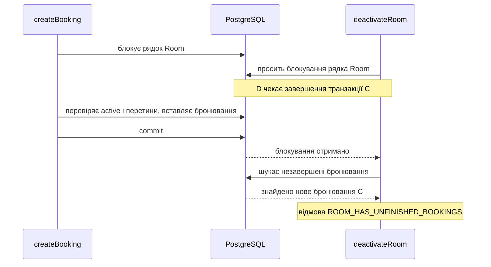

# Етап 3. Дані

Схема складається з трьох таблиць (`room`, `booking`, `app_user`), трьох зовнішніх ключів, одного обмеження-виключення для INV-08 і протоколу блокувань рядків для INV-09 і INV-14. Кеш, черга й партиціонування не потрібні (розділ «Продуктивність і кеш»). Два місця з етапів 1 і 2 довелося уточнити, див. «Виправлення до попередніх етапів».

## Угоди

| Тема | Правило |
|---|---|
| Імена | Таблиці в однині, snake_case: `room`, `booking`, `app_user` (слово user зарезервоване в PostgreSQL) |
| Ідентифікатори | bigint, значення видає СУБД (A-13) |
| Переліки | varchar із CHECK. Нативний enum PostgreSQL вимагає окремого типу в БД і спеціального мапінгу, а CHECK змінюється разом із таблицею |
| Час | Інтервал бронювання: timestamp без зони (D-01). Моменти аудиту: timestamptz. Значень за замовчуванням, що читають час БД, немає: час дає лише Clock (TR-03) |
| Імена обмежень і індексів | Префікс за видом (`pk`, `fk`, `uq`, `ck`, `ex`, `ix`), далі таблиця й суть. Імена входять у контракт із кодом: за ними порушення відображаються на причини відмов |
| Власник схеми | Лише Flyway. Hibernate перевіряє відповідність схеми (режим validate) і нічого не створює й не змінює |

## Схема

### room

| Колонка | Тип | NULL | Примітка |
|---|---|---|---|
| `id` | bigint | ні | Первинний ключ |
| `name` | varchar(100) | ні | Назва для показу, після trim |
| `name_key` | varchar(200) | ні | Ключ порівняння (D-05). Довжина із запасом: нормалізація може змінити кількість символів |
| `floor` | integer | ні | |
| `capacity` | integer | ні | |
| `equipment` | varchar(500) | так | NULL означає «не вказано» (A-25) |
| `active` | boolean | ні | За замовчуванням true |

### app_user

| Колонка | Тип | NULL | Примітка |
|---|---|---|---|
| `id` | bigint | ні | Первинний ключ |
| `username` | varchar(64) | ні | |
| `username_key` | varchar(64) | ні | Ключ порівняння (D-05) |
| `display_name` | varchar(100) | ні | |
| `password_hash` | varchar(255) | ні | Лише хеш (NFR-06). Довжина вміщує закодований хеш із префіксом алгоритму |
| `role` | varchar(16) | ні | EMPLOYEE або ADMIN |
| `enabled` | boolean | ні | За замовчуванням true |

### booking

| Колонка | Тип | NULL | Примітка |
|---|---|---|---|
| `id` | bigint | ні | Первинний ключ |
| `room_id` | bigint | ні | |
| `author_id` | bigint | ні | |
| `title` | varchar(200) | ні | |
| `start_at` | timestamp | ні | Місцевий час офісу без зони (D-01) |
| `end_at` | timestamp | ні | Те саме |
| `status` | varchar(16) | ні | ACTIVE або CANCELLED |
| `created_at` | timestamptz | ні | Ставить застосунок із Clock |
| `cancelled_at` | timestamptz | так | |
| `cancelled_by_id` | bigint | так | |

Колонок `version` у схемі немає (D-04).

## Обмеження

| Ім'я | Таблиця | Вид | Зміст | INV | Відмова |
|---|---|---|---|---|---|
| `pk_room`, `pk_app_user`, `pk_booking` | усі | PRIMARY KEY | `id` | | |
| `fk_booking_room` | booking | FOREIGN KEY | `room_id` → `room(id)`, без каскадів | INV-10 | внутрішня помилка |
| `fk_booking_author` | booking | FOREIGN KEY | `author_id` → `app_user(id)`, без каскадів | INV-10 | внутрішня помилка |
| `fk_booking_cancelled_by` | booking | FOREIGN KEY | `cancelled_by_id` → `app_user(id)`, без каскадів | INV-10 | внутрішня помилка |
| `uq_room_name_key` | room | UNIQUE | `name_key` | INV-11 | `ROOM_NAME_TAKEN` |
| `uq_app_user_username_key` | app_user | UNIQUE | `username_key` | INV-13 | `USERNAME_TAKEN` |
| `ex_booking_no_overlap` | booking | EXCLUDE (GiST) | `room_id` однакові й діапазон `[start_at, end_at)` перетинається; діє лише для `status` = ACTIVE | INV-08 | `SLOT_TAKEN` |
| `ck_booking_interval` | booking | CHECK | `start_at` < `end_at`, дати обох значень збігаються | INV-02 | внутрішня помилка |
| `ck_booking_cancel_state` | booking | CHECK | ACTIVE: `cancelled_at` і `cancelled_by_id` порожні. CANCELLED: обидва задані | INV-07 | внутрішня помилка |
| `ck_booking_status` | booking | CHECK | `status` ∈ {ACTIVE, CANCELLED} | INV-06 | внутрішня помилка |
| `ck_booking_title_not_blank` | booking | CHECK | `title` після btrim непорожня | INV-01 | внутрішня помилка |
| `ck_room_name_not_blank` | room | CHECK | `name` після btrim непорожня | INV-11 | внутрішня помилка |
| `ck_room_capacity_positive` | room | CHECK | `capacity` ≥ 1 | INV-12 | внутрішня помилка |
| `ck_app_user_role` | app_user | CHECK | `role` ∈ {EMPLOYEE, ADMIN} | INV-13 | внутрішня помилка |

Порушення `ck_*` і `fk_*` означає помилку в коді, бо домен перевіряє те саме раніше. Вони не відображаються на причини відмов і віддаються як внутрішня помилка (етап 5).

СУБД не виражає INV-03...INV-05 (параметри змінні, A-16), INV-06 (зміни полів), прив'язку INV-01 до trim і верхні межі INV-12 (A-14 змінні). Із INV-12 у схемі лише `capacity` ≥ 1, бо це вимога FR-19. INV-09 і INV-14 тримає протокол D-04.

## Індекси

| Ім'я | Колонки | Для чого |
|---|---|---|
| `ix_booking_start` | `start_at` | Вибірка за датою: FR-04, FR-06, FR-08. Діапазон доби від 00:00 дати до 00:00 наступної, без перетворення зон (D-01) |
| `ix_booking_room_start` | `room_id`, `start_at` DESC, `id` DESC | FR-08 за кімнатою. Перевірка перетину в `createBooking` і незавершених бронювань у `deactivateRoom`: діапазон `start_at` обмежується початком доби завдяки INV-02. Обслуговує `fk_booking_room` |
| `ix_booking_author_start` | `author_id`, `start_at` DESC, `id` DESC | FR-07 і FR-08 за автором. Придатний і для сторінок зі зсувом, і для курсорних: `id` розв'язує рівність `start_at`. Обслуговує `fk_booking_author` |
| індекс `ex_booking_no_overlap` | GiST | Створюється обмеженням, перевіряє INV-08 під час вставки |
| індекси `uq_*` | `name_key`, `username_key` | Унікальність. Другий обслуговує пошук користувача під час входу (FR-01) |

Не створюються індекси на `booking.status` (майже всі рядки мають значення ACTIVE, вибірковість низька), на `cancelled_by_id` (запитів немає, користувачі не видаляються) і на `room`, `app_user` (до 50 і близько 300 рядків, повне читання дешевше).

## Рішення

### D-03. Гарантія відсутності перетинів (INV-08)

**Контекст.** NFR-03(а): два паралельні запити не створюють перетинних бронювань за жодних обставин, зокрема після перезапуску й повторного надсилання форми. Умова стосується кількох рядків, тому одним CHECK її не виразити.

**Варіанти.**
- A. Обмеження-виключення (GiST) на кімнату й діапазон `[start_at, end_at)` для рядків ACTIVE. Потребує розширення btree_gist.
- B. Перевірка перетину в застосунку під блокуванням рядка кімнати. СУБД сама нічого не гарантує.
- C. Рівень SERIALIZABLE з повторами: PostgreSQL виявляє пов'язані зміни й відхиляє одну з транзакцій.
- D. Таблиця слотів з унікальністю `(room_id, slot_start)`: бронювання вставляє по рядку на кожен слот, до 16 рядків на бронювання.

**Вибір.** A.

**Причина.** A і D тримають інваріант у самих даних, чий би код їх не писав. B залежить від дисципліни коду, C від рівня ізоляції кожної транзакції. D прив'язує схему до `slotGrid`, а A-16 дозволяє його змінювати, до того ж множить рядки. A виражає FR-12 буквально: напіввідкриті інтервали (10:00-11:00 і 11:00-12:00 співіснують) і умова ACTIVE (скасоване не блокує). Паралельні вставки обробляються без повторів: друга чекає завершення першої й отримує відмову.

**Наслідки.** Порушення виходить із PostgreSQL з кодом стану 23P01 і іменем `ex_booking_no_overlap`, застосунок відображає його на `SLOT_TAKEN`. `createBooking` усе одно перевіряє перетин запитом (протокол нижче), тож у нормальному потоці відмова не вимагає відкату з винятком, а обмеження лишається останнім арбітром. Транзакція, де обмеження спрацювало, відкочується повністю.

**Ціна.** Схема залежить від розширення PostgreSQL і не переноситься на іншу СУБД без переробки (A-24). Кожна вставка й скасування оновлюють ще один індекс, на 5 записах за секунду це непомітно.

### D-04. Узгодження змін: блокування рядків перед зміною

**Контекст.** INV-09 і INV-14 залежать від інших рядків: бронювань кімнати й інших адміністраторів. Дві транзакції можуть кожна бачити узгоджений стан і разом його порушити. Окрема проблема: втрата оновлення, коли `resetPassword`, що прочитав користувача до `disableUser`, записує старе `enabled` і знову вмикає вимкнений обліковий запис.

**Варіанти.**
- A. Оптимістичні версії (колонка `version`). Вставка бронювання не змінює версію Room, тож INV-09 не захищено. Щоб захистити, довелося б примусово збільшувати версію при кожному створенні, і два паралельні створення в одній кімнаті конфліктували б із помилкою та повтором.
- B. Ексклюзивне блокування рядка кореня перед зміною й перед рішенням, що залежить від його стану.
- C. SERIALIZABLE для всіх змін з повторами.

**Вибір.** B.

**Причина.** Одна схема закриває INV-09, INV-14 і втрату оновлень. Транзакція, що прийшла другою, чекає й після отримання блокування бачить результат першої: за READ COMMITTED кожен наступний запит читає свіжий знімок. Користувач не отримує помилок конкуренції, лише очікування в мілісекундах. C вимагає повторів і працює, лише якщо кожен учасник виконується на цьому рівні.

**Правила протоколу.**
1. Операція першим читанням свого кореня бере блокування. До цього читання Room, app_user і Booking не завантажуються в контекст постійності, інакше значення можуть бути застарілими.
2. Транзакція блокує не більше одного рядка Room. Множина ADMIN блокується одним запитом у порядку `id`. Ці два види блокувань не поєднуються в одній транзакції, тож цикл очікування неможливий.
3. Рівень ізоляції READ COMMITTED (A-23).
4. Транзакція коротка, без зовнішніх викликів і без очікування користувача.

**Наслідки.** Колонок `version` немає. Таймаут очікування блокування задає етап 6, його перевищення віддається як внутрішня помилка.

**Ціна.** Пропущене блокування не ловить ні компілятор, ні СУБД: INV-09 і INV-14 тримаються лише протоколом. Потрібні тести з детермінованим чергуванням транзакцій (етап 7).

### D-05. Ключ порівняння назв

**Контекст.** A-15 визначає ключ як NFC, нижній регістр і згорнуті пробіли, FR-19 вимагає, щоб «Альфа» і « альфа » збігалися. Потрібно вирішити, де ключ обчислюється.

**Варіанти.**
- A. Застосунок обчислює ключ і зберігає в колонці `name_key` (`username_key`) з унікальним індексом.
- B. Унікальний індекс на виразі від `name`, наприклад lower(btrim(name)). Результат lower() залежить від локалі бази, а канонічну еквівалентність форм Unicode цей вираз не покриває.
- C. Недетермінована ICU-колація: порівняння без урахування регістру й канонічної еквівалентності без зайвої колонки. Згортання пробілів у колацію не входить, тож частина правила лишається в коді, а схема залежить від ICU.

**Вибір.** A.

**Причина.** Правило A-15 доменне: його юніт-тест однаковий у всіх середовищах. У B і C результат залежить від налаштувань конкретної бази, які можуть відрізнятися між розробкою, Testcontainers і продом. Унікальність по збереженому ключу все одно гарантує СУБД.

**Наслідки.** Ключ перераховується при кожній зміні `name` або `username`. Зміна правила нормалізації вимагає міграції даних, яка викликає той самий код нормалізації (Flyway дозволяє міграції на Java), а не SQL.

**Ціна.** Ручний SQL в обхід застосунку може записати неправильний ключ, і СУБД цього не помітить.

## Протоколи операцій

Транзакція дорівнює одній операції з таблиці етапу 2 і починається з блокування кореня за D-04.

| Операція | Блокується | Перевіряється під блокуванням | Відмови |
|---|---|---|---|
| `createBooking` | рядок Room | кімната активна, перетину немає | `ROOM_NOT_FOUND`, `ROOM_INACTIVE`, `SLOT_TAKEN` |
| `deactivateRoom` | рядок Room | незавершених бронювань немає | `ROOM_NOT_FOUND`, `ROOM_HAS_UNFINISHED_BOOKINGS` |
| `updateRoom`, `activateRoom` | рядок Room | | `ROOM_NOT_FOUND` (`ROOM_NAME_TAKEN` для `updateRoom`, з індексу) |
| `cancelBooking` | рядок Booking | не скасоване (тоді безпечний повтор), не завершене | `BOOKING_NOT_FOUND`, `NOT_PERMITTED`, `BOOKING_FINISHED` |
| `changeUserRole`, `disableUser` | одним запитом: цільовий User і всі активні ADMIN, у порядку `id` | після зміни лишається хоча б один активний ADMIN | `USER_NOT_FOUND`, `LAST_ADMIN` |
| `enableUser`, `resetPassword` | рядок User | | `USER_NOT_FOUND` |
| `createRoom`, `createUser` | нічого | унікальні індекси | `ROOM_NAME_TAKEN`, `USERNAME_TAKEN` |

`createBooking`:
1. Перевірки без БД у порядку етапу 2: автентифікація, INV-01...INV-05, FR-13, FR-14.
2. Початок транзакції. Читання рядка Room за `roomId` з ексклюзивним блокуванням (перший доступ до Room). Рядка немає: `ROOM_NOT_FOUND`. `active` = false: `ROOM_INACTIVE`.
3. Пошук ACTIVE-бронювань кімнати, що перетинаються з `[startAt, endAt)`. Запит обмежений добою `startAt` (INV-02) і йде по `ix_booking_room_start`. Знайдено: `SLOT_TAKEN`.
4. Вставка бронювання зі статусом ACTIVE, `created_at` з Clock. Вставка виконується всередині методу, а не при коміті, щоб порушення `ex_booking_no_overlap` перехопилося там, де його відображають на `SLOT_TAKEN`.
5. Коміт.

`deactivateRoom`:
1. Автентифікація й роль ADMIN.
2. Початок транзакції. Читання Room з ексклюзивним блокуванням (перший доступ). Рядка немає: `ROOM_NOT_FOUND`. Кімната вже неактивна: успіх без змін (A-17).
3. Пошук ACTIVE-бронювань кімнати, що починаються не раніше початку сьогоднішньої доби й закінчуються пізніше `now` з Clock. Умова на початок доби обмежує діапазон індексу й коректна завдяки INV-02. Знайдено: `ROOM_HAS_UNFINISHED_BOOKINGS`.
4. `active` = false, коміт.

Якщо першою йде деактивація, `createBooking` чекає, після її коміту читає `active` = false і відмовляє з `ROOM_INACTIVE`. Обидва порядки дають один результат: не буває успіху в обох операцій.

## Політика видалення й деактивації

| Об'єкт | Дозволені зміни | Заборонено | Як забезпечується |
|---|---|---|---|
| Room | `active` true ↔ false, зміна атрибутів | видалення | У застосунку немає операції видалення. `fk_booking_room` без каскаду не дає видалити кімнату з бронюваннями. Право DELETE в облікового запису застосунку не видається (етап 6) |
| app_user | `enabled`, `role`, `password_hash` | видалення | Так само, через `fk_booking_author` і `fk_booking_cancelled_by` |
| Booking | перехід ACTIVE → CANCELLED | видалення, зміна інших полів | Операцій видалення й зміни немає. `ck_booking_cancel_state` не пропускає скасування без автора й часу. Решту INV-06 тримає домен |

Деактивація кімнати можлива лише за відсутності незавершених бронювань (протокол вище). Минулі бронювання лишаються в БД і показуються в «Моїх бронюваннях» з поточною назвою кімнати (FR-07). Повторна активація (FR-22) відкриває кімнату для нових бронювань і нічого не змінює в старих. Деактивація користувача не чіпає його бронювань (A-09): майбутні лишаються ACTIVE й тримають слоти, доки ADMIN їх не скасує за фільтром FR-08 за автором.

## Продуктивність і кеш

Етап 1 відклав питання про кеш до появи схеми. Оцінки нижче випливають з A-10 і не є замірами (A-27).

| Запит | Що читається | Індекс |
|---|---|---|
| Зайнятість на дату (FR-04) | Бронювання однієї доби за всіма кімнатами: до кількох сотень рядків, до 50 кімнат, імена авторів | `ix_booking_start` |
| Мої бронювання (FR-07) | Одна сторінка | `ix_booking_author_start` |
| Перегляд адміністратора (FR-08) | Одна сторінка за фільтром | `ix_booking_room_start`, `ix_booking_author_start` або `ix_booking_start` залежно від фільтра |
| `createBooking` | Рядок кімнати, бронювання кімнати за добу (за поточними параметрами не більше 48), одна вставка | `ix_booking_room_start`, індекс `ex_booking_no_overlap` |
| `deactivateRoom` | Бронювання кімнати від початку сьогодні | `ix_booking_room_start` |

На 1 000 000 рядків (прогін NFR-01) таблиця з індексами займе, за моєю оцінкою, кілька сотень мегабайтів і вміститься в пам'ять сервера БД. Партиціонування для 250 000 рядків за п'ять років не потрібне. Дані для прогону мають задовольняти `ex_booking_no_overlap`, тож генератор (етап 7) розкладає бронювання без перетинів. Це можливо: мільйон рядків на 50 кімнат за п'ять років дає близько 11 бронювань на кімнату за добу при межі 48.

Жодна вимога не виправдовує кеш застосунку, чергу чи репліку для читання. Повернутися до питання варто, лише якщо p95 у прогоні NFR-01 перевищить 300 мс. Першим кроком тоді буде аналіз планів запитів, а не кеш.

## Міграції

| Правило | Зміст |
|---|---|
| Інструмент | Flyway. Запускається під час старту застосунку: інстанс один, інших запускачів немає. Облікові дані: етап 6 |
| Склад початкових міграцій | Перша створює розширення btree_gist (окремо, бо залежить від прав, A-24). Друга створює таблиці, обмеження й індекси цього етапу |
| Незмінність | Застосована міграція не редагується. Виправлення робить нова. Відкату немає: перед оновленням із міграціями робиться резервна копія (NFR-05, етап 6) |
| Розмір | Одна міграція, одна логічна зміна. Зміни схеми й даних не змішуються |
| Секрети | Міграції не містять облікових даних. Перший ADMIN створюється застосунком (A-19, етап 6) |
| Простій | Оновлення виконується поза вікном доступності (NFR-04), тож розділення на «розширення» і «звуження» схеми не потрібне |
| Параметри | Зміна параметрів із A-16 міграції не потребує: параметричних обмежень у БД немає. Збільшення довжини varchar за A-14 є міграцією, що в PostgreSQL не переписує таблицю |
| Дані з правилом нормалізації | Перерахунок ключів (D-05) робить міграція на Java, що викликає код нормалізації |
| Перевірка | Кожна міграція проходить на порожній БД і на БД із даними попередньої версії. Тести йдуть на PostgreSQL 16 у Testcontainers, тієї самої мажорної версії, що й у проді |

## Потребує перевірки

| Що | Від чого залежить | Як перевірити |
|---|---|---|
| Створення btree_gist цільовою роллю міграцій | `ex_booking_no_overlap` (A-24) | Перша міграція на цільовому PostgreSQL |
| Вигляд винятку при порушенні `ex_booking_no_overlap` у Hibernate 7 і Spring 7: чи доступне ім'я обмеження. Запасний ознака: код стану 23P01 | Відображення на `SLOT_TAKEN` | Інтеграційний тест, що створює перетин напряму через репозиторій, минаючи перевірку сервісу |
| Мапінг LocalDateTime ↔ timestamp і Instant ↔ timestamptz без зсувів зон у Hibernate 7 | D-01, TR-02 | Тест TR-02 за різних зон JVM і сесії БД. Якщо поведінка інша, міняється мапінг, а не схема |
| Модуль Flyway для PostgreSQL серед залежностей (із Flyway 10 підтримка винесена окремо) і його склад у стартері Spring Boot 4.1 | Запуск міграцій | Старт застосунку на порожній БД |

## Виправлення до попередніх етапів

Етап 2, таблиця «Конкурентні операції», останній рядок: для пари `updateRoom` і `activateRoom` або `deactivateRoom` я вказав «Версія Room». Версії в схемі немає: D-04 закриває цю пару блокуванням рядка, бо кожна зміна Room починається з нього.

Етап 1, NFR-03(б): там написано, що гарантію дає СУБД, а не лише код застосунку. Для (б) це виконується частково. INV-09 залежить від поточного часу й стану іншої таблиці, тож декларативним обмеженням (CHECK, FK, EXCLUDE) його не виразити. Тригер міг би, але читав би час БД замість Clock (порушення TR-03) і дублював би логіку домену. Тому для (б) гарантує протокол блокувань D-04, який виконує PostgreSQL, і тест, що здатний впасти, якщо блокування прибрати: відкрита транзакція деактивації тримає рядок Room, паралельне створення має не завершитися, доки вона не зробить коміт, і після цього отримати `ROOM_INACTIVE`. NFR-03(а) лишається гарантією самих даних. Нове формулювання (б): «Після успішної деактивації кімнати в ній не з'являється нове ACTIVE-бронювання. Це гарантується протоколом блокувань рядка Room (D-04) і перевіряється тестом із детермінованим чергуванням транзакцій».

## Припущення

Нумерація продовжує етап 2.

| ID | Припущення |
|---|---|
| A-23 | Усі транзакції застосунку виконуються на READ COMMITTED (значення PostgreSQL за замовчуванням). D-04 спирається на це, зміна рівня вимагає перегляду D-04 |
| A-24 | У цільовому PostgreSQL 16 роль міграцій може створити розширення btree_gist (воно входить у стандартний пакет contrib). Перевіряється першою міграцією. Якщо ні, повертаємося до D-03 і розглядаємо варіант D |
| A-25 | `equipment`, що після trim порожнє, зберігається як NULL |
| A-26 | Сховище сесій не входить у цю схему. Якщо етап 6 обере JDBC-сховище, його таблиці додає окрема міграція |
| A-27 | Оцінки обсягів і кількості прочитаних рядків є моїми розрахунками з A-10, а не замірами. Перевіряються прогоном NFR-01 |

На етапі 4 опишу архітектуру застосунку: модулі й залежності між ними, шари всередині модуля, транзакційні межі (операції з таблиці протоколів), компоненти з відповідальністю та спосіб перевірки правил залежностей.