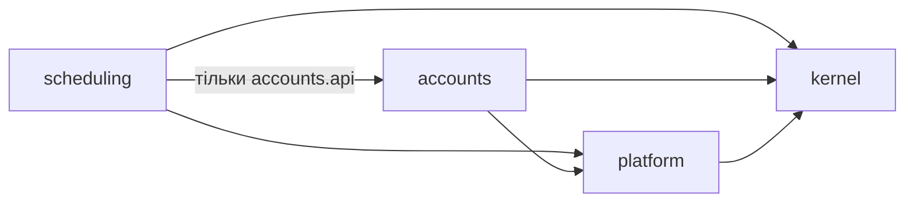
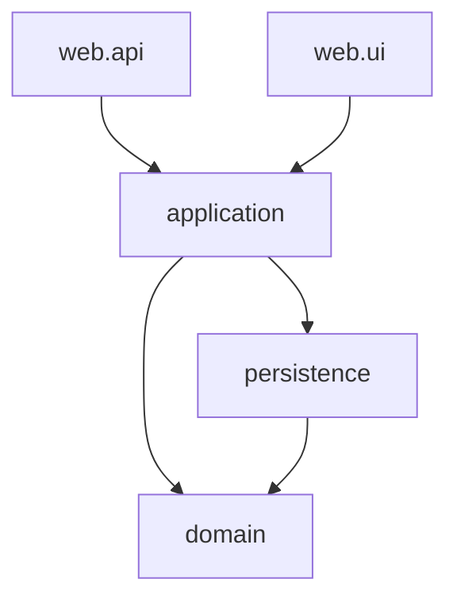

# Етап 4. Архітектура застосунку

Застосунок є модульним монолітом в одному Maven-модулі. Він складається з двох функціональних модулів (scheduling, accounts) і двох спільних пакетів (kernel, platform). Межі модулів і шарів тримає тест ArchUnit, а не компілятор (D-06). Кожен сценарій запису дорівнює одній транзакції в сервісі застосунку, і перше звернення до БД у ній блокує корінь агрегату за протоколом D-04 (AR-09, AR-11). Суперечностей із етапами 1...3 не виявлено. Відкладене на цей етап рішення про назву класу User закрито нижче: сутність називається `AppUser`.

## Модулі

| Пакет | Вид | Відповідальність | Чому окремо |
|---|---|---|---|
| `roombook.kernel` | спільний | Типи без Spring, потрібні кожному шару, зокрема домену: `Actor`, `Role`, `Reason`, `DomainException`, `ComparisonKey`, `OfficeClock` | Домен не залежить від Spring, а ці типи йому потрібні |
| `roombook.platform` | спільний | Інфраструктура Spring без знання про функції: `Clock`, ланцюг фільтрів безпеки, обробка помилок, допоміжні засоби для порушень обмежень | Не належить жодній функції |
| `roombook.scheduling` | функціональний | Room і Booking: зайнятість, створення й скасування бронювань, керування кімнатами, протокол D-04 для INV-08 і INV-09 | INV-08 і INV-09 зв'язують Room і Booking (D-07) |
| `roombook.accounts` | функціональний | AppUser: вхід, керування обліковими записами, INV-14. Публічний інтерфейс `UserDirectory` для інших модулів | Q-01: джерело облікових записів може змінитися, і зміна має зачепити лише цей модуль |

Між функціональними модулями одна залежність: scheduling читає імена авторів через `accounts.api`. Операції запису одного модуля до іншого не звертаються.

## Шари всередині модуля

Кожен функціональний модуль має пакети `domain`, `application`, `persistence`, `web.api` і `web.ui`. accounts додатково має `api` і `security`, scheduling має `configuration`. Усі шари можуть використовувати `kernel` і `platform`, а `domain` лише `kernel`.

| Шар | Робить | Не робить |
|---|---|---|
| `domain` | Правила одного агрегату (INV-01...INV-07, INV-11...INV-13), об'єкти-значення, політика часу. Усе, що не потребує БД | Не читає БД, не бачить Spring і HTTP |
| `application` | Сценарій: перевірка прав, блокування кореня, правила між агрегатами (INV-08, INV-09, INV-14), виклик домену, збереження, перетворення порушень обмежень на причини. Тут межа транзакції | Не знає про HTTP, сесію й шаблони |
| `persistence` | Репозиторії Spring Data: блокуюче читання кореня, запити, проєкції для читання | Не містить бізнес-правил |
| `web.api`, `web.ui` | Розбір запиту в команду, виклик одного методу застосунку, JSON чи HTML-фрагмент у відповідь | Не містить бізнес-правил, не відкриває транзакцій, не торкається сутностей |

## Рішення

### D-06. Стиль: модульний моноліт в одному Maven-модулі

**Контекст.** Один інстанс і одна БД, до 300 користувачів, 5 записів за секунду (NFR-01, NFR-02). Невизначеність Q-01 має зачіпати якомога менше коду, а межі між частинами мають бути зрозумілі без складання проєкту з кількох артефактів.

**Варіанти.**
- A. Пакети за шарами на весь застосунок: `controller`, `service`, `repository`.
- B. Пакети за функціями, шари всередині кожної. Один Maven-модуль, правила залежностей перевіряє ArchUnit.
- C. Окремий Maven-модуль на кожну функцію. Межі виконує компілятор.
- D. Окремі сервіси.

**Вибір.** B.

**Причина.** D суперечить розгортанню з одним інстансом і нічим не виправданий при такому навантаженні. A розкидає все про облікові записи по трьох пакетах, тож зміна через Q-01 торкнулася б усіх. C дає найсуворішу ізоляцію, але потребує окремих файлів збірки й залежностей між ними для двох невеликих модулів, а ArchUnit перевіряє те саме без зміни збірки. Spring Modulith теж перевіряє межі, але не входить у стек, а сумісність із Spring Boot 4.1 мені невідома.

**Наслідки.** Правила AR-01...AR-09 виконуються як тести, порушення ламає `mvn test`.

**Ціна.** Компілятор порушень не бачить: класи шарів лежать у різних пакетах, тому мусять бути public. Вимкнений тест знімає всі межі (R-03). ArchUnit додається в test scope (A-29).

### D-07. Межі модулів: Room і Booking разом

**Контекст.** `createBooking` має заблокувати Room і прочитати його `active`, а `deactivateRoom` має спитати в Booking, чи є незавершені бронювання (протоколи етапу 3). Залежність іде в обидва боки.

**Варіанти.**
- A. Три модулі: room, booking, accounts. Цикл room ↔ booking розриває інтерфейс, який оголошує один модуль і реалізує інший.
- B. Два модулі: scheduling (Room і Booking) та accounts.
- C. Один модуль без внутрішніх меж.

**Вибір.** B.

**Причина.** INV-08, INV-09 і протокол D-04 спільні для Room і Booking, тому змінюються разом. У варіанті A інтерфейс для розриву циклу з'явився б заради двох операцій, що й так виконуються в одній транзакції на одній БД. C не відділяє accounts, а Q-01 цього вимагає.

**Наслідки.** Room і Booking лишаються окремими агрегатами (D-02) в одному модулі. Імена авторів scheduling бере через `UserDirectory` і додає до результату в застосунку другим запитом за множиною id (A-31).

**Ціна.** Межу між Room і Booking усередині scheduling компілятор не охороняє, її частково закриває AR-04. Читання з іменами авторів робить два запити замість одного з об'єднанням. scheduling лишається найбільшим модулем.

### D-08. Окремі вхідні адаптери для REST і UI

**Контекст.** A-12 вимагає кожну функцію і в UI, і через /api/v1. Відповіді різні: JSON та HTML-фрагменти HTMX, різні форми помилок, редиректи після форм.

**Варіанти.**
- A. UI-контролери викликають власний REST API по HTTP.
- B. Один контролер на ресурс, формат відповіді за заголовком Accept.
- C. Окремі API- та UI-контролери, обидва викликають ті самі сервіси застосунку.

**Вибір.** C.

**Причина.** A додає мережевий виклик і повторну автентифікацію всередині одного процесу. B зв'язує два контракти: зміна HTML-фрагмента ризикує зачепити JSON, а коди помилок, редиректи й обробка CSRF у них різні. У C логіка живе в сервісах, контролери лишаються тонкими.

**Наслідки.** У кожному модулі є `web.api` і `web.ui`. Помилки обробляють окремі обробники в platform. Контролери розбирають лише формат запиту, а значення правил перевіряє домен (AR-05).

**Ціна.** Перетворення запиту на команду пишеться двічі, вручну (MapStruct не використовується). Рівність можливостей API й UI (A-12) не випливає зі структури, її перевіряють тести обох адаптерів на кожен сценарій (етап 7).

### D-09. Відображення агрегатів на JPA

**Контекст.** За D-02 агрегати посилаються один на одного за id. D-04 вимагає, щоб перше читання в транзакції запису було блокуючим, тож жодний рядок не має підтягнутися до нього як побічний ефект. Списки (FR-03...FR-08) потребують даних кількох таблиць.

**Варіанти.**
- A. Сутності JPA з асоціаціями: Booking має `@ManyToOne` на Room і AppUser.
- B. Сутності JPA з полями-id замість асоціацій. Читання виконують проєкції в DTO-record.
- C. Окрема модель персистентності й окремі доменні класи з ручним перетворенням.

**Вибір.** B. Доменні класи самі є сутностями JPA.

**Причина.** Асоціація `@ManyToOne` за замовчуванням жадібна й може непомітно завантажити Room чи AppUser до блокування. Наступне блокуюче читання поверне вже керований екземпляр із застарілим станом. Ліниві асоціації потребують відкритої сесії й дають N+1 у списках. Списки однаково пишуться запитами з об'єднанням, тож проєкція не додає роботи. C подвоїла б класи й ручний код перетворення для трьох агрегатів без користі, бо домен усе одно залежить лише від анотацій `jakarta.persistence` (AR-02).

**Наслідки.** Booking зберігає `startAt` і `endAt` двома колонками й віддає `interval()`, окремої відповідності для BookingInterval немає. Репозиторії оголошують лише потрібні методи й не мають `delete*`. Сутності не мають публічних сеттерів (AR-04).

**Ціна.** Навігації між агрегатами немає, кожен зв'язок читається окремим запитом. Вимоги JPA (конструктор без параметрів, нефінальні поля) послаблюють захист інваріантів у конструкторі, тому INV-06 тримається відсутністю сеттерів і тестом.

### D-10. Перевірка прав у сервісах через явний Actor

**Контекст.** NFR-06 вимагає перевіряти права на сервері для кожної операції. Правило FR-17 («автор або ADMIN») залежить від даних бронювання. За порядком перевірок етапу 2 `BOOKING_NOT_FOUND` передує `NOT_PERMITTED`.

**Варіанти.**
- A. Лише правила за URL у ланцюзі фільтрів Spring Security.
- B. Анотації на методах сервісів зі SpEL.
- C. `Actor` першим параметром кожного методу сервісу, явна перевірка в коді, а грубі URL-правила як другий бар'єр.

**Вибір.** C.

**Причина.** A не виразить «автор або ADMIN», бо автора треба прочитати з БД. B виконує перевірку до тіла методу, тобто раніше за читання бронювання: порядок причин з етапу 2 порушується, а SpEL у рядках компілятор не перевіряє. У C перевірка стоїть там, де потрібні дані вже відомі, а application не залежить від Spring Security (AR-06).

**Наслідки.** Контролери отримують `Actor` від `ActorArgumentResolver` (accounts.security). `Actor.requireAdmin()` кидає `NOT_PERMITTED`. Юніт-тести сервісів не потребують контексту безпеки.

**Ціна.** Забута перевірка в новому методі лишає прогалину. AR-07 гарантує лише наявність параметра `Actor`, зміст перевірки тримають тести NFR-06 на кожен ендпоінт і URL-правила другого бар'єра.

## Компоненти

| Пакет | Компоненти | Відповідальність |
|---|---|---|
| `kernel` | `Actor`, `Role`, `Reason`, `DomainException`, `ComparisonKey`, `OfficeClock` | `Actor`: `userId` і `role`, методи `isAdmin()` і `requireAdmin()`. `Reason`: 13 кодів з етапу 2. `DomainException`: неперевірений виняток із `Reason`. `ComparisonKey`: правило A-15 для назв кімнат і логінів. `OfficeClock`: єдине місце читання системного часу, дає `instant()`, `localNow()`, `today()` за `officeZone` (TR-03) |
| `platform` | `ClockConfiguration`, `SecurityConfiguration`, `ApiExceptionHandler`, `UiExceptionHandler`, `ConstraintNames` | Створення `Clock` і `OfficeClock`. Ланцюг фільтрів: вхід, CSRF, сесії, грубі URL-правила (етап 6). Перетворення `DomainException` на відповідь API чи UI окремими обробниками (етап 5). `ConstraintNames` дістає ім'я порушеного обмеження з винятку СУБД |
| `scheduling.domain` | `Room`, `Booking`, `BookingInterval`, `BookingStatus`, `BookingPhase`, `BookingRules`, `BookingTimePolicy` | `Booking`: створення (INV-01, INV-02), `cancel` (права, безпечний повтор, завершене; INV-06, INV-07), `phase`. `Room`: створення й зміна атрибутів з перерахунком ключа назви, `activate`, `deactivate`. `BookingRules`: параметри етапу 2 без `officeZone`, перевіряє свою узгодженість при створенні, тож хибна конфігурація не дає застосунку стартувати. `BookingTimePolicy`: INV-03...INV-05, FR-13, FR-14 |
| `scheduling.application` | `BookingService`, `RoomService`, `OccupancyQueries`, `BookingQueries`, команди й view-record | Сервіси: сценарії запису за протоколами етапу 3. Queries: FR-03...FR-08, лише читання, імена авторів через `UserDirectory`. Команди й view-record: типи входу й виходу, без сутностей |
| `scheduling.persistence` | `RoomRepository`, `BookingRepository`, `SchedulingConstraints` | `lockById`, `findActiveOverlapping`, `existsUnfinished`, збереження з негайним flush, проєкції для читання. `SchedulingConstraints` відображає `ex_booking_no_overlap` на `SLOT_TAKEN`, `uq_room_name_key` на `ROOM_NAME_TAKEN` |
| `scheduling.web.api`, `scheduling.web.ui` | Контролери кімнат і бронювань | Адаптери за D-08. Маршрути й фрагменти: етап 5 |
| `scheduling.configuration` | `SchedulingConfiguration` | Зв'язує параметри етапу 2 з `BookingRules`, створює `BookingTimePolicy` |
| `accounts.api` | `UserDirectory` | Публічний інтерфейс: `displayNames(ids)`. Розширюється за потреби етапу 5 (вибір автора у фільтрі FR-08) |
| `accounts.domain` | `AppUser`, `AdminPolicy` | `AppUser`: створення, зміна ролі, `enabled`, хеш пароля, перерахунок ключа логіна. `AdminPolicy`: чи лишається активний ADMIN після зміни (INV-14) |
| `accounts.application` | `AccountService`, `AccountQueries`, `CredentialsQueries`, `UserDirectoryQueries` | `AccountService`: FR-23 за протоколами етапу 3. `AccountQueries`: перелік користувачів для ADMIN. `CredentialsQueries`: облікові дані для входу. `UserDirectoryQueries`: реалізує `UserDirectory` |
| `accounts.persistence` | `AppUserRepository`, `AccountsConstraints` | `lockById`, `lockWithActiveAdmins` (одним запитом у порядку `id`), пошук за ключем логіна. `AccountsConstraints` відображає `uq_app_user_username_key` на `USERNAME_TAKEN` |
| `accounts.security` | `AccountUserDetailsService`, `ActorPrincipal`, `ActorArgumentResolver` | Вхід через Spring Security на основі `CredentialsQueries`. `ActorPrincipal` лежить у сесії. `ActorArgumentResolver` дає контролерам параметр `Actor` |
| `accounts.web.api`, `accounts.web.ui` | Контролери облікових записів, сторінка входу | Адаптери за D-08 |

Назва `AppUser` закриває питання з етапу 2: клас `User` збігався б із класом Spring Security, а таблиця `user` із зарезервованим словом PostgreSQL. Тепер це клас `AppUser` і таблиця `app_user` (етап 3). Шаблони Thymeleaf лежать у `templates/scheduling/`, `templates/accounts/` і `templates/layout/`, статичні файли в `static/`. Склад фрагментів HTMX визначає етап 5.

Питання для етапу 6: `ActorPrincipal` бере роль і `enabled` або зі знімка на момент входу, або з читання на кожен запит. FR-23 забороняє деактивованому користувачу лише вхід, а NFR-06 вимагає перевіряти права на кожну операцію (див. R-04). Архітектура допускає обидва варіанти, змінюється лише `ActorArgumentResolver`.

## Транзакційні межі

Транзакцію відкриває анотація на методі сервісу застосунку, і вона охоплює метод цілком. Контролери, домен і репозиторії власних транзакцій не відкривають. Перевірки без БД стоять на початку методу, до першого звернення до репозиторію (протокол етапу 3). `DomainException` неперевірений, тому відкочує транзакцію. Повторів немає: конкуренцію розв'язує очікування на блокування (D-04), а виняток СУБД після відкоту стає причиною за AR-12 або внутрішньою помилкою.

| Сценарій | Метод | Режим | Виклики репозиторіїв за порядком |
|---|---|---|---|
| `createBooking` | `BookingService.createBooking` | запис | `RoomRepository.lockById`, `BookingRepository.findActiveOverlapping`, збереження Booking з flush |
| `cancelBooking` | `BookingService.cancelBooking` | запис | `BookingRepository.lockById` |
| `createRoom` | `RoomService.createRoom` | запис | збереження Room з flush |
| `updateRoom` | `RoomService.updateRoom` | запис | `RoomRepository.lockById`, збереження з flush |
| `activateRoom` | `RoomService.activateRoom` | запис | `RoomRepository.lockById` |
| `deactivateRoom` | `RoomService.deactivateRoom` | запис | `RoomRepository.lockById`, `BookingRepository.existsUnfinished` |
| `createUser` | `AccountService.createUser` | запис | збереження AppUser з flush |
| `changeUserRole`, `disableUser` | `AccountService` | запис | `AppUserRepository.lockWithActiveAdmins` |
| `enableUser`, `resetPassword` | `AccountService` | запис | `AppUserRepository.lockById` |
| FR-01, FR-03...FR-08 | `*Queries` | лише читання | проєкції, `UserDirectory.displayNames` |

## Правила залежностей і їх перевірка

Суфікси `Service` (запис) і `Queries` (читання) є угодою, на якій тримаються AR-07 і AR-09.

| ID | Правило | Джерело | Перевірка |
|---|---|---|---|
| AR-01 | `web` викликає `application`, `application` викликає `domain` і `persistence`, `persistence` залежить від `domain`. Зворотних залежностей немає. `web` може використовувати типи `domain`, що не є сутностями (enum, BookingInterval) | D-06 | ArchUnit, шаруватість |
| AR-02 | `domain` залежить лише від `kernel`, JDK, анотацій `jakarta.persistence` і власних класів. Без `org.springframework.*`, `org.hibernate.*`, `jakarta.servlet.*` | D-09 | ArchUnit |
| AR-03 | Єдине дозволене ребро між функціональними модулями: класи `*Queries` у `scheduling.application` → `accounts.api`. Циклів між пакетами верхнього рівня немає. `kernel` не залежить від `platform`, `platform` не залежить від функціональних модулів | D-06, D-07 | ArchUnit, перевірка циклів і прямих залежностей |
| AR-04 | Сутність не залежить від іншої сутності й не має публічних `set*`. Репозиторії розширюють мінімальний інтерфейс `Repository` і не мають `delete*` | D-09, INV-06, INV-10, A-06, A-20 | ArchUnit |
| AR-05 | `web` не залежить від класів із `@Entity` і не звертається до репозиторіїв. `web.api` і `web.ui` не залежать одне від одного. Бізнес-правила в `web` не дублюються | D-08 | ArchUnit для залежностей, огляд коду для дублювання |
| AR-06 | `domain` і `application` не використовують `SecurityContext`, `Authentication`, сервлетні типи, `org.springframework.web.*`, `org.thymeleaf.*`. Виняток: `PasswordEncoder` в `accounts.application` | D-10 | ArchUnit |
| AR-07 | Кожен публічний метод `*Service` і `*Queries` має `Actor` першим параметром. Винятки: класи, що реалізують інтерфейси з `..api..`, і `CredentialsQueries` (виклик до автентифікації) | D-10, NFR-06 | ArchUnit. Зміст перевірки: тести NFR-06 на кожен ендпоінт |
| AR-08 | Системний час читає лише `OfficeClock`: поза ним немає викликів `now()` класів `java.time`, `Clock.instant()`, `Clock.millis()`, `System.currentTimeMillis()` | TR-03 | ArchUnit. Тести з фіксованим `Clock` |
| AR-09 | `@Transactional` стоїть лише в `..application..`. Клас `*Queries` має `readOnly`. `*Service` не залежить від інших `*Service` | D-04, етап 3 | ArchUnit |
| AR-10 | Контекст постійності живе рівно стільки, скільки транзакція: OSIV вимкнено | D-04, D-09 | Тест на ефективну конфігурацію |
| AR-11 | Перше звернення до БД у транзакції запису: блокуюче читання кореня за протоколом етапу 3. Блокування Room і множини ADMIN не поєднуються в одній транзакції | D-04 | Інтеграційні тести з чергуванням транзакцій (етап 7). Статично не видно (R-02) |
| AR-12 | Збереження, що може порушити іменоване обмеження, виконується з негайним flush усередині методу. Виняток СУБД перетворюється на `DomainException` у тому ж методі | етап 3 | Інтеграційний тест на кожне обмеження: `SLOT_TAKEN`, `ROOM_NAME_TAKEN`, `USERNAME_TAKEN` |

AR-01...AR-09 реалізує один тестовий клас `ArchitectureTest` з методом на правило. Він аналізує класи `main` один раз, тому швидкий і входить у звичайний `mvn test`. Використовується ядро ArchUnit, що викликається зі звичайних тестів JUnit, а модуль інтеграції `archunit-junit5` не потрібен. AR-10...AR-12 перевіряють інтеграційні тести з PostgreSQL у Testcontainers, їхні імена визначить етап 7. AR-08 закриває обіцянку TR-03 з етапу 2.

## Ризики

| ID | Ризик | Імовірність | Вплив | Захід |
|---|---|---|---|---|
| R-02 | Новий шлях запису обходить протокол D-04: блокування відсутнє або стоїть не першим | Середня | Високий: INV-09 чи INV-14 порушуються лише за паралельних запитів, звичайні тести цього не бачать | AR-09, AR-11. Тест із чергуванням транзакцій на кожен сценарій запису. Огляд коду |
| R-03 | Тест ArchUnit вимкнено або обійдено, межі розмиваються | Низька | Середній: зміна через Q-01 перестає бути локальною | Тест у складі `mvn test`, збірка падає на порушенні (етап 6) |
| R-04 | Роль і `enabled` у `ActorPrincipal` беруться зі знімка при вході: деактивований чи знижений користувач із відкритою сесією діє зі старими правами | Висока, якщо етап 6 нічого не вирішить | Високий для NFR-06 | Рішення етапу 6: інвалідація сесій або читання `role` і `enabled` на кожен запит |

## Потребує перевірки

| Що | Від чого залежить | Як перевірити |
|---|---|---|
| Найменша версія ArchUnit, що читає клас-файли Java 21, і робота його ядра в тестах Spring Boot 4.1 | AR-01...AR-09 | Перший запуск `ArchitectureTest` на проєкті з усіма пакетами |
| Назва й значення за замовчуванням властивості OSIV у Spring Boot 4.1 (у 3.x це `spring.jpa.open-in-view`, увімкнена за замовчуванням) | AR-10 | Тест читає ефективне значення. Якщо властивість перейменована, тест падає |
| Порядок захоплення блокувань у `lockWithActiveAdmins`: запит з ORDER BY і FOR UPDATE має блокувати рядки в порядку `id` | D-04 (правило 2), INV-14 | План запиту на PostgreSQL 16 і тест із двома транзакціями, що змагаються за двох ADMIN |
| Ім'я порушеного обмеження у винятку Hibernate 7 | `ConstraintNames`, AR-12 | Те саме, що в етапі 3 |

## Припущення

Нумерація продовжує етап 3.

| ID | Припущення |
|---|---|
| A-28 | Кореневий пакет `roombook` є робочою назвою. groupId і назву артефакту визначає замовник |
| A-29 | ArchUnit додається в test scope, у списку стеку його немає. Без нього AR-01...AR-09 довелося б перевіряти власним аналізом байткоду, що дорожче в підтримці |
| A-30 | `Reason` є одним enum у `kernel`. Новий код причини змінює `kernel`, зате відображення на HTTP (етап 5) має одне місце й перевіряється перебором значень |
| A-31 | Імена авторів у списках і зайнятості додаються другим запитом за множиною id (до кількох сотень) через `UserDirectory`. Це вкладається в бюджет NFR-01, перевіряється прогоном (A-27). Якщо ні, повертаємося до D-07 |

На етапі 5 опишу контракти: REST API таблицею (метод, шлях, ролі, вхід, вихід, коди помилок), формат помилок, фільтри й пагінацію, поведінку при конфлікті, а також маршрути UI й взаємодії HTMX.