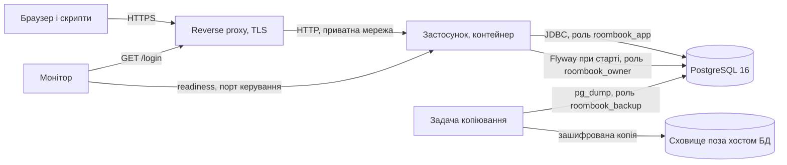

# Етап 6. Наскрізні питання

Етап закриває те, що попередні етапи залишили для нього: R-04, A-19 і A-26, спосіб передавати токен CSRF і маршрути входу з етапу 5, облікові дані міграцій, право DELETE і таймаут блокувань з етапу 3. Сесії лежать у пам'яті процесу, а роль і `enabled` користувача читаються з БД на кожен запит (D-16, D-17). Токен CSRF живе в сесії, для скриптів є окремий ендпоінт (D-18). Дві ролі БД відокремлюють міграції від роботи застосунку (D-20), перший ADMIN створюється зі змінних середовища (D-22), а резервні копії є щоденним логічним дампом з обов'язковим пробним відновленням (D-23). Одна вимога виглядає неповною: за FR-23 пароль задає й змінює лише ADMIN, тож користувач не може змінити власний (Q-04). Контракт етапу 5 розширено ендпоінтом EP-20 і сторінкою PG-13.

## Автентифікація й авторизація

### Вхід і вихід

| Маршрут | Доступ | Поведінка |
|---|---|---|
| `GET /login` (PG-13) | усі | Сторінка входу. Якщо сесія вже автентифікована, 302 на `/` |
| `POST /login` | усі | Поля `username`, `password` і токен CSRF. Успіх: нова сесія (SEC-06), 302 на запам'ятований запит, інакше на `/`. Невдача: 302 на `/login?error` |
| `POST /logout` | усі | Токен CSRF. Сесія завершується, cookie видаляється, 302 на `/login?logout`. Для клієнта з `Accept: application/json` відповідь 204 |
| `GET /api/v1/csrf` (EP-20) | усі | 200 з полями `headerName`, `parameterName`, `token` для поточної сесії. Створює сесію, якщо її немає |

Вхід через стару форму з недійсним токеном дає відповідь за SEC-14: редирект на `/login` з новою формою.

### Правила автентифікації

| ID | Правило | Перевірка |
|---|---|---|
| SEC-01 | Вхід лише формою `POST /login`. Логін порівнюється за ключем (A-15) | «Ivan» і «ivan» входять як один користувач |
| SEC-02 | Невдалий вхід (невідомий логін, хибний пароль, `enabled` = false) дає однакову відповідь: 302 на `/login?error`, причини не розрізняються | Три сценарії дають однаковий статус і `Location` |
| SEC-03 | Паролі зберігаються лише як bcrypt-хеші з префіксом алгоритму (D-15). Пароль і хеш не потрапляють у відповіді, журнали й `toString` DTO | `passwordHash` не дорівнює паролю. `toString` записів `UserInput` і `PasswordInput` не містить пароля. Відповіді EP-13...EP-19 не мають поля пароля чи хеша |
| SEC-04 | Політика паролів (A-42) діє для `createUser`, `resetPassword` і bootstrap: від 10 символів, не більше 72 байтів у UTF-8, не збігається з логіном за ключем, без правил складності. Пароль не обрізається й не нормалізується (виняток із A-36). Порушення дає `INVALID_INPUT` з `errors[].field` = `password` | Граничні значення: 9 і 10 символів, 72 і 73 байти, пароль, що дорівнює логіну |

### D-15. Хешування паролів

**Контекст.** NFR-06 вимагає зберігати лише хеші. FR-23 дозволяє ADMIN задавати й скидати паролі, політику треба визначити.

**Варіанти.**
- A. bcrypt через `DelegatingPasswordEncoder`: префікс алгоритму в хеші дозволяє змінити алгоритм, не ламаючи наявних хешів.
- B. Argon2id: у Spring Security потребує бібліотеки Bouncy Castle (для версії 7 потребує перевірки).
- C. PBKDF2: є в JDK, додаткових залежностей немає.

**Вибір.** A.

**Причина.** Найпоширеніший варіант у Spring Security без нових залежностей. Для близько 300 внутрішніх облікових записів перевага Argon2id над bcrypt менша за вартість зайвої бібліотеки.

**Наслідки.** Вартість 12, у тестовому профілі 4. bcrypt не опрацьовує вхід довший за 72 байти (мовчки обрізає чи відхиляє, залежно від версії), тому SEC-04 обмежує довжину.

**Ціна.** Ліміт 72 байти діє й для парольних фраз. Кирилична літера займає 2 байти, тож максимум для неї 36 символів.

### Доступ за ролями

Права перевіряються двічі (D-10). Перший бар'єр: URL-правила в ланцюгу фільтрів. Другий: сервіси через `Actor`, де враховується і власність бронювання (FR-17). URL-правила не замінюють другий бар'єр.

| Шаблон | Хто |
|---|---|
| `/login`, `/logout`, `/api/v1/csrf`, статичні ресурси | усі |
| `/admin/**`, `/api/v1/users/**`, `GET /api/v1/bookings` (EP-12), `POST` і `PUT` під `/api/v1/rooms` | ADMIN |
| Решта: `/`, `/occupancy`, `/rooms`, `/bookings/**`, `/fragments/**`, інші `/api/v1/**` | будь-який автентифікований |

Усе, чого немає в таблиці, вимагає автентифікації. ADMIN має права EMPLOYEE (FR-02), тому ієрархії ролей у налаштуваннях немає: спільні маршрути вимагають лише автентифікації. Кінцевих точок керування на основному порту немає (розділ «Розгортання»).

## Сесії

### D-16. Перевірка користувача сесії на кожен запит

**Контекст.** Етап 4 залишив R-04: принципал зі знімком `role` і `enabled` при вході дозволяє деактивованому чи знижену в ролі користувачу діяти зі старими правами до кінця сесії. NFR-06 вимагає перевіряти права на кожну операцію, FR-23 забороняє деактивованому користувачу вхід.

**Варіанти.**
- A. Знімок при вході. Щоб відрізати користувача, його сесії треба знайти й завершити через реєстр сесій.
- B. Фільтр читає користувача за `id` з БД на кожен автентифікований запит і будує права для цього запиту.
- C. B з кешем на кілька секунд.

**Вибір.** B.

**Причина.** Читання за первинним ключем у таблиці на близько 300 рядків коштує мілісекунди, а навантаження зростає на 25-30 запитів за секунду (NFR-02). B діє й на зміни, зроблені поза застосунком, і не залежить від реєстру сесій та від правильної рівності принципалів. C залишає вікно зі старими правами й додає кеш без вимоги.

**Наслідки.** Зміна ролі чи деактивація діє з наступного запиту. Фільтр стоїть після відновлення контексту з сесії. Якщо користувача немає або `enabled` = false, сесія завершується, а запит іде далі без автентифікації (відповідь за SEC-14). Інакше фільтр кладе в атрибут запиту `CurrentUser` (id, логін, ім'я, роль), і `ActorArgumentResolver` бере з нього `Actor` без другого читання. Принципал у сесії зберігає лише `userId` і логін. Читання виконує `CredentialsQueries` (виняток AR-07). Збій читання БД відхиляє запит, прав за замовчуванням ніхто не отримує.

**Ціна.** Кожен автентифікований запит робить ще одне звернення до БД і бере з'єднання з пулу (входить у прогін NFR-01). Статичні ресурси фільтр не чіпає.

### D-17. Сховище сесій: пам'ять процесу

**Контекст.** A-26 відклав вибір сховища сесій. Інстанс один, оновлення йдуть поза вікном доступності (NFR-04).

**Варіанти.**
- A. Сесії Tomcat у пам'яті процесу.
- B. Spring Session із JDBC: окрема таблиця, залежність поза списком стека й міграція.

**Вибір.** A.

**Причина.** Спільні сесії потрібні лише за кількох інстансів. Відрізання користувача забезпечує D-16, а не реєстр сесій. B додає таблицю, чистку прострочених записів і залежність без вимоги.

**Наслідки.** Таблиць сесій у схемі немає (A-26 закрито). Перезапуск завершує всі сесії: перший запит після нього дає 401, HTMX переходить на вхід (HX-10).

**Ціна.** Незапланований перезапуск у робочі години змушує всіх увійти знову, а відкрита форма втрачає введене. Другий інстанс (поза межами) поверне нас до B.

### Параметри сесії

| Параметр | Значення |
|---|---|
| Сховище | Пам'ять процесу (D-17) |
| Простій до завершення | 8 годин (A-41), абсолютного строку немає |
| Паралельні сесії одного користувача | Без обмеження |
| Cookie | HttpOnly, Secure (у проді), SameSite=Lax. Strict ламає перехід за посиланням із месенджера: перший запит іде без cookie й перекидає на вхід |
| «Запам'ятати мене» | Немає, вимоги немає |

| ID | Правило | Перевірка |
|---|---|---|
| SEC-05 | Cookie сесії має HttpOnly, Secure (у проді) і SameSite=Lax. Прапорець Secure задається конфігурацією, а не виводиться із запиту | Інтеграційний тест у профілі прода читає `Set-Cookie` |
| SEC-06 | Вхід створює новий ідентифікатор сесії | Ідентифікатор до й після входу різний |
| SEC-07 | Простій 8 годин завершує сесію. Вихід завершує її негайно | Тест із малим тайм-аутом. Запит після виходу дає 401 |
| SEC-08 | Користувач сесії перечитується на кожен автентифікований запит (D-16) | Після `disableUser` наступний запит тієї самої сесії відхиляється як неавтентифікований. Після зміни ролі ADMIN → EMPLOYEE `GET /admin/users` дає 403 без повторного входу |

## CSRF

### D-18. Токен CSRF: синхронізатор у сесії й ендпоінт для скриптів

**Контекст.** NFR-06 вимагає захисту змін стану від CSRF. Клієнтів три: форми Thymeleaf, запити HTMX і скрипти (A-12). Етап 5 залишив спосіб передачі токена на цей етап.

**Варіанти.**
- A. Токен у сесії. Форми отримують його прихованим полем, HTMX заголовком із атрибута `<body>`, скрипти окремим ендпоінтом EP-20.
- B. Токен у cookie, що читається з JavaScript (double submit).
- C. Без токена для `/api/v1/**`: захист через SameSite і обов'язковий `Content-Type: application/json`.

**Вибір.** A.

**Причина.** A не покладається на cookie, які може підсадити сусідній піддомен, а видає токен у єдиному місці для форм і заголовків. B простіший для скриптів, але слабший. C залишає API без вимоги NFR-06: SameSite=Lax не зупиняє запити з того самого сайту, а обмеження за `Content-Type` не є повним захистом.

**Наслідки.** Додається EP-20. Токен змінюється при вході, тому скрипт бере його після входу (таблиця нижче). Токен у `<body>` вимагає, щоб кожен шаблон із HTMX мав спільний каркас.

**Ціна.** Скрипт робить на один запит більше, ніж із cookie-варіантом.

### Клієнти

| Клієнт | Як передає токен |
|---|---|
| Форма Thymeleaf | Приховане поле `_csrf`, яке додає сам шаблон |
| HTMX | Заголовок `X-CSRF-TOKEN`. Значення лежить в атрибуті `hx-headers` елемента `<body>` спільного каркаса, тож його додають усі запити |
| Скрипт | Заголовок `X-CSRF-TOKEN`, значення з EP-20 |

Сценарій для скрипта з клієнтом, що зберігає cookie:

| Крок | Запит | Результат |
|---|---|---|
| 1 | `GET /api/v1/csrf` | 200, cookie сесії, токен |
| 2 | `POST /login` з полями `username`, `password`, `_csrf` (токен кроку 1) | 302. Якщо `Location` дорівнює `/login?error`, вхід невдалий. Ідентифікатор сесії змінився (SEC-06) |
| 3 | `GET /api/v1/csrf` | Новий токен. Токен кроку 1 після входу вважається недійсним |
| 4 | Будь-який `POST` чи `PUT` із заголовком `X-CSRF-TOKEN` (токен кроку 3) | Відповіді за контрактом етапу 5 |
| 5 | `POST /logout` із тим самим заголовком та `Accept: application/json` | 204 |

| ID | Правило | Перевірка |
|---|---|---|
| SEC-09 | Токен вимагають усі `POST` і `PUT`, зокрема `/login` і `/logout`. `GET`, `HEAD`, `OPTIONS` не змінюють стану (AR-14) | Кожен `POST` і `PUT` без токена з дійсною сесією дає 403 `CSRF_INVALID` |
| SEC-10 | Токен передається полем `_csrf` або заголовком `X-CSRF-TOKEN`. Видає його EP-20 | Запит із токеном проходить, із чужим токеном відхиляється |
| SEC-11 | Недійсний токен при дійсній сесії: 403 `CSRF_INVALID`. Без сесії відповідь така сама, як на відсутню автентифікацію (SEC-14), бо інакше 403 замість 401 зламав би HX-10 | Прострочена сесія плюс стара форма дають 401 із `HX-Redirect` |

**AR-14** (доповнює етап 4). Методи з `@GetMapping` не викликають класи `*Service`. Перевіряє ArchUnit. Без цього правила SEC-09 нічого не гарантує: зміна стану через GET обходить CSRF.

## Заголовки безпеки

| Заголовок | Значення | Хто ставить |
|---|---|---|
| `Content-Security-Policy` | `default-src 'self'; frame-ancestors 'none'; form-action 'self'; base-uri 'self'` | застосунок |
| `X-Content-Type-Options` | `nosniff` | застосунок |
| `X-Frame-Options` | `DENY` | застосунок |
| `Referrer-Policy` | `same-origin` | застосунок |
| `Cache-Control` | `no-store` для динамічних відповідей, статичні ресурси кешуються | застосунок |
| `Strict-Transport-Security` | `max-age=31536000` | проксі, що завершує TLS |

CSP без `unsafe-inline` і `unsafe-eval` вимагає, щоб бібліотека HTMX лежала в `static/` у фіксованій версії (A-47), без CDN, а шаблони не мали вбудованого JavaScript.

| ID | Правило | Перевірка |
|---|---|---|
| SEC-12 | Відповіді застосунку мають заголовки з таблиці (крім HSTS) | Тест перевіряє заголовки на HTML і JSON |
| SEC-13 | CORS не вмикається. Застосунок обслуговує лише власний origin | Запит із чужим `Origin` не отримує заголовків `Access-Control-*` |

**AR-13** (доповнює етап 4). Шаблони не містять вбудованих `<script>`, атрибутів `style` і `on*`, а також `hx-on*` та `js:` у `hx-vals` (CSP). Перевіряє тест, що сканує `templates/`.

## Обробка помилок

Відображення причин на статуси описав етап 5. Тут визначено відповідь на відсутність автентифікації й прав залежно від клієнта: шлях `/api/v1/` означає API, заголовок `HX-Request` означає HTMX, решта це сторінка UI.

| ID | Клієнт | Немає автентифікації | Недостатньо прав або недійсний токен при дійсній сесії |
|---|---|---|---|
| SEC-14 | API | 401 `UNAUTHENTICATED` | 403 `NOT_PERMITTED` або `CSRF_INVALID` |
| | HTMX | 401 із `HX-Redirect: /login` (HX-10) | 403, повідомлення в `#alerts` (D-14) |
| | Сторінка UI | 302 на `/login` | Сторінка 403 |

| ID | Правило | Перевірка |
|---|---|---|
| SEC-15 | Після входу користувач повертається лише на запам'ятований запит повної UI-сторінки. Запити `/api/**`, `/fragments/**` і з `HX-Request` не запам'ятовуються | Вхід після протухлої сторінки не веде на фрагмент чи JSON |
| OPS-01 | Неочікуваний виняток логується один раз, рівень ERROR зі стеком, в обробниках помилок. Очікувані `DomainException` логуються на рівні INFO без стеку: лише `code` і `requestId` | Тест рахує записи для 500 і для `SLOT_TAKEN` |
| OPS-02 | Відповіді не містять стеків, SQL, імен класів і обмежень | Тест на 500 і на порушення обмеження (AR-12) |

Сторінки помилок 403, 404 і 500 мають шаблони з українськими повідомленнями. Сторінка 500 показує `requestId` (OPS-03). Таймаут блокування й таймаут з'єднання віддаються як `INTERNAL_ERROR`, як і вирішено на етапі 4, але пишуться з окремою ознакою (розділ «Логування»).

## Час і зони

Правила обчислення задано TR-01...TR-06, тут лише зведено, де яка зона діє.

| Шар | Зона | Примітка |
|---|---|---|
| Правила домену, показ у UI | `officeZone` | TR-01, TR-02 |
| Інтервал бронювання в БД | без зони | D-01 |
| Моменти аудиту в БД | UTC (`timestamptz`) | TR-02 |
| JVM і контейнер | UTC за замовчуванням, результат від зони не залежить | TR-01 перевіряється на двох зонах |
| Журнали | UTC, ISO-8601 із `Z` | D-19 |
| Планувальник резервних копій | `officeZone`, 01:00 | Поза 03:00-04:00, де відбувається перехід часу (A-18) |
| Годинник хоста | Синхронізація NTP обов'язкова | R-07 |

## Логування й спостережуваність

### D-19. Формат журналів: JSON у stdout, час UTC

**Контекст.** Інстанс один, збирача журналів немає, оператор читає журнали на хості. Потрібні зв'язок запиту з діями користувача й фільтрація за кодами відмов.

**Варіанти.**
- A. Структурований JSON у stdout у проді, звичайний текст у dev.
- B. Текст за єдиним шаблоном у всіх середовищах.
- C. Файли, які пише сам застосунок зі своєю ротацією.

**Вибір.** A.

**Причина.** Формат вбудований у Spring Boot і вмикається конфігурацією. Поля `requestId`, `userId`, `code` фільтруються без розбору тексту, і формат не доведеться міняти, якщо збирач з'явиться. C дублює ротацію рантайму контейнерів.

**Наслідки.** Час у UTC. У добу переходу восени місцеві 03:30 повторюються, тож журнал у місцевому часі двозначний (пор. D-01).

**Ціна.** JSON гірше читається очима, оператору потрібен фільтр за полями. Вигляд журналу в dev відрізняється від прода.

### Події

До кожного запису додаються `requestId` і, коли відомий, `userId` (через MDC). Бізнес-події пишуться наприкінці успішного методу сервісу.

| Подія | Рівень | Поля |
|---|---|---|
| Запит завершено | INFO | `method`, `path` без query, `status`, `durationMs`. Статичні ресурси не пишуться |
| Вхід успішний, вихід | INFO | `userId` |
| Вхід невдалий | WARN | Введений логін, обрізаний до 64 символів |
| Бронювання створено | INFO | `bookingId`, `roomId`, `actorId` |
| Бронювання скасовано | INFO | `bookingId`, `actorId`, `authorId` |
| Кімнату створено, змінено, активовано, деактивовано | INFO | `roomId`, `actorId`, вид зміни |
| Користувача створено, активовано, деактивовано, змінено роль, скинуто пароль | INFO | `targetUserId`, `actorId`, для ролі стара й нова |
| Відмова за `Reason` | INFO | `code`, `rule` |
| Неочікуваний виняток | ERROR | Стек |
| Таймаут блокування чи з'єднання | ERROR | Ознака `LOCK_TIMEOUT` або `POOL_TIMEOUT` |
| Старт | INFO | Версія застосунку, застосовані міграції, результат bootstrap |

| ID | Правило | Перевірка |
|---|---|---|
| OPS-03 | Кожен запит має `requestId`: береться із заголовка `X-Request-Id` проксі, якщо він складається з літер, цифр і дефісів до 64 символів, інакше генерується. Повертається заголовком `X-Request-Id` і входить у кожен запис журналу | Запити з коректним, надто довгим і відсутнім заголовком дають три різні `requestId`, які збігаються в заголовку відповіді й журналі |
| OPS-04 | У журнали не потрапляють паролі, хеші, токени CSRF, ідентифікатори сесій, тіла запитів, `title`, `displayName` | Тест виконує сценарії з маркерними значеннями цих полів і перевіряє, що вони відсутні у перехопленому журналі |
| OPS-05 | Події з таблиці пишуться з указаними полями. Журнали операційні, не аудит (A-44) | Тест на кожну подію перевіряє наявність полів |

### Метрики, готовність і доступність

Зовнішнього збирача метрик немає: жодна вимога його не виправдовує (A-47). Метрики HTTP і JVM доступні на порту керування для разового перегляду. Тривалість запитів видно в журналі (`durationMs`), p95 рахується скриптом на вимогу. NFR-01 перевіряється навантажувальним прогоном (етап 7), а не в проді. На порту керування відкриті лише health і метрики, деталі health приховані.

| Проба | Що перевіряє | Хто й як часто |
|---|---|---|
| Liveness | Процес відповідає | Рантайм контейнерів, кожні 10 с |
| Readiness | Міграції застосовано, bootstrap виконано, БД відповідає | Монітор, раз на хвилину |
| Синтетична: `GET /login` через проксі, очікується 200 за 3 с | Шлях користувача: проксі й застосунок | Монітор, раз на хвилину |

| ID | Правило | Перевірка |
|---|---|---|
| OPS-06 | Readiness UP лише коли міграції застосовано, bootstrap завершено й БД відповідає на запит | Зупинка БД дає readiness DOWN |
| OPS-07 | Хвилина вважається доступною, якщо успішні readiness і синтетична проба. Лічаться хвилини 07:00-21:00 за Києвом. Доступність за місяць дорівнює частці доступних хвилин, норма 99,5% (NFR-04). Монітор працює не на хості застосунку | Штучна відмова БД і проксі по черзі: хвилини зараховуються як недоступні |
| OPS-08 | Оператор отримує сповіщення, коли: три хвилини поспіль недоступні (у вікні); немає успішної копії понад 26 годин; вільного місця менше 20% на томі БД чи копій | Штучно зупинити БД, перейменувати копію, заповнити том |

## Конфігурація й середовища

| Середовище | Призначення | БД | Профіль |
|---|---|---|---|
| dev | Локальна розробка | PostgreSQL 16 у контейнері | `dev` |
| ci | Автотести | PostgreSQL 16 через Testcontainers | `test` |
| prod | Робоче | PostgreSQL 16 за D-20 | без профілю |

Окремого стенду немає (A-46). Профіль за замовчуванням безпечний для прода, `dev` послаблює лише: cookie Secure, формат журналу, вартість bcrypt і журнал SQL.

| Група | Параметр | За замовчуванням | Секрет |
|---|---|---|---|
| БД | URL, логін і пароль `roombook_app` | немає | пароль |
| БД | Логін і пароль `roombook_owner` (лише для Flyway) | немає | пароль |
| Пул | Розмір пулу, очікування з'єднання | 10, 3 с | |
| Бізнес | Параметри етапу 2 | Значення етапу 2. Зміна діє після перезапуску. Зміна `officeZone` вимагає перегляду D-01 | |
| Безпека | `passwordHashCost`, простій сесії, cookie Secure | 12 (тест 4), 8 год, true (dev false) | |
| Bootstrap | Логін і пароль першого ADMIN | немає | пароль |
| Мережа | Порт HTTP, порт керування, довірені проксі | | |
| Журнали | Формат, рівень | json (dev text), INFO | |
| Ресурси | Пам'ять контейнера, heap | 1 ГіБ, до 512 МіБ (A-43) | |

| ID | Правило | Перевірка |
|---|---|---|
| SEC-16 | Секрети беруться лише зі змінних середовища, значень за замовчуванням немає | Старт без секрету завершується помилкою з назвою параметра |
| OPS-09 | Відсутній чи некоректний параметр є помилкою старту, зокрема неузгоджені `BookingRules` | Старт із порожнім середовищем і з `workDayEnd` раніше `workDayStart` завершується помилкою |

## Розгортання

### D-20. Ролі БД і запуск міграцій

**Контекст.** Етап 3: Flyway запускається при старті, міграції створюють розширення й таблиці, право DELETE застосунку не видається.

**Варіанти.**
- A. Одна роль для міграцій і для роботи: DELETE і DDL не заборонити.
- B. Дві ролі: `roombook_owner` для Flyway при старті, `roombook_app` для застосунку без DDL і без DELETE.
- C. Міграції окремим кроком розгортання до старту застосунку, облікові дані власника в застосунку відсутні.

**Вибір.** B.

**Причина.** SQL-ін'єкція чи помилка в коді не видалить бронювання, не змінить схему й не прибере `ex_booking_no_overlap` (INV-08). A цього не дає. C дає ще й відсутність секрету власника в процесі застосунку, але додає окремий артефакт і крок, який оператор може пропустити. Для одного інстанса й малого застосунку це зайве.

**Наслідки.** Два набори облікових даних. Інтеграційні тести працюють із обома ролями (OPS-10).

**Ціна.** Секрет власника доступний процесу застосунку, тож захист діє від SQL-ін'єкції й помилок коду, а не від виконання довільного коду в JVM. Для посилення переходимо на C без змін у застосунку.

### D-21. Упаковка й топологія

**Контекст.** Один інстанс (NFR). Сесійні cookie й паролі вимагають TLS. Хост і мережа описані припущеннями A-39, A-40.

**Варіанти.**
- A. Образ контейнера з виконуваним JAR за reverse proxy, що завершує TLS.
- B. Виконуваний JAR під systemd на хості, TLS у reverse proxy.
- C. JAR зі своїм TLS у вбудованому Tomcat, без проксі.

**Вибір.** A.

**Причина.** Образ фіксує версію JDK разом із даними часових зон (R-01), а відкат до попереднього образа не залежить від стану хоста. Проксі винесе сертифікат із застосунку: оновлення сертифіката не потребує перезапуску застосунку, і є одне місце для HSTS та обмеження швидкості (R-05). B прийнятний без контейнерного рантайму, решта розділів не змінюється, але версію JDK доведеться вести оператору. C тримає сертифікат у застосунку.

**Наслідки.** Застосунок слухає HTTP у приватній мережі, порт назовні не публікується. Заголовки `X-Forwarded-*` довіряються лише від проксі. Порт керування окремий і не проксується. Контейнер працює не від root, його файлова система доступна лише для читання, окрім `/tmp`.

**Ціна.** Проксі додає ще одну точку відмови, яку покриває синтетична проба (OPS-07). Якщо в офісі вже є корпоративний проксі, він і є цим компонентом.

### Підготовка БД

Виконується один раз і перед кожним відновленням.

| Що | Як |
|---|---|
| База й ролі | База `roombook`. `roombook_owner` володіє базою й схемою. `roombook_app` для застосунку. `roombook_backup` для копіювання |
| Права `roombook_app` | Підключення, використання схеми, SELECT, INSERT і UPDATE на таблицях, використання послідовностей. DELETE і DDL відсутні. Для майбутніх таблиць права видаються через привілеї за замовчуванням власника |
| Права `roombook_backup` | Лише читання всіх даних (вбудована роль `pg_read_all_data`) |
| Розширення | `btree_gist` створює перша міграція під `roombook_owner` (A-24) |
| Таймаути | `lock_timeout` 5 с і `statement_timeout` 10 с задані на ролі `roombook_app` (A-43) |
| Доступ | Лише з приватної мережі, з хоста застосунку й хоста задачі копіювання |

### D-22. Створення першого ADMIN

**Контекст.** A-19: перший ADMIN створюється під час розгортання. Самореєстрації немає (A-09), а всі дії FR-23 потребують ADMIN.

**Варіанти.**
- A. При старті, якщо в БД немає активного ADMIN, застосунок створює його з логіну й пароля зі змінних середовища.
- B. Міграція Flyway створює ADMIN із випадковим паролем, що друкується в журнал.
- C. Оператор вносить запис у БД вручну разом із bcrypt-хешем.

**Вибір.** A.

**Причина.** Пароль надходить зі сховища секретів, а не з міграції чи репозиторію. Дія повторювана: за наявності активного ADMIN нічого не робить. Хеш і політику (SEC-04) забезпечує той самий код, що й для звичайних користувачів. B кладе пароль у журнал, C змушує оператора рахувати хеші вручну.

**Наслідки.** Виконує клас `AdminBootstrap` в `accounts.application`, його запускає `BootstrapRunner` у новому пакеті `accounts.configuration` після міграцій. Якщо з таким логіном користувач уже є, він отримує роль ADMIN, `enabled` = true і новий пароль. Без активного ADMIN і без змінних bootstrap старт завершується помилкою. Bootstrap виконується до того, як readiness стане UP, і конкуренції не має, тому протокол D-04 тут не застосовується (виняток із AR-11).

**Ціна.** Облікові дані лежать у середовищі застосунку, доки оператор їх не прибере. Окремого режиму для єдиного ADMIN, що втратив пароль, немає. Runbook: оператор вручну вимикає цього ADMIN у БД (дія оператора в обхід INV-14) і перезапускає застосунок зі змінними bootstrap.

### Реліз

1. Реліз проводиться з 21:00 до 07:00 за Києвом (NFR-04).
2. Позачергова копія (D-23) і перевірка, що файл читається.
3. Для релізу, у якому міграція змінює дані (а не лише додає об'єкти), репетиція: відновити останню копію в тимчасову БД, виконати міграції, перевірити запит зайнятості.
4. Зупинити контейнер застосунку. Нова версія стартує лише після повної зупинки старої.
5. Запустити образ нової версії: міграції, перевірка bootstrap, readiness.
6. Перевірити readiness, синтетичну пробу, вхід адміністратора й перегляд зайнятості.
7. Невдача: зупинити нову версію. Якщо міграції вже застосовано, відновити передрелізну копію й запустити попередній образ, інакше просто запустити попередній образ.
8. Записати версію образа, версію схеми й результат.

Відкату міграцій немає (етап 3), тому відкат це відновлення передрелізної копії. Дані при цьому не втрачаються, бо реліз іде поза вікном, коли ніхто не пише.

| ID | Правило | Перевірка |
|---|---|---|
| OPS-10 | Інтеграційні тести виконуються з двома ролями: міграції від `roombook_owner`, тести від `roombook_app` без DELETE і DDL | Набір тестів проходить у такому середовищі. Спроба видалити бронювання від імені застосунку дає відмову |
| OPS-11 | Реліз іде поза вікном 07:00-21:00 за кроками вище. Базовий образ і залежності перебудовуються щонайменше раз на місяць і після кожного оновлення безпеки JDK чи Spring. Збірка включає тест TR-06 (R-01) | Розклад збірки в CI. Репетиція релізу й відкату на копії прод-даних до запуску в роботу |

## Резервні копії й відновлення

### D-23. Резервні копії: щоденний логічний дамп

**Контекст.** NFR-05: RPO до 24 годин, RTO до 4 годин. Q-02 вважає втрату доби прийнятною. Обсяг даних невеликий (A-10).

**Варіанти.**
- A. Щоденний логічний дамп (`pg_dump`, власний формат).
- B. Щоденна фізична копія кластера.
- C. Базова копія й безперервне архівування WAL з відновленням на момент часу.

**Вибір.** A.

**Причина.** Для RPO 24 години достатньо добової копії. C дає RPO у хвилини, але додає сховище для WAL, налаштування кластера й складнішу процедуру відновлення, а Q-02 цього не вимагає. A відновлюється в порожню БД тієї самої чи новішої мажорної версії й не залежить від файлів кластера, тоді як B прив'язана до тієї самої мажорної версії PostgreSQL. Знімок `pg_dump` узгоджений без зупинки застосунку.

**Наслідки.** Копія не містить ролей кластера: їх створює «Підготовка БД». Версія застосунку на момент копії записується в ім'я файлу. Якщо Q-02 стане «неприйнятно», переходимо на C без змін схеми.

**Ціна.** NFR-05 виконується, лише коли нічна копія успішна. Одна пропущена ніч дає втрату до 48 годин, тож сповіщення OPS-08 обов'язкове. Час відновлення росте з обсягом, за A-10 це хвилини (перевіряється тестом відновлення, A-27).

### Параметри копіювання

| Параметр | Значення |
|---|---|
| Метод | `pg_dump`, власний формат, роль `roombook_backup` |
| Розклад | Щодня о 01:00 за Києвом (A-45) |
| Зміст | База `roombook` повністю, з історією міграцій. Ролі не входять |
| Ім'я файлу | Дата, версія образу застосунку, версія схеми |
| Шифрування | Перед виходом із хоста БД. Ключ зберігається окремо від копій |
| Зберігання | Поза хостом БД. 30 щоденних копій, передрелізні копії 30 днів |
| Перевірка кожної копії | Файл читається (`pg_restore --list`), розмір не менший за половину попередньої |
| Результат | Рядок успіху в журналі задачі й сигнал монітору |

Секрети й конфігурація до копії БД не входять, їх зберігає оператор у сховищі секретів.

### Відновлення

1. Підготувати PostgreSQL 16 за розділом «Підготовка БД».
2. Дістати й розшифрувати потрібну копію, відновити в порожню базу під `roombook_owner`.
3. Запустити образ тієї версії, що записана в імені копії (або новішої: Flyway докотить схему). Дочекатися readiness.
4. Перевірити кількість рядків у таблицях, наявність обмежень і індексів зі схеми етапу 3, запит зайнятості на сьогодні та вхід адміністратора.
5. Перемкнути проксі на відновлений інстанс.
6. Повідомити користувачів, що дані після часу копії (до 24 годин) втрачено.

| ID | Правило | Перевірка |
|---|---|---|
| OPS-12 | Копіювання виконується за таблицею параметрів. Невдача сповіщає оператора (OPS-08) | Штучна невдача викликає сповіщення. Відсутність копії понад 26 годин теж |
| OPS-13 | Пробне відновлення за кроками 1-4 виконується до запуску в роботу, потім щокварталу й після зміни процедури чи мажорної версії PostgreSQL. Час вимірюється. Приймання: від початку до готовності не більше 4 годин (NFR-05), ціль до 1 години | Протокол кожного пробного відновлення з виміряним часом |

## Ризики

R-04 закрито рішенням D-16.

| ID | Ризик | Імовірність | Вплив | Захід |
|---|---|---|---|---|
| R-05 | Підбір паролів на формі входу: обмеження кількості спроб немає | Низька за A-39 | Високий для облікового запису ADMIN | Доступ лише з мережі офісу (A-39), bcrypt 12, політика A-42. Якщо Q-03 покаже вихід в інтернет, обмеження швидкості на проксі до запуску в роботу |
| R-06 | Копії немає чи вона не відновлюється, коли потрібна: нічна задача впала непоміченою, копія лише на хості БД, ключ шифрування втрачено, відновлення жодного разу не пробували | Середня | Високий: втрата даних поза RPO | Копія поза хостом, сповіщення (OPS-08), пробне відновлення (OPS-13), ключ окремо від копій |
| R-07 | Годинник хоста розходиться з реальним: правила «минуле», слот, горизонт (TR-04, TR-05) і INV-09 рахуються за часом застосунку | Низька | Середній: слот приймається чи відхиляється хибно | Обов'язкова синхронізація NTP, перевірка в чеклісті релізу |

## Зміни до попередніх етапів

Етап 5: додано EP-20 і PG-13. Пароль не обрізається, виняток із A-36. Помилка політики паролів віддається як `INVALID_INPUT` з полем `password`.

Етап 4: принципал у сесії містить лише `userId` і логін (D-16). З'явився пакет `accounts.configuration` з `BootstrapRunner`. Додано AR-13 і AR-14. AR-07 без змін: перечитування користувача йде через `CredentialsQueries`, що вже в винятках. R-04 закрито.

Етап 3: Flyway працює від `roombook_owner`, застосунок від `roombook_app` без DELETE і DDL (D-20). `lock_timeout` 5 с і `statement_timeout` 10 с задаються на ролі застосунку. A-26 закрито: таблиць сесій немає.

Етап 1: NFR-04 і NFR-05 отримали метод вимірювання (OPS-07, OPS-13).

## Потребує перевірки

| Що | Від чого залежить | Як перевірити |
|---|---|---|
| Порядок фільтрів у Spring Security 7: власний фільтр перечитування користувача після відновлення контексту й до перевірки прав. `CsrfFilter` викликає `AccessDeniedHandler` із відновленим контекстом | D-16, SEC-08, SEC-11 | Інтеграційні тести SEC-08 і SEC-11 із реальним ланцюгом фільтрів |
| Токен CSRF: чи приймається те саме значення з поля форми, заголовка й EP-20 при захисті від BREACH, чи змінюється токен після входу | D-18, SEC-10 | Токен із EP-20 до й після входу, запит із кожним способом передачі |
| `HttpSessionRequestCache` із власним критерієм у Spring Security 7 | SEC-15 | Тест SEC-15 |
| Налаштування Spring Boot 4.1: ознаки cookie сесії, стратегія forwarded headers, порт керування й відкриті кінцеві точки, групи health і перевірка БД у readiness, readiness після `ApplicationRunner`, формат структурованих журналів і виведення MDC, окремі облікові дані Flyway | Сесії, логування, розгортання | Старт у профілі prod, перегляд ефективної конфігурації, тести SEC-05 і OPS-06 |
| HTMX: `hx-headers` на `<body>`, вимкнення вбудованих стилів індикатора й `allowEval`, `HX-Redirect` у відповіді 401 | SEC-12, AR-13, D-18 | Ручна перевірка в браузері з увімкненим CSP, консоль без порушень |
| Поведінка bcrypt із входом понад 72 байти у вибраній версії Spring Security, вирівнювання часу відповіді для невідомого логіна | D-15, SEC-02, SEC-04 | Тест пароля на 73 байти, порівняння часу для відомого й невідомого логіна |
| `btree_gist` як довірене розширення PostgreSQL 16 для `roombook_owner`. `pg_dump` від ролі з `pg_read_all_data` | D-20, D-23, A-24 | Перша міграція під `roombook_owner`, перша копія від `roombook_backup` |

## Питання

**Q-03.** Чи доступний сервіс лише з мережі офісу (або VPN), і чи є в офісі reverse proxy з TLS? Від відповіді залежить, чи потрібні обмеження швидкості входу (R-05) і чи розгортаємо ми проксі самі. Рухаюсь за «лише мережа офісу, проксі є або розгортається поруч».

**Q-04.** Чи додавати самостійну зміну власного пароля? За FR-23 пароль задає й змінює лише ADMIN, тож він знає початкові паролі всіх користувачів, а користувач не може їх змінити. Додавання коштує одну вимогу FR-24, ендпоінт, сторінку й метод `AccountService.changeOwnPassword` із тією самою політикою. Рухаюсь без неї, контракти етапу 5 лишаються.

## Припущення

Нумерація продовжує етап 5.

| ID | Припущення |
|---|---|
| A-39 | Сервіс доступний лише з корпоративної мережі або VPN. TLS завершує reverse proxy у приватній мережі застосунку, порт застосунку назовні не публікується (Q-03) |
| A-40 | Є хост із контейнерним рантаймом. PostgreSQL 16 доступний застосунку в приватній мережі. Оператор надає сховище для копій поза хостом БД. Без контейнерів реліз виглядає як у D-21, варіант B |
| A-41 | Простій сесії 8 годин, абсолютного строку й обмеження паралельних сесій немає |
| A-42 | Політика паролів: від 10 символів, не більше 72 байтів у UTF-8, не збігається з логіном за ключем, без правил складності. Пароль не обрізається й не нормалізується. Початковий пароль задає ADMIN, примусової зміни при першому вході немає (Q-04) |
| A-43 | Пул з'єднань 10, очікування з'єднання 3 с, `lock_timeout` 5 с, `statement_timeout` 10 с. Контейнер 1 ГіБ, heap до 512 МіБ. Значення перевіряються прогоном NFR-01 (A-27) |
| A-44 | Журнали операційні, не аудит: строк зберігання визначається ротацією рантайму (щонайменше 14 днів). Дії ADMIN над кімнатами й обліковими записами лишаються лише в журналах, у БД їх немає. Вимог аудиту немає |
| A-45 | Копії щодня о 01:00 за Києвом, 30 копій, шифровані, поза хостом БД. Поріг розміру копії (не менше половини попередньої) мій. Q-02 лишається за «прийнятно» |
| A-46 | Окремого тестового стенду немає. Заміна: пробне відновлення копії в тимчасову БД і репетиція міграцій на копії прод-даних |
| A-47 | HTMX лежить у репозиторії у фіксованій версії, без CDN. Spring Boot Actuator додається в залежності без реєстру метрик для зовнішнього збирача. Монітор працює будь-яким інструментом, що раз на хвилину робить HTTP-запит і сповіщає оператора, і не на хості застосунку |

На етапі 7 опишу тестову стратегію й реєстр ризиків: що перевіряється на якому рівні, критичні сценарії (конкуренція, протоколи блокувань, безпека за SEC, експлуатація за OPS), прогін NFR-01 і повний реєстр ризиків з імовірністю, впливом і заходами.