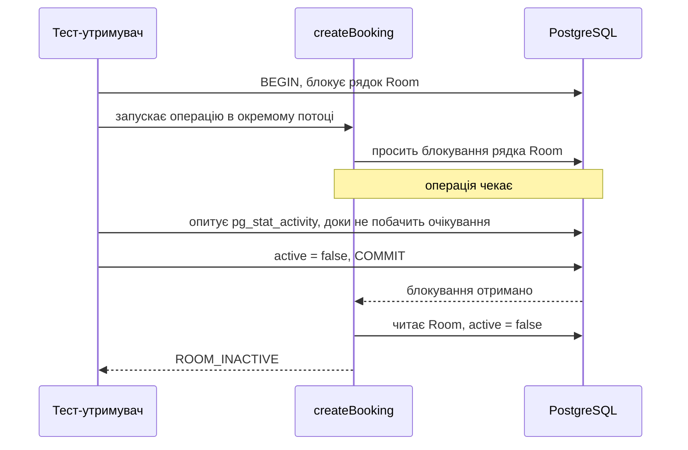

# Етап 7. Тестова стратегія і ризики

Стратегія має шість рівнів і 26 наборів тестів (TS-01...TS-26). INV-08, INV-09 і INV-14 доводяться лише тестами з реальним PostgreSQL, бо моки цих інваріантів не бачать (D-02). Паралельні сценарії будуються на детермінованому чергуванні транзакцій, кількість потоків їх лише доповнює (D-24). Поведінку в браузері перевіряє ручний чекліст (D-25). Реєстр містить 15 ризиків: сім з попередніх етапів (R-04 закрито) і вісім нових. Одну суперечність у вимогах знайдено: RTO 4 години з NFR-05 не вміщується в місячний бюджет простою з NFR-04. Виправлення подано в розділі «Виправлення до попередніх етапів».

## Рівні тестування

| Рівень | Інструменти | Що перевіряє | Чого не бачить |
|---|---|---|---|
| Модульні | JUnit 5, без Spring і БД | Правила домену (INV-01...INV-07), ключі порівняння, політика часу, `AdminPolicy` | Усе, що залежить від БД чи паралельності |
| Сервіси | JUnit 5, Mockito | Порядок перевірок з етапу 2, відображення причин, порядок викликів репозиторіїв (AR-11), права (D-10) | Інваріанти між рядками: Mockito не виконує SQL |
| Архітектура | ArchUnit | AR-01...AR-09, AR-13, AR-14, трасування тестів до ID | Поведінку |
| Веб | MockMvc, сервіси замінено Mockito | HTTP-контракт, формат помилок, ланцюг безпеки, шаблони, заголовки HTMX | Збереження даних |
| Інтеграційні | Повний контекст, PostgreSQL 16 у Testcontainers | Міграції, обмеження, запити, транзакції, протоколи блокувань, сценарії приймання, сесії | Продуктивність, браузер |
| Поза збіркою | Навантажувальний інструмент, скрипти, браузер | NFR-01, відновлення, моніторинг, реліз, чекліст браузера | Виконується за розкладом, не в `mvn test` |

Усе, крім останнього рівня, виконується в `mvn test`.

## Угоди тестового середовища

| Тема | Правило |
|---|---|
| PostgreSQL | Версія 16, той самий мажор, що в проді, у Testcontainers. Один контейнер на запуск збірки, схему створює Flyway |
| Ролі | Міграції від `roombook_owner`, тести від `roombook_app` без DELETE і DDL (OPS-10). Ролі й параметри таймаутів створює скрипт ініціалізації контейнера за розділом «Підготовка БД» етапу 6 |
| Ізоляція | Паралельні сценарії комітять по-справжньому, тому відкат тестової транзакції не використовується. Перед кожним тестом БД очищується (усі таблиці, крім історії Flyway), довідкові дані створюють будівники |
| Час | `OfficeClock` у тестах будується з керованого `Clock`, усі дати рахуються від нього |
| Зона JVM | Весь набір у CI виконується двічі: UTC і America/Los_Angeles (TR-01) |
| Локаль БД | TS-04 і сценарії унікальності ключів із TS-14 додатково виконуються на базі, створеній із локаллю C: D-05 від локалі не залежить |
| Паролі | bcrypt cost 4 у профілі `test`. Тести SEC-05, SEC-12, SEC-13, OPS-06 і навантаження беруть профіль прода з тестовими секретами |
| Журнали | Тестовий перехоплювач записів для TS-21 |
| Трасування | Тест, що доводить вимогу, має `@Tag` з її ID. Перелік обов'язкових ID лежить у тестових ресурсах, а перевірку, що кожен має тест, виконує ArchitectureTest (A-53) |
| Заборони | `@Disabled` без посилання на задачу, `Thread.sleep` як очікування паралельної операції, спільний стан між тестами |

## Набори тестів

### Модульні, сервіси, архітектура

| ID | Набір | Що перевіряє | Джерела |
|---|---|---|---|
| TS-01 | Правила Booking | INV-01...INV-05 на граничних значеннях з FR-10 і FR-11. FR-13 і FR-14 (початок слота, день 90 і 91). Параметри `BookingRules` | FR-10...FR-14, INV-01...INV-05, TR-04 |
| TS-02 | Життєвий цикл Booking | Фази на межах, скасування з UPCOMING і IN_PROGRESS, відмова для FINISHED, безпечний повтор зі збереженням `cancelledAt` і `cancelledById` першого скасування, відсутність зміни інших полів | FR-17, FR-18, INV-06, INV-07, TR-05, A-17 |
| TS-03 | Room, AppUser, AdminPolicy | Межі полів з A-14. `activate` і `deactivate` з повторами. `AdminPolicy`: скільки активних ADMIN лишається після зміни | FR-19...FR-23, INV-12...INV-14, A-14, A-17 |
| TS-04 | ComparisonKey | «Альфа» і « альфа » однакові. Літера «й» у складеній і розкладеній формі. Згорнуті пробіли. Нижній регістр кирилиці. Ключ найдовшої назви вміщується в 200 символів | FR-19, INV-11, INV-13, A-15, D-05 |
| TS-05 | Час і зони | TR-01...TR-06 з керованим `Clock` і обов'язкові випадки нижче. Обхід переходів зони за правилами JDK на 5 років уперед: жоден не потрапляє в 08:00-20:00 | NFR-07, TR-01...TR-06, A-18, R-01 |
| TS-06 | Сервіси з Mockito | Порядок перевірок `createBooking` і `cancelBooking`. Відображення винятків СУБД за іменами обмежень на причини. Перший виклик репозиторію в кожному методі запису є блокуючим читанням (`InOrder`). EMPLOYEE не скасовує чуже й не користується `includeInactive`. Безпечні повтори | FR-16, FR-17, A-17, AR-11, AR-12, D-10 |
| TS-07 | ArchitectureTest | AR-01...AR-09, AR-13, AR-14. Пакети `configuration` не мають вхідних залежностей. Кожен обов'язковий ID має тест із `@Tag`. Жодного `@Disabled` без посилання на задачу | AR-01...AR-09, AR-13, AR-14, R-03 |

### Веб

| ID | Набір | Що перевіряє | Джерела |
|---|---|---|---|
| TS-08 | Контракт API | EP-01...EP-20: валідація й межі A-14, формати дат (зсув у `LocalDateTime` відхиляється), невідомі поля ігноруються (`authorId` у `POST /bookings`, `active` у `POST /rooms` і `PUT /rooms/{id}`), `Location` і коди успіху, 405 для відсутніх операцій, фільтри й пагінація (`size` поза межами, `hasNext`), `phase` і `cancellable`, порядок кімнат і користувачів за українською абеткою | EP-01...EP-20, FR-09, FR-18, A-06, A-20, A-37, D-12 |
| TS-09 | Помилки | Кожен `Reason` і транспортний код має статус, `code`, `detail`. `INVALID_TIME` має `rule` для шести підкодів, `INVALID_INPUT` має `errors[].field`. Відповіді 500 і порушення обмежень не містять стеків, SQL, імен класів і обмежень | D-11, FR-16, OPS-02 |
| TS-10 | Доступ і CSRF | Матриця «маршрут × роль» (без сесії, EMPLOYEE, ADMIN) для кожного EP, PG і HX. Тест повноти: кожен відображений обробник присутній у матриці. Кожен POST і PUT без токена дає 403 `CSRF_INVALID`. Відповіді SEC-14 для API, HTMX і сторінок. Заголовки SEC-12, відсутність CORS | NFR-06, SEC-09...SEC-14, EP-01...EP-20 |
| TS-11 | Сторінки UI | PG-01...PG-13: рендер із даними, формати дати й часу (A-11), меню за роллю, `_csrf` у формах, `hx-headers` у каркасі, сторінки 403, 404, 500 із `requestId`. Підказка біля назви в PG-04, що її бачать усі. Екранування `title`, `name`, `displayName`, `equipment` зі спецсимволами в сторінках, фрагментах, повідомленнях і в `hx-confirm` | PG-01...PG-13, SEC-12, AR-13, R-15 |
| TS-12 | Взаємодії HTMX | HX-01...HX-10: статуси й заголовки (`HX-Redirect`, `HX-Retarget`, `HX-Reswap`), форма з помилками полів, оновлення `#room-day` для `SLOT_TAKEN` і `ROOM_INACTIVE`, 401 із `HX-Redirect` без сесії. Атрибути `hx-disabled-elt` і `hx-confirm` на формах і кнопках | HX-01...HX-10, D-14 |

### Інтеграційні

| ID | Набір | Що перевіряє | Джерела |
|---|---|---|---|
| TS-13 | Міграції, схема, ролі | Flyway на порожній БД і (з другого релізу) на БД із даними попереднього релізу. Hibernate validate. Каталог: кожне ім'я з таблиць обмежень і індексів етапу 3 існує. `btree_gist` створюється під `roombook_owner`. `roombook_app` не може DELETE і DDL | етап 3, OPS-10, A-24 |
| TS-14 | Обмеження БД напряму | Кожне `ex_`, `uq_`, `ck_`, `fk_` порушується через JDBC і відхиляється. Суміжні інтервали, різні кімнати й CANCELLED не конфліктують | INV-02, INV-07, INV-08, INV-10, INV-11, INV-13, FR-12 |
| TS-15 | Збереження й запити | Відображення LocalDateTime і Instant у двох зонах JVM і двох зонах сесії БД (UTC, Pacific/Auckland). Перетворення винятків на `SLOT_TAKEN`, `ROOM_NAME_TAKEN`, `USERNAME_TAKEN`. Запити FR-03...FR-08: CANCELLED і неактивні кімнати, межі доби, фільтри, порядок за `startAt` і `id`. `hasNext` на останній і передостанній сторінках. Імена авторів другим запитом. OSIV вимкнено | TR-02, FR-03...FR-08, AR-10, AR-12, D-12, A-31 |
| TS-16 | Сценарії приймання | Колонка «Перевірка» кожної FR з етапу 1 і кожен UC-01...UC-06 як наскрізні виклики API на реальній БД: усі причини відмов з реальними даними, FR-20 (перейменування лишає бронювання), FR-21 (деактивація після скасування), деактивований користувач не входить | FR-01...FR-23, UC-01...UC-06 |
| TS-17 | Автентифікація, сесії, CSRF-потік | Логін без урахування регістру. Однакова відповідь на три види невдачі. Пароль 73 байти. Новий ідентифікатор сесії після входу. Простій сесії. Деактивація й зниження ролі діють з наступного запиту. Збій читання користувача (заглушка `CredentialsQueries`) не дає прав. Сценарій скрипта: EP-20, `/login`, EP-20, `POST`, `/logout`. Токен змінюється після входу. Логін із метасимволами SQL і довший за 64 символи | SEC-01...SEC-08, SEC-15, D-16...D-18, EP-20 |
| TS-18 | Конкуренція: бронювання | CS-01...CS-05 | NFR-03(а), INV-08, D-03, D-13 |
| TS-19 | Конкуренція: протоколи | CS-06...CS-14 | INV-09, INV-14, NFR-03(б), D-04, OPS-01 |
| TS-20 | Конфігурація, bootstrap, готовність | Профіль прода: cookie, заголовки, відсутність CORS, порт керування (лише health і метрики), readiness (DOWN без БД, UP після bootstrap). D-22: немає ADMIN і є змінні, ADMIN є, логін уже існує. Старт без секретів і з `workDayEnd` раніше `workDayStart` завершується помилкою з назвою параметра. Чи створює `GET /login` і EP-20 сесію без автентифікації (R-12) | SEC-05, SEC-12, SEC-13, SEC-16, OPS-06, OPS-09, D-22 |
| TS-21 | Журнали | Один запис ERROR зі стеком для 500, INFO без стека для `SLOT_TAKEN`. `requestId` для коректного, надто довгого й відсутнього `X-Request-Id`. Маркерні значення пароля, токена, `title`, `displayName` відсутні в журналі. Події з полями. Ознаки `LOCK_TIMEOUT` і `POOL_TIMEOUT` | OPS-01...OPS-05 |

### Поза збіркою

| ID | Набір | Зміст | Джерела |
|---|---|---|---|
| TS-22 | Навантаження | Розділ «Навантаження» | NFR-01, NFR-02, R-08, R-12 |
| TS-23 | Відновлення й копії | Кроки відновлення етапу 6 на чистому хості, вимірюваний час, аудит інваріантів | NFR-05, OPS-12, OPS-13, UC-07 |
| TS-24 | Моніторинг і сповіщення | Штучна відмова БД і проксі, зникла копія, заповнений том | NFR-04, OPS-07, OPS-08 |
| TS-25 | Репетиція релізу | Реліз і відкат за кроками етапу 6 на копії прод-даних. Smoke на образі: вхід, зайнятість, сортування кімнат за українською абеткою | OPS-11, R-01, UC-07 |
| TS-26 | Чекліст браузера | Розділ «Поведінка в браузері» | HX-01...HX-10, A-11, D-25, R-09 |

Покриття: кожна група ID має щонайменше один набір у колонці «Джерела». Для наборів у збірці повноту перевіряє ArchitectureTest, для наборів поза збіркою запис приймання (розділ «Приймання експлуатації»).

## Критичні сценарії

### D-24. Як доводити інваріанти, що залежать від паралельності

**Контекст.** INV-08, INV-09 і INV-14 тримаються протоколом D-04 і обмеженнями СУБД. Юніт-тести з моками їх не доводять (D-02). Вікно гонки вимірюється мілісекундами, тому стрес-тест без блокувань може пройти випадково.

**Варіанти.**
- A. Стрес-тест: багато потоків, багато повторів, перевірка кінцевого стану.
- B. Детерміноване чергування: тест у власній транзакції утримує блокування рядка, запускає операцію застосунку в окремому потоці, дочекавшись її очікування за `pg_stat_activity` (очікування типу Lock), потім завершує свою транзакцію й перевіряє результат.
- C. Точки синхронізації в коді застосунку (виклик після взяття блокування), якими тест керує чергуванням.

**Вибір.** B, A як доповнення.

**Причина.** B перетворює гонку на відтворювану послідовність без змін у коді застосунку. Тест падає, якщо операція не бере блокування: вона не чекатиме, або прочитає застаріле значення. A знаходить несподіване (взаємні блокування, пари, яких не передбачено), але без блокувань проходить із високою ймовірністю, тож доказом не є. C додає в код місця, що існують лише для тестів, і змінює часові властивості.

**Наслідки.** Обидва з'єднання тесту (утримувач і запит стану) працюють під `roombook_app` із відрізнюваним іменем застосунку, тож `pg_stat_activity` показує обидві сесії. Для кожної пари з таблиці «Конкурентні операції» етапу 2 є тест типу B. Під час приймання задачі виконавець один раз прибирає блокування в коді й підтверджує, що CS-06, CS-07 і CS-09 падають. Результат записується в опис зміни.

**Ціна.** Тести складніші за стрес-варіант і прив'язані до семантики очікування блокувань PostgreSQL 16. Утримувач має власний код, який теж треба підтримувати.

### Сценарії конкуренції

| ID | Сценарій і чергування | Очікується | Доводить |
|---|---|---|---|
| CS-01 | 50 потоків із бар'єром одночасно створюють бронювання на один інтервал однієї кімнати. 20 повторів з різними інтервалами | У кожному повторі один 201 і 49 `SLOT_TAKEN`, у БД один ACTIVE-запис, 5xx немає | INV-08, NFR-03(а) |
| CS-02 | Паралельно створюються суміжні інтервали однієї кімнати: 08:00-08:15, 08:15-08:30 і далі до 20:00 | Усі успішні: послідовність по кімнаті не дає хибних конфліктів | FR-12, D-03 |
| CS-03 | Паралельно створюються частково перетинні інтервали (10:00-11:00, 10:30-11:30, 10:45-11:45 та інші) | Успішні попарно не перетинаються, решта `SLOT_TAKEN`, аудит INV-08 порожній | INV-08 |
| CS-04 | Подвійне надсилання: два однакові запити паралельно й два послідовно | Один 201 і один `SLOT_TAKEN` | NFR-03, D-13 |
| CS-05 | Перезапуск контексту застосунку між двома створеннями перетинних бронювань | Друге дає `SLOT_TAKEN` | NFR-03(а) |
| CS-06 | Тест тримає блокування Room, `createBooking` чекає. Тест ставить `active` = false і комітить | `createBooking` повертає `ROOM_INACTIVE`, бронювання немає | INV-09, D-04 |
| CS-07 | Тест тримає блокування Room, `deactivateRoom` чекає. Тест вставляє ACTIVE-бронювання на завтра й комітить | `deactivateRoom` повертає `ROOM_HAS_UNFINISHED_BOOKINGS`, `active` лишається true | INV-09, A-23 |
| CS-08 | 100 повторів: `createBooking` і `deactivateRoom` стартують разом | У кожному повторі або 201 і відмова деактивації, або 200 і `ROOM_INACTIVE`. Аудит INV-09 порожній | INV-09, NFR-03(б) |
| CS-09 | Тест тримає блокування двох останніх ADMIN, `disableUser` над одним із них чекає. Тест вимикає другого й комітить | `disableUser` повертає `LAST_ADMIN`, один активний ADMIN лишається | INV-14 |
| CS-10 | 200 повторів: двоє останніх ADMIN одночасно вимикають одне одного. Те саме для `changeUserRole` і змішаних пар | У кожному повторі один успіх і один `LAST_ADMIN`, взаємного блокування (SQLState 40P01) немає | INV-14, D-04 |
| CS-11 | Тест тримає блокування рядка User, `resetPassword` чекає. Тест вимикає користувача й комітить. Аналог для `updateRoom` і `deactivateRoom` | `enabled` і `active` лишаються false: пізніший запис не повертає старе значення | D-04 |
| CS-12 | Два скасування одного бронювання одночасно (два ADMIN) | Обидва 200, `cancelledAt` і `cancelledById` першого лишаються | A-17, INV-07 |
| CS-13 | `cancelBooking` і `createBooking` на той самий слот одночасно. `cancelBooking` і `deactivateRoom` одночасно | Допустимі обидва порядки, 5xx немає, аудит INV-08 і INV-09 порожній | етап 2 |
| CS-14 | Тест тримає блокування Room довше за `lock_timeout` (у тесті 500 мс). Окремо: пул з одним з'єднанням, зайнятим тестом | `INTERNAL_ERROR`, у журналі `LOCK_TIMEOUT` чи `POOL_TIMEOUT`, з'єднання повертається в пул, наступний запит успішний | OPS-01, D-04 |

### Обов'язкові випадки часу

Входять у TS-05, весь набір виконується в обох зонах JVM.

| № | Момент | Перевіряється |
|---|---|---|
| 1 | 25 жовтня 2026, 00:30 UTC і 01:30 UTC (обидва моменти мають місцевий час 03:30) | «Сьогодні» 25.10.2026, початок слота 03:30 в обох. Бронювання 08:00-09:00 приймається, має фазу UPCOMING і блокує деактивацію кімнати. Результат однаковий (TR-06) |
| 2 | 01:00 за Києвом у зимовий час (23:00 UTC попередньої дати) | «Сьогодні» дорівнює даті за Києвом. День 90 приймається, день 91 відхиляється відносно цієї дати (TR-04) |
| 3 | 10:59:59.999 і 11:00:00.000 для бронювання 10:00-11:00 | Перша мить: IN_PROGRESS, скасування дозволене. Друга: FINISHED, `BOOKING_FINISHED`. Бронювання 11:00-12:00 у другу мить триває (TR-05) |
| 4 | 10:07 | Початок 10:00 приймається, 09:45 відхиляється з `IN_THE_PAST` (FR-13) |
| 5 | Доба весняного переходу (29 березня 2026) і доба переходу наступного року за правилами JDK | Інтервал 08:00-09:00 приймається, тривалість година, «сьогодні» і горизонт коректні (TR-06) |

## Поведінка в браузері

### D-25. Перевірка поведінки в браузері

**Контекст.** MockMvc не виконує JavaScript, тому не бачить, як HTMX підставляє відповіді, чи спрацьовує підтвердження і чи CSP не блокує потрібне (D-14, AR-13).

**Варіанти.**
- A. Ручний чекліст перед кожним релізом.
- B. Автоматизований браузерний тест у CI (Playwright чи Selenium). Поза стеком, браузери потрібні в CI.
- C. HtmlUnit: лише Java, але його рушій JavaScript обмежений, і CSP він не застосовує так, як браузер.

**Вибір.** A.

**Причина.** Інтерфейс малий (13 сторінок, 10 взаємодій), релізи рідкі. B виправданий, якщо інтерфейс зросте або релізи почастішають. C дає хибну впевненість.

**Наслідки.** Чекліст TS-26 виконується в Chrome, Edge, Firefox і Safari на комп'ютері (A-11). Для кожного HX-01...HX-10 перевіряється успішний шлях і щонайменше один шлях помилки за таблицею етапу 5. Додатково: консоль без порушень CSP, кнопка блокується на час запиту, скасування просить підтвердження, після видалення cookie сесії дія веде на вхід (HX-10). Результат записується в запис релізу (OPS-11, крок 8).

**Ціна.** Регресії в браузері ловляться пізно, на релізі, і потребують ручної роботи на кожному релізі (R-09).

## Навантаження

### Середовище і дані

Прогін виконується на хості з тими самими лімітами, що в проді: контейнер 1 ГіБ, heap до 512 МіБ, пул 10 (A-43), не менше 2 vCPU (A-50). Профіль прода з bcrypt cost 12: тестове значення 4 сховало б вартість входу (R-08). PostgreSQL 16 налаштовано як у проді й розташовано окремо від генератора навантаження.

Дані: 1 000 000 бронювань за NFR-01 (A-10 із запасом ×4). Форма розподілу за A-51: 50 кімнат, 300 користувачів, близько 5 років історії й 90 діб уперед, тобто близько 520 бронювань на добу, з них близько 365 ACTIVE. Це щільніше за 200 на добу з A-10. Генератор детермінований (фіксований seed) і укладає ACTIVE-бронювання без перетинів, бо інакше `ex_booking_no_overlap` не дасть їх завантажити. Після пакетного завантаження збирається статистика планувальника.

Час береться з поля `durationMs` у журналі запитів: воно охоплює обробку від прийому запиту до завершення відповіді, без мережі й статичних файлів (NFR-01). Перцентилі рахуються окремо для кожного запиту.

### Профілі

| Профіль | Навантаження | Тривалість | Мета |
|---|---|---|---|
| P1 Основний | 50 одночасних користувачів: 25 запитів/с читання і 5 запитів/с запису за сумішшю нижче | 2 хв розігріву, 15 хв виміру | Приймання NFR-01 і NFR-02 |
| P2 Запас | Удвічі більше: 50 і 10 запитів/с | 10 хв | Інформаційно: p95, завантаження CPU і пулу, де система ламається |
| P3 Хвиля входів | P1 і 300 входів за 60 с | 5 хв | R-08: p95 читання під входами |
| P4 Гаряча кімната | 50 користувачів одночасно створюють той самий інтервал, потім 50 різних інтервалів тієї самої кімнати | 20 повторів | Один 201 і 49 `SLOT_TAKEN`, потім 50 успішних |
| P5 Глибокі сторінки | Автор із найбільшою кількістю бронювань: усі сторінки EP-11. EP-12 без фільтрів: сторінки 0, 1 000, 25 000, 49 000 | 100 запитів на сторінку | D-12 |
| P6 Витримка | P1 і проба `GET /login` без cookie щохвилини | 60 хв | R-08, R-12 |

### Суміш запитів у P1

| Запит | Частка | Примітки |
|---|---|---|
| Читання: `GET /occupancy` (PG-02, EP-07) | 40% | Випадкові дати від -30 до +30 діб |
| Читання: `GET /rooms` (EP-01, зокрема вільні на інтервал) | 20% | |
| Читання: `GET /bookings/mine` (EP-11) | 25% | 70% перша сторінка, решта глибші |
| Читання: `GET /fragments/room-day` (HX-02) | 10% | |
| Читання: `GET /admin/bookings` (EP-12) із фільтром | 5% | |
| Запис: `POST /bookings` (EP-08) | 70% | Вільні слоти в майбутніх добах, 15% навмисно на зайнятий слот |
| Запис: `POST /bookings/{id}/cancel` (EP-10) | 30% | Скасування створених у прогоні бронювань |

### Приймання

| Метрика | Умова |
|---|---|
| p95 зайнятості й «Моїх бронювань» (перша й глибші сторінки) у P1 | не більше 300 мс |
| p95 `POST /bookings` у P1 і P4, окремо для 201 і `SLOT_TAKEN` | не більше 300 мс |
| Відповіді 5xx, таймаути блокувань і пулу в P1, P3, P4 | 0 |
| p95 читання у P3 | не більше 300 мс. Інакше R-08: cost 10 і повторний прогін |
| P5: EP-11 | p95 не більше 300 мс на всіх сторінках |
| P5: EP-12 без фільтрів | Вимір. Поріг 300 мс інформаційний: NFR-01 цей запит не охоплює, глибоке гортання адміністратором без фільтра не є очікуваним сценарієм (D-12) |
| P6 | Heap після GC без монотонного росту (різниця між 10-ю і 60-ю хвилиною до 10%, значення моє), пул без виснаження, кількість сесій відповідає очікуваній |
| Аудит інваріантів після прогону | Порожній |

Якщо умови не виконано, порядок дій такий: плани запитів і індекси, потім розмір пулу й таймаути (A-43), cost bcrypt для P3, курсорна пагінація за D-12. Кеш розглядається лише після цього й окремим рішенням.

## Приймання експлуатації

### Чекліст запуску

| Перевірка | Як перевіряється | Джерело |
|---|---|---|
| Копія створюється, шифрується й лежить поза хостом БД | Запустити задачу, прочитати перелік вмісту останнього файлу | OPS-12, D-23 |
| Пробне відновлення вкладається в 2 години (ціль 1 година) | Кроки відновлення на чистому хості, час записано | OPS-13, NFR-05 |
| Аудит інваріантів після відновлення порожній | Запити аудиту | NFR-03 |
| Сповіщення спрацьовують | Зупинити БД на 3 хвилини у вікні, перейменувати копію, заповнити том | OPS-07, OPS-08 |
| Годинник синхронізований | Перевірити NTP на хостах застосунку й БД | R-07 |
| TLS і HSTS на проксі, порт застосунку й порт керування закриті ззовні | Запит ззовні мережі | D-21, SEC-12 |
| Доступ лише з мережі офісу або VPN | Запит із зовнішньої мережі | A-39, R-05 |
| Секрети лише в середовищі, bootstrap виконано | Старт без секретів падає, вхід першого ADMIN | SEC-16, D-22 |
| Застосунок не має DELETE і DDL | Спроба від `roombook_app` | OPS-10 |
| Реліз і відкат відрепетирувано | TS-25 | OPS-11 |
| Журнали зберігаються щонайменше 14 днів | Налаштування ротації рантайму | A-44 |
| Чекліст браузера пройдено на образі прода | TS-26 | D-25 |

### Аудит інваріантів

Це набір читаючих запитів у репозиторії, що повертають порушників: INV-07 (статус і поля скасування), INV-08 (перетини ACTIVE-бронювань однієї кімнати), INV-09 (незавершені ACTIVE-бронювання в неактивних кімнатах за поточним місцевим часом Києва), INV-10 (висячі посилання), INV-14 (кількість активних ADMIN). Окремий інформативний пункт: бронювання, що не відповідають INV-02...INV-05 за поточними параметрами. Після зміни параметрів вони нормальні (A-16).

Порожній результат обов'язкових пунктів є умовою приймання після прогону NFR-01, після кожного відновлення (OPS-13, крок 4) і за запитом оператора. Запити виконуються від `roombook_backup` лише на читання. Для INV-09 вони беруть час із БД: це єдине місце, де правило часу рахується не за `Clock`, і для офлайн-перевірки це припустимо.

## Критерії завершеності задачі

Ці умови використовує план етапу 8.

1. Набори, призначені задачі, зелені в `mvn test` в обох зонах JVM (TR-01).
2. ArchitectureTest зелений, зокрема трасування: кожен ID задачі, що має автотест, відображений `@Tag`.
3. Немає `@Disabled`, `Thread.sleep` як очікування паралельної операції й тестів, що залежать від порядку виконання.
4. Нова операція запису має рядок у таблиці протоколів, `InOrder`-тест (TS-06), тест типу B для кожної пари з таблиці «Конкурентні операції» етапу 2 і запис про одноразову перевірку падіння тесту без блокування (D-24).
5. Новий маршрут має рядок у матриці доступу (TS-10), без нього тест повноти падає.
6. Нове іменоване обмеження чи індекс оновлює каталог (TS-13) і має тест порушення (TS-14).
7. Нова причина відмови має рядок у таблиці D-11, TS-09 перебирає всі значення.
8. Зміна шаблонів чи взаємодій HX вимагає чекліст TS-26 перед релізом.

## Реєстр ризиків

Шкали. Імовірність: низька (рідше ніж раз на рік), середня (кілька разів на рік), висока (щомісяця). Вплив: низький (незручність без втрати функцій), середній (функція недоступна чи помилкові відмови, без втрати даних і порушення інваріантів), високий (втрата даних, порушення інваріантів, чужий доступ, простій понад бюджет NFR-04).

| ID | Ризик | Імовірність | Вплив | Захід | Перевірка | Статус |
|---|---|---|---|---|---|---|
| R-01 | Правила зони змінилися, а JDK зі старою tzdata цього не знає: перехід потрапляє в робочі години, «зараз» розходиться з годинником офісу на годину | Низька | Середній | Тест обходу переходів (TS-05), перебудова образу щомісяця й після оновлень JDK (OPS-11) | TS-05, TS-25 | Відкритий |
| R-02 | Нова операція запису обходить протокол D-04: блокування відсутнє або стоїть не першим | Середня | Високий | AR-09, AR-11 через `InOrder` (TS-06), CS-тест для кожної пари операцій (D-24), одноразова перевірка падіння тесту, критерії завершеності | TS-06, TS-18, TS-19 | Відкритий |
| R-03 | ArchUnit-тест вимкнено або обійдено, межі розмиваються | Низька | Середній | Тест у складі `mvn test`, збірка падає. `@Disabled` без посилання ловить TS-07 | TS-07 | Відкритий |
| R-04 | Деактивований або знижений користувач діє зі старими правами | | | Закрито D-16 | TS-17 | Закрито |
| R-05 | Підбір паролів на формі входу, обмеження спроб немає | Низька (A-39) | Високий | Доступ лише з мережі офісу, bcrypt 12, політика A-42. Якщо Q-03 покаже вихід в інтернет, обмеження швидкості на проксі до запуску | Чекліст запуску | Відкритий |
| R-06 | Копії немає чи вона не відновлюється, коли потрібна | Середня | Високий | Копія поза хостом, сповіщення (OPS-08), пробне відновлення (OPS-13), ключ окремо від копій | TS-23, TS-24 | Відкритий |
| R-07 | Годинник хоста розходиться з реальним (NTP) | Низька | Середній | Перевірка синхронізації в чеклісті запуску й релізу | Чекліст запуску | Відкритий |
| R-08 | Хвиля входів (наприклад, після перезапуску) вичерпує CPU через bcrypt cost 12 і псує p95 читання | Середня | Середній | Профіль P3, запас CPU (A-50), за потреби cost 10 (вхід дешевшає в 4 рази) | TS-22 | Відкритий |
| R-09 | Помилки поведінки в браузері (HTMX, CSP, підтвердження) не ловить жоден автотест | Середня | Середній | Чекліст TS-26 перед кожним релізом, малий інтерфейс. Якщо регресії почастішають, браузерні тести (D-25, варіант B) | TS-26 | Відкритий |
| R-10 | Розширення btree_gist недоступне на цільовому PostgreSQL | Низька | Високий | Перевірка першою міграцією до основної реалізації, запасний варіант D-03 D | TS-13 | Відкритий |
| R-11 | Поведінка Spring Boot 4.1, Spring Security 7, Hibernate 7, Jackson 3 чи HTMX відрізняється від припущень (група «Потребує перевірки» етапів 3...6) | Середня | Високий для безпеки (фільтри, CSRF), середній для решти | Перевірочний кістяк на початку плану, версії зафіксовано, кожен пункт має тест | Зведення нижче | Відкритий |
| R-12 | Анонімні запити створюють сесії в пам'яті (якщо `GET /login` і EP-20 їх створюють): heap вичерпується, застосунок падає, усі втрачають сесії | Низька (A-39) | Середній | Витримка P6 із пробою щохвилини, обмеження швидкості на проксі (разом із R-05), скорочений простій сесій без автентифікації (15 хвилин, моє значення, потребує перевірки) | TS-20, TS-22 | Відкритий |
| R-13 | Одна відмова хоста чи БД у робочі години витрачає місячний бюджет NFR-04 (близько 2 годин) | Низька | Високий | Відновлення до 2 годин (виправлення NFR-05), пробне відновлення, моніторинг. Резервний інстанс поза межами | TS-23, TS-24 | Прийнятий |
| R-14 | Тести конкуренції нестабільні, і їх починають ігнорувати чи відключати | Середня | Високий | Детерміноване чергування (D-24), жодних `sleep`, повтори лише доповнюють, збірка падає, карантину тестів немає | TS-18, TS-19 | Відкритий |
| R-15 | Працівники вписують у назву зустрічі конфіденційне, а її бачать усі (A-07) | Середня | Середній | Підказка біля поля назви «Назву бачать усі працівники», підтвердження A-07 із замовником | TS-11 | Відкритий |

Першими закриваються R-10 і R-11 у перевірочному кістяку, бо від них залежать D-03, D-16 і D-18.

## Зведення перевірок припущень

Перша задача плану створює мінімальний застосунок із цими елементами й проганяє перелічені набори до початку основної реалізації. Провал будь-якого пункту тягне перегляд указаного рішення.

| Група | Що перевіряється (етап) | Набір | Якщо не підтвердилось |
|---|---|---|---|
| PostgreSQL | `btree_gist` під `roombook_owner` (3, 6). `pg_dump` від `roombook_backup` (6) | TS-13, TS-23 | Розширення: D-03, варіант D. `pg_dump`: права ролі |
| Hibernate, Spring Data | Ім'я обмеження чи SQLState 23P01 у винятку. Мапінг часових типів без зсувів. OSIV за замовчуванням. `hasNext` для проєкцій (3, 4, 5) | TS-15 | Відображення за SQLState і розбором повідомлення. Мапінг змінюється, схема лишається |
| ArchUnit | Версія для класів Java 21 і Boot 4.1 (4) | TS-07 | Інша версія |
| Jackson 3, Problem Details | Формат дат, відхилення зсуву, невідомі поля, верхньорівневі члени розширень (5) | TS-08, TS-09 | Явне налаштування, контракт не змінюється |
| Сортування | Порядок ґ, є, і, ї. Дані локалі `uk` на образі прода: у зменшених образах JRE вони можуть бути відсутні (5) | TS-08, TS-25 | Додати дані локалі в образ або явні правила порівняння |
| Spring Security 7 | Порядок фільтрів із перечитуванням користувача. CSRF: поле, заголовок, EP-20, зміна токена після входу. Request cache. bcrypt і 72 байти. Вирівнювання часу для невідомого логіна (6) | TS-10, TS-17 | Перегляд D-16 чи D-18 |
| Spring Boot 4.1 | Ознаки cookie, forwarded headers, порт керування, health-групи, readiness після `ApplicationRunner`, структуровані журнали й MDC, окремі облікові дані Flyway (6) | TS-20, TS-21 | Налаштування в коді замість властивостей |
| Блокування | Порядок захоплення в `lockWithActiveAdmins` (4) | TS-19 (CS-10) | Окремі запити в порядку `id` |
| HTMX | Версія, `hx-headers`, `HX-Redirect` на 401, `HX-Retarget`, `HX-Reswap`, `hx-swap-oob`, `hx-confirm`, CSP без `unsafe-inline` (5, 6) | TS-12, TS-26 | Інша версія чи спосіб підстановки, перегляд D-14 |
| Сесії | Чи створюють `GET /login` і EP-20 сесію без автентифікації (R-12) | TS-20, TS-22 | Скорочення простою таких сесій, обмеження на проксі |

## Відкриті питання

Нових питань немає. План етапу 8 будується за прийнятими відповідями.

| ID | Питання | Прийнята відповідь | Що зміниться при іншій |
|---|---|---|---|
| Q-01 | Звідки облікові записи | Локальні (A-09) | `passwordHash` зникає. Змінюються `accounts.security`, SEC-01...SEC-04, D-22. Решта accounts і scheduling не змінюються |
| Q-02 | Чи прийнятно втратити до 24 годин даних | Прийнятно | Архівування WAL (D-23, варіант C): змінюються OPS-12, OPS-13, TS-23 |
| Q-03 | Доступ лише з мережі офісу, проксі є | Так (A-39) | Обмеження швидкості входу на проксі до запуску (R-05) |
| Q-04 | Самостійна зміна пароля | Немає | FR-24, ендпоінт, сторінка, `AccountService.changeOwnPassword`, зміни в TS-08, TS-11, TS-17 |

## Виправлення до попередніх етапів

**NFR-05 (етап 1) і OPS-13 (етап 6).** NFR-04 допускає близько 2,1 години незапланованого простою на місяць у вікні 07:00-21:00 (14 годин на добу, 30 діб, 0,5%), а NFR-05 дозволяє відновлення до 4 годин. Одна аварія, що потребує відновлення довше за 2 години в робочий час, уже порушує NFR-04 за цей місяць. Обираю RTO до 2 годин (ціль 1 година) і вношу це в NFR-05 та приймання OPS-13. Обидва числа були моїми пропозиціями в етапі 1. Якщо замовник готовий вважати аварію з відновленням із копії винятком із NFR-04, повертаємо 4 години.

**AR-01 (етап 4).** Пакети `configuration` (scheduling і accounts) можуть залежати від усіх шарів свого модуля, від них не залежить жоден шар. Це правило перевіряє TS-07.

## Припущення

Нумерація продовжує етап 6.

| ID | Припущення |
|---|---|
| A-48 | Сортування кімнат і користувачів за назвою виконує застосунок за правилами порівняння для української мови, а не БД: порядок у БД залежить від локалі кластера (та сама причина, що в D-05). Списки без пагінації (A-37) це дозволяють |
| A-49 | Поведінку в браузері перевіряє ручний чекліст (D-25). Автоматизації браузера в стеку немає |
| A-50 | Прод-контейнер має щонайменше 2 vCPU. Значення моє: від CPU залежить вартість хвилі входів із bcrypt cost 12 (R-08). Навантажувальний прогін виконується з тими самими лімітами |
| A-51 | Форма даних прогону NFR-01 (50 кімнат, 300 користувачів, близько 5 років історії й 90 діб уперед, 70% ACTIVE, тривалість від 15 хвилин до 4 годин із середнім близько 45 хвилин) моя. A-10 дає лише обсяг |
| A-52 | Навантажувальний інструмент: будь-який, що тримає 50 сесій із cookie й токеном CSRF. Вибір за виконавцем. Інструмент не входить у стек і не запускається в `mvn test` |
| A-53 | Трасування через `@Tag` і перевірка в ArchitectureTest запропоновані мною. Індекс обов'язкових ID у тестових ресурсах веде виконавець |
| A-54 | Параметри тестів мої: 50 потоків у CS-01, 20, 100 і 200 повторів, `lock_timeout` 500 мс у CS-14, тривалості профілів P1...P6. Змінюються без зміни логіки |

На етапі 8 складу впорядкований план реалізації: задачі з метою, посиланнями на розділи дизайну, залежностями й критеріями приймання через набори TS і сценарії CS цього етапу.

## Доповнення етапу 9

Інтерфейс (`09-ui-design.md`) додає набір TS-27 і три ризики. Огляд DR-01...DR-11 входить у TS-26.

| ID | Набір | Що перевіряє | Джерела |
|---|---|---|---|
| TS-27 | Тест стилю (`UiStyleTest`) | Читає `static/css/*.css` і `templates/**/*.html`: кольори лише з токенів, без градієнтів, `box-shadow`, `border-radius` понад 4 px, `text-transform`, `!important`, зовнішніх URL, `data:`-URI, `@import`, емодзі, знака оклику, довгого тире, середньої крапки й «→» у шаблонах. `@keyframes` лише `fresh`, `transition` до 120 мс, є `:focus-visible` і `prefers-reduced-motion`, `lang="uk"`, шість файлів шрифтів і `OFL.txt`, класи `tl-len-1`...`tl-len-48`, усі токени. Кожне правило має фікстуру з порушенням | UI-01...UI-09, AR-13, A-64, A-65 |

| ID | Ризик | Імовірність | Вплив | Захід | Перевірка | Статус |
|---|---|---|---|---|---|---|
| R-16 | Вигляд не ловить жоден автотест: виконавець (особливо слабша модель) імпровізує й повертає «середній» стиль | Висока | Середній | Токени, тексти й структура задані документом, TS-27, макети до реалізації (D-30), огляд DR у T-30, `.claude/rules/ui.md` | TS-27, TS-26 | Відкритий |
| R-17 | Сітка важка: до 2 400 клітинок на 50 кімнат, понад 100 КБ HTML | Середня | Середній | Профіль P1 включає PG-02 з 20 і 50 кімнатами. Якщо p95 вище 300 мс чи сторінка важча за 300 КБ, посилання на вільні слоти прибираються | TS-22, T-33 | Відкритий |
| R-18 | Зміна `workDayStart`, `workDayEnd` чи `slotGrid` без перегляду CSS ламає сітку | Низька | Середній | Старт завершується помилкою, якщо слотів на добу більше 48 (T-33). Зміна параметрів супроводжується оглядом сітки | TS-11, TS-20 | Відкритий |
