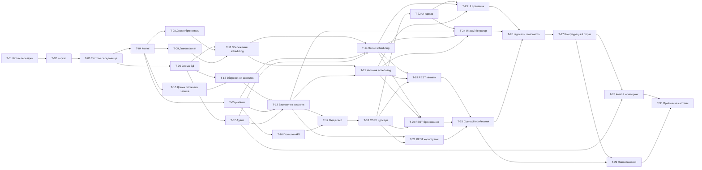

# Етап 8. План реалізації

План має 30 задач (T-01...T-30) у восьми фазах. Перша задача не пише продукт. Вона перевіряє припущення про Spring Boot 4.1, Spring Security 7, Hibernate 7, Jackson 3 і PostgreSQL, від яких залежать D-03, D-14, D-16 і D-18, та фіксує версії. Далі йдуть каркас із тестом архітектури, тестове середовище, схема, домен, сервіси, безпека, API, інтерфейс і експлуатація. Інваріанти з паралельністю (INV-08, INV-09, INV-14) доводяться в T-13 і T-14, тобто одразу з появою операцій запису, а не наприкінці. Знайдено дві суперечності й три прогалини в етапах 2...6, жодна не змінює вимоги (розділ «Виправлення до попередніх етапів»). Оцінок трудомісткості в плані немає: для них потрібні відомості про команду, яких у мене немає.

## Як читати план

Кожна задача має мету, посилання на розділи дизайну, залежності, зміст і приймання. Задача завершена, коли виконано її приймання і критерії завершеності з етапу 7. Тут вони позначені КЗ-1...КЗ-8 за порядком списку етапу 7.

| ID | Критерій завершеності |
|---|---|
| КЗ-1 | `mvn test` зелений в обох зонах JVM: UTC і America/Los_Angeles (TR-01) |
| КЗ-2 | ArchitectureTest зелений, ID вимог, що мають автотести, відображені тегами `@Tag` (A-53) |
| КЗ-3 | Немає `@Disabled` без посилання на задачу, `Thread.sleep` як синхронізації паралельних операцій і тестів, що залежать від порядку виконання |
| КЗ-4 | Нова операція запису має рядок у таблиці протоколів, `InOrder`-тест, тест типу B (D-24) для кожної пари з таблиці «Конкурентні операції» етапу 2 і запис про одноразову перевірку, що тест падає без блокування |
| КЗ-5 | Новий маршрут має рядок у матриці доступу (TS-10) |
| КЗ-6 | Нове обмеження чи індекс відображене в каталозі (TS-13) і має тест порушення (TS-14) |
| КЗ-7 | Нова причина відмови має рядок у таблиці D-11, TS-09 її перебирає |
| КЗ-8 | Зміна шаблонів чи взаємодій HTMX потребує чекліст TS-26 перед релізом |

У прийманні задач КЗ-1...КЗ-3 не повторюються, інші згадуються там, де застосовні.

| Якщо під час задачі | Дія |
|---|---|
| Перевірка з «Потребує перевірки» не підтвердилась | Застосувати запасний варіант зі «Зведення перевірок припущень» (етап 7), записати в `docs/verification-results.md`. Без запасного варіанта зупинитися й повідомити архітектора |
| Тест із приймання не проходить через дефект дизайну | Зупинитися й описати розбіжність. Тест не послаблювати |
| Бракує правила, яке не блокує роботу | Взяти найпростіше тлумачення, записати припущення в опис зміни, продовжити |
| Потрібна зміна дизайну | Окремий запит архітектору. Документ дизайну виконавець не редагує |

Артефакти поза кодом застосунку (розташування запропоноване мною, A-59):

| Шлях | Зміст | Задача |
|---|---|---|
| `docs/verification-results.md` | Результати перевірочного кістяка | T-01 |
| `ops/db/` | Підготовка БД: ролі, права, таймаути. Спільна для тестів і оператора | T-03, T-27 |
| `ops/audit/` | Запити аудиту інваріантів | T-07 |
| `ops/backup/` | Задача копіювання, процедура відновлення | T-28 |
| `ops/monitoring/` | Проби, правила сповіщень, розрахунок доступності | T-28 |
| `ops/load/` | Генератор даних і сценарії навантаження | T-29 |
| `docs/runbook.md` | Таблиця змінних середовища, реліз, відновлення, вимоги до проксі | T-27, T-28 |
| Визначення образу контейнера в корені | Збірка образу | T-27 |

## Порядок і залежності

| Фаза | Задачі | Що готово наприкінці |
|---|---|---|
| 1. Перевірка | T-01 | Версії зафіксовано, припущення підтверджено чи замінено запасними варіантами |
| 2. Основа | T-02...T-07 | Збірка, тестове середовище, kernel, схема з обмеженнями, аудит інваріантів |
| 3. Домен | T-08...T-10 | Усі доменні правила працюють без БД |
| 4. Дані й сервіси | T-11...T-15 | Усі сценарії запису й читання працюють на PostgreSQL, набори CS-01...CS-13 зелені |
| 5. Безпека й помилки | T-16...T-18 | Вхід, сесії, CSRF, формат помилок |
| 6. API | T-19...T-21, T-25 | Усе, що вимагає FR, доступне через `/api/v1` і перевірене наскрізно |
| 7. Інтерфейс | T-22...T-24 | Усі сторінки й взаємодії HTMX |
| 8. Експлуатація й приймання | T-26...T-30 | Журнали, образ, копії, навантаження, приймання системи |

Після T-04 паралельно йдуть T-05 і три доменні задачі T-08, T-09, T-10. Після T-06 працюють дві гілки: scheduling (T-11, T-14, T-15) і accounts (T-12, T-13). T-16 не залежить від гілок. Після T-18 API (T-19...T-21) і UI (T-22...T-24) ведуться паралельно, але T-23 і T-24 чекають на сервіси.

## Задачі

### T-01. Перевірочний кістяк

**Мета.** Підтвердити чи спростувати припущення про версії стека до початку основної реалізації й зафіксувати версії.
**Дизайн.** Етап 7: «Зведення перевірок припущень», R-10, R-11, R-12. Таблиці «Потребує перевірки» етапів 3...6. A-58, A-60.
**Залежить від.** Немає.
**Зміст.**
- Одноразовий проєкт поза основним деревом вихідних кодів (A-60). Spring Boot 4.1.x останнього патчу, JDK 21, PostgreSQL 16 у Testcontainers із ролями `roombook_owner`, `roombook_app`, `roombook_backup`.
- Кожен рядок «Зведення перевірок припущень» виконується окремим коротким тестом або ручним кроком.
- Додатково: точні версії Spring Boot, Spring Security, Hibernate, Jackson, Flyway (з модулем PostgreSQL), JDBC-драйвера, ArchUnit, Testcontainers, HTMX і базового образу JDK. Чи містить образ дані локалі `uk`.
- Окремо: чи створюють `GET /login` і `GET /api/v1/csrf` сесію без автентифікації (R-12) і чи можна на час до входу зменшити простій такої сесії та підняти до 8 годин після входу (A-58). Чи вирівнює Spring Security час відповіді для невідомого логіна (SEC-02). Чи блокує `lockWithActiveAdmins`-подібний запит рядки в порядку `id`.
- Результати: `docs/verification-results.md`, таблиця «перевірка, результат, доказ, застосований запасний варіант».

**Приймання.**
1. Таблиця містить усі десять груп зі «Зведення перевірок припущень» і кожен пункт стовпців «Потребує перевірки» етапів 3...6.
2. Кожен негативний результат має застосований запасний варіант зі стовпця «Якщо не підтвердилось». Негативний результат без запасного варіанта означає зупинку.
3. Перелік версій узято T-02 без змін.
4. Статуси R-10, R-11, R-12 оновлено.
5. Кістяка немає в основному дереві вихідних кодів.

### T-02. Каркас проєкту й збірка

**Мета.** Збірка, пакети за етапом 4, профілі й тест архітектури, що забороняє порушення меж від першого коміту.
**Дизайн.** D-06, D-07, D-08, AR-01...AR-09, AR-13, AR-14, AR-15, A-28, A-29. Етап 6: «Конфігурація й середовища».
**Залежить від.** T-01.
**Зміст.**
- Один Maven-модуль, Java 21, версії з T-01. Без Lombok і MapStruct. Залежності стека: Web, Thymeleaf, Data JPA, Security, Actuator, Flyway з модулем PostgreSQL, драйвер PostgreSQL. У test scope: JUnit 5, Mockito, Testcontainers, Spring Test, Security Test, ядро ArchUnit.
- Пакети з `package-info` (одне речення відповідальності) для `kernel`, `platform`, `scheduling` і `accounts` з усіма підпакетами етапу 4, зокрема `accounts.security`, `accounts.configuration`, `scheduling.configuration`. Кореневий пакет `roombook`.
- Профілі dev, test, prod за таблицею «Конфігурація й середовища». Параметри згруповані як у таблиці, секретів у значеннях за замовчуванням немає (SEC-16). OSIV вимкнено, Hibernate лише перевіряє схему (AR-10).
- ArchitectureTest: окремий метод на кожне правило AR-01...AR-09, AR-13, AR-14, AR-15, ID у назві методу. Правила без класів-суб'єктів тимчасово дозволяють порожню вибірку, дозвіл знімає T-30.
- README: як зібрати й запустити dev.

**Приймання.**
1. Кожне правило AR має окремий метод. Одноразова перевірка: тимчасовий клас у `domain` з імпортом Spring змушує відповідний метод падати (записується в опис зміни).
2. Пакети збігаються з таблицею «Компоненти» етапу 4 з поправкою про `accounts.security` (розділ «Виправлення»).

### T-03. Тестове середовище

**Мета.** Спільна основа для всіх подальших наборів.
**Дизайн.** Етап 7: «Угоди тестового середовища», D-24, A-53, A-54. Етап 6: «Підготовка БД». D-20, A-43.
**Залежить від.** T-02.
**Зміст.**
- Скрипт підготовки БД в `ops/db/` за таблицею «Підготовка БД»: ролі, права, привілеї за замовчуванням, таймаути ролі застосунку. Використовується і тестами, і оператором (T-27).
- PostgreSQL 16 у Testcontainers, один контейнер на запуск збірки. Друга база з локаллю C (для TS-04, TS-14, TS-15). Підключення від кожної з трьох ролей.
- Очищення БД перед кожним тестом (усі таблиці, крім історії Flyway). Відкату тестових транзакцій немає. Будівники Room, AppUser, Booking пишуть у БД напряму від імені власника, без сервісів.
- Фабрика керованого `Clock` і `OfficeClock`.
- Збірка виконує весь набір двічі: зони JVM UTC і America/Los_Angeles. У CI два завдання.
- Індекс обов'язкових ID у тестових ресурсах і перевірка наявності тега `@Tag` (A-53). Сканер вихідних файлів тестів: `@Disabled` без посилання на задачу й `Thread.sleep` (КЗ-3).
- Утиліта чергування (D-24, B): у власній транзакції тримає блокування рядка, запускає операцію в окремому потоці, чекає появи очікування блокування в `pg_stat_activity`, знімає блокування й повертає результат операції. Сесії мають розрізнювані імена застосунку, очікування обмежене дедлайном, фіксованих пауз як синхронізації немає. Бар'єр для одночасного старту N потоків.

**Приймання.**
1. Smoke: контейнер стартує, ролі створені, `roombook_app` не може DELETE і DDL на тестовій таблиці, таймаути ролі мають значення A-43.
2. Самотест утиліти чергування на тимчасовій таблиці: операція чекає до коміту утримувача. Якщо блокування немає, утиліта завершується помилкою очікування, а не зависає.
3. Прогін у двох зонах друкує різні зони JVM.
4. Самотести сканера й індексу ID: фікстури з `Thread.sleep`, `@Disabled` без посилання й ID без тесту падають.

### T-04. Ядро (kernel)

**Мета.** Типи, спільні для всіх шарів і не залежні від Spring.
**Дизайн.** Етап 4: «Компоненти». A-15, A-30, A-33, A-36, A-55, A-56, TR-01...TR-05, D-01, D-11, AR-15.
**Залежить від.** T-03.
**Зміст.**
- `Role` (EMPLOYEE, ADMIN). `Actor`: `userId`, `role`, `isAdmin()`, `requireAdmin()` (кидає `NOT_PERMITTED`).
- `Reason`: 13 кодів з етапу 5. `TimeRule`: шість підкодів `INVALID_TIME`. `FieldRule`: правила помилок полів (REQUIRED, LENGTH, RANGE, FORMAT, ILLEGAL_CHARACTERS і ті, що знадобляться доменам). `DomainException` (неперевірений): `reason`, необов'язкові `rule`, список `FieldError` (`field`, `FieldRule`, параметри) і параметри повідомлення. Українських текстів у kernel немає, їх тримає platform (A-56).
- Текстові правила: пробільний символ за A-55, `strip`, згортання пробілів, довжина в кодових точках, перевірка керувальних символів (A-36).
- `ComparisonKey` за A-15: NFC, нижній регістр без залежності від локалі, згорнуті пробіли.
- `OfficeClock` на основі `Clock` і `officeZone`: метод, що повертає знімок моменту (Instant, місцевий час, сьогодні). Операція бере один знімок і передає його далі.

**Приймання.**
1. TS-04: «Альфа» і « альфа » мають однаковий ключ. Літера «й» у складеній і розкладеній формі дає один ключ. Нерозривний пробіл обрізається за A-55. Нижній регістр кирилиці. Ключ найдовшої назви вміщується в 200 символів.
2. TS-05 для `OfficeClock` в обох зонах JVM: випадки 1 і 2 з розділу «Обов'язкові випадки часу».
3. `Actor.requireAdmin` для EMPLOYEE дає `NOT_PERMITTED`. Ідентифікатори `Reason` і `TimeRule` дослівно збігаються з таблицями етапу 5.
4. AR-15: kernel не залежить від Spring, Hibernate, servlet і platform.

### T-05. Платформа: годинник, запит, журнал

**Мета.** Інфраструктура, що не залежить від функцій.
**Дизайн.** D-19, OPS-01, OPS-03, OPS-09, TR-03, AR-08.
**Залежить від.** T-04.
**Зміст.**
- `ClockConfiguration`: бінни `Clock` (системний, UTC) і `OfficeClock` із `officeZone` з конфігурації. Невірний ідентифікатор зони зупиняє старт (OPS-09).
- Фільтр `requestId` першим у ланцюгу: заголовок `X-Request-Id` приймається, якщо складається з літер, цифр і дефісів до 64 символів, інакше генерується. Значення в MDC і в заголовку відповіді (OPS-03).
- Журнал запитів: INFO, `method`, `path` без query, `status`, `durationMs` від прийому запиту до завершення відповіді (NFR-01). Статичні ресурси не пишуться.
- Формат журналу: JSON у stdout для прода, UTC (ISO-8601 із `Z`), текст для dev (D-19).
- `ConstraintNames`: дістає ім'я порушеного обмеження і SQLState із виняткового ланцюга (спосіб з T-01).

**Приймання.**
1. Заголовок `X-Request-Id`: коректний, надто довгий і відсутній дають три різні `requestId`, що збігаються в заголовку відповіді й журналі.
2. Журнал прода є валідним JSON із `requestId`, час у UTC.
3. `ConstraintNames` повертає ім'я з винятків, спричинених на тимчасових об'єктах БД: порушення унікальності, виключення (23P01), CHECK, зовнішнього ключа.
4. Невірна зона в конфігурації завершує старт помилкою з назвою параметра.

### T-06. Схема БД

**Мета.** Міграції Flyway, що реалізують схему етапу 3.
**Дизайн.** Етап 3: «Схема», «Обмеження», «Індекси», «Міграції». D-03, D-05, D-20, A-23, A-24. INV-02, INV-07, INV-08, INV-10, INV-11, INV-13.
**Залежить від.** T-03.
**Зміст.**
- Перша міграція створює розширення btree_gist від `roombook_owner` (окремо, A-24). Друга створює `room`, `app_user`, `booking`, усі обмеження й індекси.
- Імена, типи, NULL, значення за замовчуванням і порядок колонок індексів (зокрема `DESC`) точно за таблицями етапу 3. Колонок `version` немає. Ідентифікатори генерує СУБД.
- `ex_booking_no_overlap`: рівність `room_id`, діапазон `[start_at, end_at)`, умова лише для ACTIVE.
- Flyway працює від `roombook_owner` на старті (D-20). Права `roombook_app` приходять із привілеїв за замовчуванням з T-03, у міграціях їх немає.

**Приймання.**
1. TS-13: міграції на порожній БД, а також на базі з локаллю C. Каталог містить кожне ім'я й визначення з етапу 3. `btree_gist` створюється під `roombook_owner`. `roombook_app` не може DELETE і DDL.
2. TS-14: кожне `ex_`, `uq_`, `ck_`, `fk_` порушується напряму через JDBC і відхиляється. Суміжні інтервали (10:00-11:00 і 11:00-12:00), різні кімнати й CANCELLED-бронювання не конфліктують. Після скасування слот можна зайняти знову.
3. Контрольна сума застосованої міграції не дозволяє її змінити (правило «Незмінність»).

### T-07. Аудит інваріантів

**Мета.** Читаючі запити, що повертають порушників інваріантів, для тестів і оператора.
**Дизайн.** Етап 7: «Аудит інваріантів». INV-07, INV-08, INV-09, INV-10, INV-14, A-16.
**Залежить від.** T-06.
**Зміст.**
- Запити в `ops/audit/` для INV-07, INV-08, INV-09 (час із БД за Europe/Kyiv), INV-10, INV-14. Інформативний запит для INV-02...INV-05 за поточними параметрами, параметри передаються ззовні.
- Тестова утиліта `InvariantAudit` виконує запити й перевіряє порожній результат. Запити виконуються від `roombook_backup`, лише читання.

**Приймання.**
1. Для кожного запиту є тест на окремій схемі з копіями таблиць без обмежень, куди записано порушника. Запит його повертає.
2. На чистих даних (1 000 рядків, згенерованих будівниками) усі запити повертають порожній результат.
3. Роль `roombook_backup` не може змінити дані.

### T-08. Домен бронювань

**Мета.** Правила Booking без БД і Spring.
**Дизайн.** INV-01...INV-07, FR-10...FR-14, FR-17, FR-18, TR-04, TR-05, D-01, D-09, D-10. Етап 4: `scheduling.domain`.
**Залежить від.** T-04.
**Зміст.**
- `BookingInterval`: початок, кінець (`LocalDateTime`), дата, тривалість, перетин. `BookingStatus`, `BookingPhase`.
- `BookingRules`: параметри з етапу 2 без `officeZone`. Перевіряє узгодженість при створенні: `workDayStart` раніше `workDayEnd`, обидва кратні `slotGrid`, `slotGrid` додатний, `0 < minDuration ≤ maxDuration`, обидві кратні `slotGrid`, `horizonDays ≥ 0`. Порушення дає виняток з назвою параметра (OPS-09).
- `BookingTimePolicy`: два входи. Форма інтервалу (INV-02...INV-05) для пошуку вільних кімнат (A-32). Створення додає FR-13 і FR-14. Порядок і підкоди за таблицею «Підкоди INVALID_TIME» етапу 5.
- Сутність `Booking` (JPA-анотації, поля-ідентифікатори, без публічних сеттерів): створення (повторно перевіряє INV-01 і INV-02 тими самими причинами), `cancel(Actor, знімок моменту)` у порядку: автор чи ADMIN (`NOT_PERMITTED`), повтор для скасованого (без змін), завершене (`BOOKING_FINISHED`). `phase`, `isUnfinished`.
- Помилки полів накопичуються й віддаються разом (`FieldError`).

**Приймання.**
1. TS-01: граничні значення FR-10 (0, 1, 200, 201 символ, лише пробіли), приклади FR-11, FR-13, FR-14. Підкоди за прикладами етапу 5.
2. TS-02: скасування з UPCOMING і IN_PROGRESS, відмова для FINISHED, безпечний повтор зі збереженням `cancelledAt` і `cancelledById` першого скасування, чужий EMPLOYEE отримує `NOT_PERMITTED`, зміна інших полів неможлива.
3. TS-05: випадки 3, 4 і 5 з розділу «Обов'язкові випадки часу».
4. `BookingRules` відхиляє: початок пізніше кінця, `minDuration` більше `maxDuration`, `slotGrid` нуль, тривалість не кратну сітці.
5. AR-02, AR-04, AR-06 виконуються для пакета.

### T-09. Домен кімнат

**Мета.** Правила Room.
**Дизайн.** INV-11, INV-12, FR-19...FR-22, A-06, A-14, A-15, A-17, A-25, A-36.
**Залежить від.** T-04.
**Зміст.** Сутність `Room`: створення й зміна `name`, `floor`, `capacity`, `equipment` із перевіркою меж A-14 і накопиченням помилок полів, перерахунком ключа назви при кожній зміні `name`, `equipment` порожнє після `strip` стає NULL. `activate` і `deactivate` є безпечними повторами. Рішення про деактивацію приймає сервіс (існування незавершених бронювань), а не Room. `active` не змінюється через `update`.

**Приймання.** TS-03 (частина Room): межі `floor` (-5, 100, -6, 101), `capacity` (1, 1000, 0, 1001), `name` (100, 101, порожня після `strip`), `equipment` (500, 501, порожнє дає NULL), керувальні символи у `name` відхиляються, перенос рядка в `equipment` дозволений. Ключ перераховується при перейменуванні. Повторні `activate` і `deactivate` не змінюють стан.

### T-10. Домен облікових записів

**Мета.** Правила AppUser і політики паролів.
**Дизайн.** INV-13, INV-14, FR-02, FR-23, SEC-03, SEC-04, A-14, A-17, A-19, A-42.
**Залежить від.** T-04.
**Зміст.**
- `AppUser`: створення з `username` (3...64, латиниця, цифри, крапка, підкреслення, дефіс), `displayName` (1...64? ні: 1...100), `role`, `enabled` = true, хеш пароля. Зміна ролі, `disable`, `enable`, заміна хеша. Ключ логіна. `toString` без хеша.
- `PasswordPolicy` (чиста функція): від 10 кодових точок, не більше 72 байтів у UTF-8, не збігається з логіном за ключем, не обрізається й не нормалізується. Помилка дає `FieldError` з полем `password`.
- `AdminPolicy`: чи лишається активний ADMIN після зміни ролі чи деактивації.

**Приймання.** TS-03 (частина AppUser): `username` (3, 64, 2, 65 символів, заборонені символи), `displayName`, `PasswordPolicy` (9 і 10 символів, 72 і 73 байти, тобто 36 і 37 кириличних літер, пароль, що дорівнює логіну без урахування регістру, пробіли на краях зараховуються), `AdminPolicy` за таблицею випадків: два ADMIN і вимкнення одного дозволено, вимкнення чи зниження останнього дає `LAST_ADMIN`, вимкнення EMPLOYEE байдуже, повтор для вже вимкненого користувача не дає `LAST_ADMIN`.

### T-11. Збереження scheduling

**Мета.** Відображення Room і Booking на таблиці та репозиторії для операцій запису.
**Дизайн.** D-04, D-09, AR-04, AR-10, AR-12, етап 3: «Протоколи операцій».
**Залежить від.** T-06, T-08, T-09.
**Зміст.**
- Відображення сутностей за схемою (`timestamp` у `LocalDateTime`, `timestamptz` у `Instant`, поля-ідентифікатори, без асоціацій).
- `RoomRepository`: `lockById` (блокування запису), збереження з негайним flush. `BookingRepository`: `lockById`, `findActiveOverlapping(roomId, інтервал)` для ACTIVE, обмежений добою початку (INV-02), `existsUnfinished(roomId, місцевий момент)` (ACTIVE, `end_at` пізніше моменту, початок не раніше початку сьогоднішньої доби).
- `SchedulingConstraints`: відображення `ex_booking_no_overlap` на `SLOT_TAKEN`, `uq_room_name_key` на `ROOM_NAME_TAKEN`. Імена обмежень як константи в одному місці. Методів `delete*` немає.

**Приймання.**
1. TS-15 (збереження): значення `startAt` 10:00 і `createdAt` читаються без зсуву при JVM {UTC, Los_Angeles} × сесії БД {UTC, Pacific/Auckland}. Hibernate у режимі перевірки приймає схему. OSIV вимкнено (AR-10).
2. `lockById` блокує: друга сесія чекає (утиліта T-03).
3. `findActiveOverlapping`: суміжні інтервали, CANCELLED і інша кімната не повертаються. `existsUnfinished`: кінець дорівнює моменту дає false, пізніше дає true, CANCELLED ігнорується.
4. AR-12: перетин, записаний напряму через репозиторій у обхід сервісу, дає `SLOT_TAKEN`. Дублікат назви дає `ROOM_NAME_TAKEN`. Транзакція після порушення відкочена повністю.
5. AR-04: немає `delete*` і публічних сеттерів.

### T-12. Збереження accounts

**Мета.** Відображення AppUser і репозиторій.
**Дизайн.** D-04, D-09, INV-13, INV-14, AR-12, етап 3: «Протоколи операцій».
**Залежить від.** T-06, T-10.
**Зміст.** Відображення AppUser. `AppUserRepository`: `lockById`, `lockWithActiveAdmins(targetId)` (цільовий користувач і всі активні ADMIN одним запитом, блокування в порядку `id`), `findByUsernameKey`, збереження з flush. `AccountsConstraints`: `uq_app_user_username_key` у `USERNAME_TAKEN`. Методів `delete*` немає.

**Приймання.** Відображення без зсувів. Hibernate у режимі перевірки приймає схему. `lockWithActiveAdmins` повертає цільового користувача й усіх активних ADMIN у порядку `id` (перевірка за планом запиту й тестом із двома сесіями без взаємного блокування). Пошук за ключем логіна. Дублікат логіна дає `USERNAME_TAKEN` (AR-12). Немає `delete*` (AR-04).

### T-13. Застосунок accounts

**Мета.** Сценарії керування обліковими записами, читання й bootstrap.
**Дизайн.** D-04, D-10, D-22, INV-14, FR-23, A-17, A-19, A-34, A-57. Етап 3: «Протоколи операцій». Етап 4: «Транзакційні межі».
**Залежить від.** T-05, T-07, T-12.
**Зміст.**
- `AccountService`: `createUser`, `changeUserRole`, `disableUser`, `enableUser`, `resetPassword`. Перше в кожному методі `Actor.requireAdmin()`, далі протокол етапу 3: `createUser` без блокування, зміна ролі й вимкнення через `lockWithActiveAdmins` і `AdminPolicy` (`LAST_ADMIN`), увімкнення й скидання пароля через `lockById`. Безпечні повтори за A-17 ідуть до перевірки політики. Пароль хешується `PasswordEncoder` (bcrypt за D-15) і ніде не логується. Повертає `UserView` без хеша.
- `AccountQueries` (список і один користувач, лише ADMIN), `CredentialsQueries` (`loadForLogin`, `loadForSession`), `UserDirectoryQueries` для інтерфейсу `UserDirectory` (`displayNames`, `selectableUsers`, A-34).
- `AdminBootstrap` за D-22: активного ADMIN немає й змінні задані: створює користувача або підвищує наявного з тим самим логіном, вмикає його й ставить новий пароль. Активний ADMIN є: нічого не робить. Активного ADMIN немає й змінних немає: помилка. Протокол D-04 не застосовується (виняток із AR-11).
- Події з таблиці етапу 6 пишуться наприкінці успішного методу.

**Приймання.**
1. TS-06 (частина accounts): `requireAdmin` до будь-якого звернення до БД. Перший виклик репозиторію є блокуючим (`InOrder`). Безпечні повтори. Відображення причин.
2. CS-09, CS-10 (200 повторів, пари вимкнення/вимкнення, роль/роль, змішані), CS-11 (`resetPassword` і `disableUser`).
3. Одноразова перевірка (КЗ-4): без `lockWithActiveAdmins` CS-09 падає. Запис в опису зміни.
4. Чотири сценарії bootstrap покриті тестами.
5. Події пишуться з полями етапу 6 (тест із тегом OPS-05).

### T-14. Scheduling: запис

**Мета.** Сценарії створення й скасування бронювань і керування кімнатами за протоколами етапу 3.
**Дизайн.** D-02, D-03, D-04, D-10, D-13, INV-08, INV-09, FR-09...FR-22, A-17, A-57. Етап 2: «Порядок перевірок». Етап 3: «Протоколи операцій». Етап 4: «Транзакційні межі».
**Залежить від.** T-05, T-07, T-11.
**Зміст.**
- `BookingService.createBooking`: поля й назва (`INVALID_INPUT` з накопиченими помилками полів), `BookingTimePolicy` (`INVALID_TIME` з підкодом), у транзакції `lockById` кімнати (`ROOM_NOT_FOUND`, `ROOM_INACTIVE`), `findActiveOverlapping` (`SLOT_TAKEN`), збереження з flush і відображення виняток обмеження на `SLOT_TAKEN`. Автор береться з `Actor`, значення у вхідних даних не використовується.
- `BookingService.cancelBooking`: `lockById` бронювання (`BOOKING_NOT_FOUND`), далі правила `Booking.cancel`.
- `RoomService`: `createRoom`, `updateRoom` (з `lockById`), `activateRoom`, `deactivateRoom` (`lockById`, безпечний повтор, `existsUnfinished` дає `ROOM_HAS_UNFINISHED_BOOKINGS`). Для всіх `requireAdmin` до першого звернення до БД.
- Один знімок `OfficeClock` на операцію. Результатом є view-record, зібраний через `BookingQueries` свого модуля в тій самій транзакції (A-57). Події пишуться наприкінці успішного методу.

**Приймання.**
1. TS-06 (частина scheduling): порядок перевірок із розділу «Порядок перевірок» етапу 2. Перший виклик репозиторію блокуючий (`InOrder`). Права. Безпечні повтори. Відображення винятків обмежень.
2. CS-01...CS-08, CS-11 (`updateRoom` і `activateRoom`/`deactivateRoom`), CS-12, CS-13, CS-14 (рівень сервісу: після таймаутів блокування й пулу з'єднання повертається, наступна операція успішна). Аудит T-07 порожній після кожного набору.
3. Одноразова перевірка (КЗ-4): без `lockById` кімнати CS-06 і CS-07 падають. Запис в опису зміни.
4. Інтеграційні перевірки TS-05, випадок 1: бронювання 08:00-09:00 приймається, має фазу UPCOMING і блокує деактивацію кімнати.
5. Події пишуться з полями етапу 6 (тег OPS-05).

### T-15. Scheduling: читання

**Мета.** Запити для FR-03...FR-08 і допоміжних даних UI.
**Дизайн.** FR-03...FR-08, A-31, A-32, A-34, A-38, A-48, D-12. Етап 5: «Фільтри й пагінація», «Типи даних». Етап 4: AR-03, AR-07.
**Залежить від.** T-11, T-13.
**Зміст.**
- `OccupancyQueries`: зайнятість доби (лише активні кімнати й ACTIVE-бронювання), перелік кімнат із фільтрами та пошуком вільних на інтервал (A-32), кімната за id (будь-яка, A-38). `includeInactive` для EMPLOYEE дає `NOT_PERMITTED`.
- `BookingQueries`: `get(actor, id)`, власні бронювання, усі бронювання (лише ADMIN), варіанти фільтрів для PG-06 (усі кімнати й `UserDirectory.selectableUsers()`).
- Параметри списків перевіряються тут (рік 2000...2100, `page` від 0, `size` 1...100, `dateFrom` не пізніше `dateTo`, `freeFrom` і `freeTo` лише разом, `includeInactive` разом із вільним інтервалом дає `INVALID_INPUT` із назвою параметра).
- Сторінка читає `size` + 1 рядок для `hasNext` (D-12), порядок за `startAt` і `id` в одному напрямку. Імена авторів і скасувальників додаються другим запитом за множиною id через `UserDirectory`. Кімнати сортуються за поверхом і назвою за українською абеткою в застосунку (A-48).
- `phase` і `cancellable` обчислюються з `Actor` і знімка моменту.

**Приймання.**
1. TS-15 (запити): CANCELLED і неактивні кімнати не потрапляють у зайнятість. Межі доби (бронювання 19:45-20:00 належить своїй даті, `dateFrom` і `dateTo` включно). Фільтри. Порядок за `startAt` і `id`. `hasNext` на останній і передостанній сторінках. Рівно два SELECT на сторінку списку (лічильник запитів). Бронювання, що перетинається, ACTIVE блокує кімнату у пошуку вільних, CANCELLED не блокує.
2. TS-06 (читання): EMPLOYEE бачить лише власні бронювання в «моїх», `allBookings` для EMPLOYEE дає `NOT_PERMITTED`.
3. Сортування кімнат: список із літерами ґ, є, і, ї впорядковується за українською абеткою (результат T-01).
4. Межі параметрів: `size` 0 і 101, `page` -1, `dateFrom` пізніше `dateTo`, `freeFrom` без `freeTo`.

### T-16. Обробка помилок API

**Мета.** Єдине місце, де коди перетворюються на відповіді.
**Дизайн.** D-11, SEC-14, OPS-01, OPS-02, A-33, A-56. Етап 5: «Формат помилок», «Відображення кодів на HTTP», «Підкоди INVALID_TIME».
**Залежить від.** T-05.
**Зміст.**
- Одна таблиця в platform: `Reason`, `TimeRule`, `FieldRule` і транспортні коди (`UNAUTHENTICATED`, `CSRF_INVALID`, `UNSUPPORTED_REQUEST`, `INTERNAL_ERROR`), для кожного HTTP-статус і шаблон повідомлення українською. Параметри повідомлень (`workDayStart`, `slotGrid` та ін.) беруться з `DomainException`.
- `ApiExceptionHandler`: `application/problem+json` із верхньорівневими `code`, `errors`, `rule`. Некоректний JSON, невідомий тип, невідомий шлях, метод і медіатип дають `INVALID_INPUT` або `UNSUPPORTED_REQUEST` за таблицею.
- Класифікатор клієнта (API за шляхом `/api/v1/`, HTMX за `HX-Request`, інакше сторінка). Відповіді автентифікації й прав за SEC-14 для API та HTMX (401 із `HX-Redirect` без тіла).
- Класифікація збоїв БД: SQLState 55P03 дає `LOCK_TIMEOUT`, збій отримання з'єднання з пулу дає `POOL_TIMEOUT`, обидва як `INTERNAL_ERROR` з окремою ознакою в журналі. Порушення `ck_*` і `fk_*` теж `INTERNAL_ERROR`.
- Логування: неочікуваний виняток один раз на рівні ERROR зі стеком, `DomainException` на рівні INFO без стека (`code`, `rule`, `requestId`).

**Приймання.**
1. TS-09: перебір усіх значень `Reason`, `TimeRule`, `FieldRule` і транспортних кодів: у кожного є статус, `code` і непорожнє повідомлення українською. Тест падає при новому значенні без рядка (КЗ-7).
2. Структура: `code`, `errors`, `rule` на верхньому рівні, `errors[].field` для `INVALID_INPUT`, `rule` для шести підкодів.
3. 500 і порушення обмеження не містять стеків, SQL, імен класів чи обмежень (OPS-02).
4. Журнал: один запис ERROR зі стеком на 500, один INFO без стека на `SLOT_TAKEN`. Ознаки `LOCK_TIMEOUT` і `POOL_TIMEOUT` для відповідних винятків (тест із заглушкою сервісу).

### T-17. Автентифікація й сесії

**Мета.** Вхід за формою, сесії, перечитування користувача на кожен запит.
**Дизайн.** D-15, D-16, D-17, SEC-01...SEC-08, SEC-15, A-41, A-58. Етап 6: «Автентифікація й авторизація», «Сесії».
**Залежить від.** T-13, T-16.
**Зміст.**
- У `accounts.security`: `AccountUserDetailsService` на основі `CredentialsQueries.loadForLogin`, `PasswordEncoder` із префіксом алгоритму й вартістю з конфігурації, `ActorPrincipal` у сесії (лише `userId` і логін).
- Вхід `POST /login`, вихід `POST /logout` (302 для сторінки, 204 для `Accept: application/json`), перенаправлення автентифікованого з `GET /login` на `/` (маршрут PG-13: сторінка в T-22).
- Фільтр D-16 після відновлення контексту з сесії: читає користувача за `userId` через `CredentialsQueries.loadForSession`. Користувача немає чи `enabled` = false: сесія завершується, запит іде без автентифікації. Інакше запит отримує `CurrentUser` (id, логін, ім'я, роль) і права на цей запит. Збій читання відхиляє запит як `INTERNAL_ERROR`, ніяких прав не видається. `userId` додається в MDC. Статичні ресурси фільтр не чіпає.
- `ActorArgumentResolver` будує `Actor` з `CurrentUser`.
- Сесії в пам'яті, простій 8 годин, cookie HttpOnly, Secure (за конфігурацією) і SameSite=Lax, новий ідентифікатор при вході (SEC-06). Неавтентифікована сесія живе 15 хвилин простою і подовжується до 8 годин при вході (A-58).
- Невдалий вхід (невідомий логін, хибний пароль, вимкнений користувач) дає однакову відповідь (SEC-02). Якщо Spring Security не вирівнює час (результат T-01), для невідомого логіна виконується порівняння з фіктивним хешем.
- Запам'ятовування запиту після входу лише для повних сторінок UI (SEC-15).

**Приймання.** TS-17 повністю, окрім сценарію CSRF-потоку (T-18):
1. Вхід без урахування регістру. Три види невдачі дають однакові статус, `Location` і тіло.
2. Пароль завдовжки 73 байти відхиляється. Логін із метасимволами SQL і довший за 64 символи дає звичайну невдачу без 500.
3. Ідентифікатор сесії змінюється при вході. Простій завершує сесію (малий тайм-аут у тесті). Неавтентифікована сесія має скорочений тайм-аут.
4. Після `disableUser` наступний запит тієї ж сесії відхиляється як неавтентифікований. Після зміни ролі з ADMIN на EMPLOYEE адміністративний маршрут дає 403 без нового входу (SEC-08).
5. Збій читання користувача (заглушка `CredentialsQueries`) не дає прав.
6. Cookie має HttpOnly, Secure (за конфігурацією) і SameSite=Lax.
7. `toString` DTO із паролем не містить пароля (SEC-03).

### T-18. CSRF, доступ, заголовки, EP-20

**Мета.** Ланцюг фільтрів безпеки й захист змін стану.
**Дизайн.** D-10, D-18, SEC-09...SEC-14, AR-13, AR-14, EP-20, A-47. Етап 6: «Доступ за ролями», «CSRF», «Заголовки безпеки».
**Залежить від.** T-17.
**Зміст.**
- `SecurityConfiguration` у `accounts.security` (розділ «Виправлення»): порядок фільтрів (requestId, відновлення сесії, фільтр D-16, CSRF, авторизація), URL-правила за таблицею «Доступ за ролями». Правила розрізняють колекцію й елемент: ADMIN лише для `GET /api/v1/bookings` без ідентифікатора, `GET /api/v1/bookings/{id}` для будь-якого автентифікованого.
- CSRF: токен у сесії, приймається як `_csrf` чи `X-CSRF-TOKEN`, вимагається для кожного `POST` і `PUT`, зокрема `/login` і `/logout`. Недійсний токен при дійсній сесії дає 403 `CSRF_INVALID`, без сесії відповідь як на відсутню автентифікацію (SEC-11).
- `GET /api/v1/csrf` (EP-20) в `accounts.web.api`.
- Відповіді на відсутність автентифікації й прав за SEC-14 (сторінка: 302 на `/login`, 403 зі сторінкою з T-22).
- Заголовки SEC-12 (HSTS ставить проксі). CORS не вмикається (SEC-13).
- Матриця доступу: файл у тестових ресурсах «метод і шаблон, роль → очікуваний статус», тест повноти, що знаходить усі відображені обробники MVC і вимагає рядка для кожного (КЗ-5).

**Приймання.**
1. TS-10: матриця (без сесії, EMPLOYEE, ADMIN) для наявних маршрутів. Кожен `POST` і `PUT` без токена при сесії дає 403 `CSRF_INVALID`. Відповіді SEC-14 для API, HTMX і сторінки. Заголовки SEC-12 на HTML і JSON. Запит із чужим `Origin` не отримує `Access-Control-*`.
2. TS-17 (CSRF-потік): сценарій скрипта з п'яти кроків із етапу 6, токен змінюється після входу, токен до входу недійсний.
3. AR-14 діє проти реальних контролерів: методи `@GetMapping` не викликають `*Service`.
4. AR-13 перевіряє шаблони, що вже існують.

### T-19. REST: кімнати й зайнятість

**Мета.** EP-01...EP-07.
**Дизайн.** Етап 5: «Угоди API», «Типи даних», «Ендпоінти REST», «Фільтри й пагінація». D-08, A-35, A-36, A-37, A-38.
**Залежить від.** T-14, T-15, T-18.
**Зміст.** Контролери в `scheduling.web.api`. Запити є окремими record із перетворенням на команди (A-35). Невідомі поля ігноруються, тому `active` у `POST` і `PUT` кімнат не діє. Формати дат і відхилення зсуву в `LocalDateTime` налаштовано за результатом T-01. Створення віддає 201 з `Location`. `PUT /rooms/{id}` приймає повний набір полів. Дії активації й деактивації віддають 200 із `RoomView`. Рядки доступу додаються до матриці.

**Приймання.**
1. TS-08 для EP-01...EP-07: межі A-14, формати дат, значення за замовчуванням (`date` дорівнює сьогодні), `active` у `POST` і `PUT` не впливає на стан, `includeInactive` (ADMIN, EMPLOYEE дає `NOT_PERMITTED`, разом із вільним інтервалом дає `INVALID_INPUT`), `freeFrom` без `freeTo`, `INVALID_TIME` із підкодом для хибного інтервалу, порядок кімнат за українською абеткою.
2. TS-09 для кодів цих ендпоінтів. TS-10: рядки матриці для EP-01...EP-07.

### T-20. REST: бронювання

**Мета.** EP-08...EP-12.
**Дизайн.** Етап 5: «Ендпоінти REST», «Поведінка при конфлікті». D-13, FR-09...FR-18.
**Залежить від.** T-14, T-15, T-18.
**Зміст.** `POST /bookings` (201 і відносний `Location`, `authorId` ігнорується), `GET /bookings/{id}`, `POST /bookings/{id}/cancel` (200 із `BookingView`), `GET /me/bookings`, `GET /bookings` (ADMIN). `PUT`, `PATCH`, `DELETE` для бронювань дають 405 `UNSUPPORTED_REQUEST` (FR-18). Контролер викликає один метод застосунку на запит.

**Приймання.**
1. TS-08 для EP-08...EP-12: зсув у `startAt` відхиляється, `authorId` у `POST` ігнорується, `size` поза межами, `hasNext`, `phase` null для CANCELLED, `cancellable`.
2. TS-09: приклади етапу 5 дають підкоди `OUTSIDE_WORK_HOURS` (07:45-08:15), `NOT_ON_GRID` (10:07-10:22), `BAD_DURATION` (10:00-14:15), `INTERVAL_SHAPE` (10:00-10:00).
3. Гонки з таблиці D-13: подвійне надсилання дає 201 і 409 `SLOT_TAKEN`.
4. CS-14 наскрізно: запит під заблокованою кімнатою повертає 500 `INTERNAL_ERROR`, у журналі `LOCK_TIMEOUT`, наступний запит успішний.
5. TS-10: рядки матриці.

### T-21. REST: користувачі

**Мета.** EP-13...EP-19.
**Дизайн.** Етап 5: «Ендпоінти REST». SEC-03, SEC-04, FR-23.
**Залежить від.** T-13, T-18.
**Зміст.** Контролери в `accounts.web.api`. Записи запитів із паролем (`UserInput`, `PasswordInput`) мають `toString` без пароля. Список користувачів за `displayName` за українською абеткою. `PUT /users/{id}/password` віддає 204.

**Приймання.** TS-08 для EP-13...EP-19. Жодна відповідь не містить поля пароля чи хеша (SEC-03). Помилки політики паролів мають `errors[].field` = `password` (SEC-04). `LAST_ADMIN` дає 409. Рядки матриці доступу.

### T-22. UI: каркас

**Мета.** Спільна основа сторінок і взаємодій HTMX.
**Дизайн.** D-08, D-14, AR-13, SEC-12, A-11, A-47. Етап 5: «Угоди UI», PG-13, HX-10. Етап 6: «Заголовки безпеки».
**Залежить від.** T-18.
**Зміст.**
- Спільний каркас у `templates/layout/`: меню за роллю, область `#alerts`, елемент `<body>` з заголовком CSRF для HTMX (`hx-headers`).
- Статичні ресурси: HTMX у фіксованій версії з T-01 без CDN, прості стилі, невеликий файл із обробником `htmx:beforeSwap`, що дозволяє підстановку відповідей зі статусами від 400, крім 401 (D-14). Вбудованих `<script>`, `style` і `on*` немає.
- Сторінка входу PG-13 (помилка, вихід), сторінки 403, 404, 500 із `requestId`.
- `UiExceptionHandler`: HTMX-запити дістають фрагмент повідомлення з `HX-Retarget: #alerts` і `HX-Reswap: innerHTML`, звичайні запити сторінку помилки. Загальний шаблон повторного рендерингу форми з помилками полів із `DomainException`. Відповіді сторінки за SEC-14 (302 на вхід, сторінка 403).
- Допоміжні засоби форматування: дата `дд.мм.рррр`, час `гг:хх`, моменти аудиту з UTC в `officeZone` (TR-02).

**Приймання.**
1. TS-11 (каркас): меню адміністратора лише для ADMIN, `_csrf` у формах, `hx-headers` у `<body>`, сторінки 403, 404, 500 із `requestId`. Відповіді динамічних сторінок мають `Cache-Control: no-store`.
2. TS-12 (HX-10): HTMX-запит без сесії дає 401 із `HX-Redirect: /login` без тіла.
3. AR-13: шаблони не містять вбудованих скриптів, стилів, `on*`, `hx-on*`, `js:` у `hx-vals`.
4. Моменти аудиту відображаються за Києвом незалежно від зони JVM.

### T-23. UI: сторінки працівника

**Мета.** PG-01...PG-05 і HX-01...HX-03.
**Дизайн.** Етап 5: «Сторінки», «Взаємодії HTMX». D-13, D-14, TR-01, R-15.
**Залежить від.** T-14, T-15, T-22.
**Зміст.**
- PG-01 (перенаправлення на `/occupancy`), PG-02, PG-03 (вільні на інтервал за `date`, `start`, `end`), PG-04 із панеллю `#room-day`, PG-05 (вкладки «Сьогодні й далі» і «Раніше» через `dateFrom` і `dateTo` від `OfficeClock.today()`). Фрагмент `GET /fragments/room-day`.
- Форма створення складає `LocalDateTime` із `date`, `start`, `end` в `officeZone` (зона браузера участі не бере). Початок і кінець є `select` зі слотами за `slotGrid` (D-29).
- HX-01...HX-03: кнопки мають `hx-disabled-elt`, скасування просить підтвердження (`hx-confirm`). Успішне створення дає `HX-Redirect: /occupancy?date=...`. При `SLOT_TAKEN` і `ROOM_INACTIVE` відповідь містить форму з помилкою й оновлену `#room-day` (out-of-band).
- Біля поля назви підказка «Назву бачать усі працівники» (R-15). Усі користувацькі значення виводяться з екрануванням.

**Приймання.**
1. TS-11 для PG-01...PG-05: рендер з даними, формати дати й часу, меню, екранування `title` і `equipment` зі спецсимволами в сторінках, фрагментах, повідомленнях і в тексті `hx-confirm`. Форма створення в обох зонах JVM дає той самий інтервал.
2. TS-12 для HX-01...HX-03: статуси й заголовки, `#room-day` в out-of-band при `SLOT_TAKEN`, наявність `hx-disabled-elt` і `hx-confirm`.
3. TS-10: рядки матриці (КЗ-5).

### T-24. UI: сторінки адміністратора

**Мета.** PG-06...PG-12 і HX-04...HX-09.
**Дизайн.** Етап 5: «Сторінки», «Взаємодії HTMX». FR-08, FR-19...FR-23, D-14.
**Залежить від.** T-13, T-14, T-15, T-22.
**Зміст.** PG-06 з фільтрами (варіанти з `BookingQueries`, A-34) і скасуванням, PG-07...PG-09 (кімнати, форма без `active`), PG-10...PG-12 (користувачі, роль, скидання пароля). Ідентифікатори цілей заміни `#room-{id}`, `#room-form`, `#user-{id}`, `#user-form`, `#user-panel`, `#password-form`, `#booking-{id}` за таблицею HX. Після успішного скидання пароля поле порожнє, повідомлення «Пароль змінено» (HX-09). `LAST_ADMIN` показується повідомленням, рядок не змінюється (HX-07, HX-08).

**Приймання.** TS-11 для PG-06...PG-12 (екранування `displayName`, `username`, `equipment`, меню лише для ADMIN). TS-12 для HX-04...HX-09 із прикладами помилок за таблицею етапу 5. TS-10: EMPLOYEE на `/admin/**` отримує 403, без сесії 302 на вхід. Рядки матриці.

### T-25. Наскрізні сценарії приймання

**Мета.** Перевірити вимоги етапу 1 цілком, на реальній БД і через API.
**Дизайн.** Етап 7: TS-16. Етап 1: колонки «Перевірка» FR-01...FR-23, UC-01...UC-06.
**Залежить від.** T-19, T-20, T-21.
**Зміст.** Тести через HTTP із сесіями: по одному класу на кожен UC і окремі сценарії для кожного рядка «Перевірка» FR. Окремо: FR-02 (ADMIN бронює й скасовує власні), FR-09 (чужий автор не діє), FR-14 (день 90 і 91), FR-15, FR-16 (для кожної причини окремий сценарій), FR-17 (EMPLOYEE чуже не скасовує, ADMIN будь-яке, завершене не скасовується, поточне скасовується), FR-18 (операцій зміни немає), FR-20 (перейменування лишає бронювання), FR-21 (після скасування бронювання деактивація проходить), FR-23 (деактивований не входить, `LAST_ADMIN`). Після всього набору виконується аудит T-07.

**Приймання.** Кожен приклад із колонки «Перевірка» етапу 1 має тест із тегом свого ID. Кожен UC-01...UC-06 має наскрізний сценарій. Аудит після набору порожній. Набір проходить в обох зонах.

### T-26. Журнали, готовність, спостережуваність

**Мета.** Завершити вимоги OPS до журналів і проб.
**Дизайн.** D-19, OPS-01...OPS-08, A-44, A-47. Етап 6: «Логування й спостережуваність».
**Залежить від.** T-23, T-24, T-25.
**Зміст.**
- Перевірка повноти подій з таблиці етапу 6: вхід (успіх і невдача), вихід, створення й скасування бронювання, зміни кімнат і користувачів, відмови за `Reason`, неочікуваний виняток, `LOCK_TIMEOUT` і `POOL_TIMEOUT`, старт. Поля подій окремими полями JSON.
- Actuator на окремому порту керування: відкриті лише health (групи liveness і readiness, деталі приховані) і метрики. Readiness UP, коли міграції застосовано, `BootstrapRunner` завершився й БД відповідає (OPS-06); сам запуск `BootstrapRunner` і прапорець готовності входять до T-27.
- Тестовий перехоплювач записів журналу.

**Приймання.** TS-21: один ERROR для 500, INFO без стека для `SLOT_TAKEN` (OPS-01). `requestId` для коректного, надто довгого й відсутнього заголовка (OPS-03). Маркерні значення пароля, токена CSRF, ідентифікатора сесії, `title`, `displayName` відсутні в перехопленому журналі після всіх сценаріїв входу, створення бронювання й користувача (OPS-04). Кожна подія містить свої поля (OPS-05). Readiness DOWN при зупиненій БД (частина OPS-06).

### T-27. Конфігурація, bootstrap, образ

**Мета.** Запуск застосунку в середовищі прода.
**Дизайн.** D-20, D-21, D-22, SEC-05, SEC-12, SEC-13, SEC-16, OPS-06, OPS-09, OPS-10, OPS-11, A-39, A-40, R-05, R-12. Етап 6: «Розгортання», «Конфігурація й середовища».
**Залежить від.** T-26.
**Зміст.**
- `SchedulingConfiguration`: `BookingRules` і `BookingTimePolicy` з параметрів. Властивості для всіх груп таблиці «Конфігурація й середовища». Відсутній чи некоректний параметр зупиняє старт з назвою параметра (OPS-09, SEC-16).
- `BootstrapRunner` в `accounts.configuration`: після міграцій і до готовності запускає `AdminBootstrap`. Окремі облікові дані Flyway (власник) і застосунку (`roombook_app`).
- Визначення образу контейнера: JDK 21 із T-01, не від root, файлова система лише для читання, окрім `/tmp`, heap до 512 МіБ у контейнері 1 ГіБ, порт застосунку без публікації назовні, окремий порт керування. Пакет даних часових зон оновлюється перебудовою образу щомісяця й після оновлень JDK чи Spring, збірка включає тест TS-05 (OPS-11, R-01).
- `docs/runbook.md`: таблиця змінних середовища, кроки релізу з етапу 6, вимоги до reverse proxy (TLS, HSTS, `X-Forwarded-*`, `X-Request-Id`, обмеження швидкості для `/login` і `/api/v1/csrf`, таймаути).

**Приймання.** TS-20 у профілі прода: cookie має HttpOnly, Secure і SameSite=Lax (SEC-05), заголовки SEC-12, CORS немає (SEC-13), порт керування віддає лише health і метрики, readiness DOWN без БД і UP після bootstrap. Старт без секрету завершується помилкою з назвою параметра. Старт із `workDayEnd` раніше `workDayStart` завершується помилкою (OPS-09). Три сценарії D-22 і помилка без змінних. Інтеграційні тести працюють із двома ролями, видалення бронювання від `roombook_app` відхиляється (OPS-10). Анонімний `GET /login` у тесті з малим тайм-аутом: сесія закривається після скороченого простою (R-12). Образ запускається в CI з файловою системою лише для читання без root і проходить smoke: порожня БД, bootstrap, вхід.

### T-28. Копії, відновлення, моніторинг

**Мета.** Резервні копії, процедура відновлення, проби й сповіщення.
**Дизайн.** D-23, NFR-04, NFR-05, OPS-07, OPS-08, OPS-12, OPS-13, R-06, R-07, A-45, A-61. Етап 6: «Резервні копії й відновлення», «Метрики, готовність і доступність». Етап 7: розділ «Виправлення» (RTO до 2 годин).
**Залежить від.** T-07, T-27.
**Зміст.**
- Задача копіювання в `ops/backup/`: `pg_dump` у власному форматі від `roombook_backup`, щодня о 01:00 за Києвом, шифрування до виходу з хоста БД, зберігання поза хостом (30 щоденних копій, передрелізні 30 днів), ім'я з датою, версією образу й версією схеми. Перевірка кожної копії: файл читається (`pg_restore --list`), розмір не менший за половину попередньої. Рядок результату в журналі й сигнал монітору.
- Процедура відновлення в `docs/runbook.md` за кроками етапу 6.
- `ops/monitoring/`: проби (liveness, readiness раз на хвилину, синтетичний `GET /login` через проксі, очікується 200 за 3 с), розрахунок доступності (OPS-07), правила сповіщень (OPS-08), перевірка синхронізації NTP (R-07). Монітор не на хості застосунку.

**Приймання.**
1. TS-23: відновлення на чистому хості за кроками 1...4 з виміряним часом. Приймання: до 2 годин від початку до готовності, ціль до 1 години. Аудит T-07 після відновлення порожній.
2. TS-24: зупинка БД на 3 хвилини у вікні 07:00-21:00 дає сповіщення. Копія, старша за 26 годин, і заповнення тому понад 80% дають сповіщення. Штучна невдача копіювання дає сповіщення (OPS-12).
3. Доступність за OPS-07 обчислюється на пробних даних, хвилини відмови зараховуються як недоступні.
4. Ключ шифрування зберігається окремо від копій. Це записано в runbook.

### T-29. Навантажувальний прогін

**Мета.** Підтвердити NFR-01 і NFR-02.
**Дизайн.** Етап 7: «Навантаження». NFR-01, NFR-02, D-12, R-08, R-12, A-27, A-50, A-51, A-52.
**Залежить від.** T-25, T-27.
**Зміст.**
- Детермінований генератор даних в `ops/load/` за A-51: 50 кімнат, 300 користувачів, близько 1 000 000 бронювань, ACTIVE-бронювання без перетинів (інакше `ex_booking_no_overlap` їх не прийме). Після завантаження збір статистики планувальника.
- Сценарії P1...P6 з етапу 7: 50 сесій із cookie й токеном CSRF, суміш запитів за таблицею. Середовище з лімітами прода: контейнер 1 ГіБ, пул 10, не менше 2 vCPU, профіль прода з bcrypt cost 12, БД окремо від генератора.
- Час береться з `durationMs` у журналі. Звіт: p95 по кожному запиту окремо.
- За невиконання умов порядок дій із етапу 7: плани запитів і індекси, потім пул і таймаути, потім cost bcrypt для P3, потім курсорна пагінація за D-12.

**Приймання.** Усі пункти таблиці «Приймання» етапу 7 зелені: p95 зайнятості й «Моїх бронювань» не більше 300 мс у P1, p95 створення бронювання в P1 і P4 не більше 300 мс, 5xx немає в P1, P3, P4, p95 читання в P3 не більше 300 мс, P5 і P6 виконані за критеріями. Аудит T-07 після прогону порожній. Звіт збережено. Якщо середовища з потрібними лімітами немає, ліміти звіту позначені як відмінні, і приймання T-30 це фіксує.

### T-30. Приймання системи

**Мета.** Закрити розробку й підготувати передачу в експлуатацію.
**Дизайн.** Етап 7: «Приймання експлуатації», TS-22...TS-26, реєстр ризиків. Етап 6: «Реліз».
**Залежить від.** T-23, T-24, T-28, T-29.
**Зміст.**
- Зняти дозвіл на порожню вибірку в ArchitectureTest (T-02). Перевірити, що індекс обов'язкових ID повний за таблицею «Покриття».
- Репетиція релізу й відкату за кроками етапу 6 на копії даних, наближених до прод (TS-25), із smoke на образі: вхід, зайнятість, сортування кімнат за українською абеткою.
- Чекліст браузера (TS-26) у Chrome, Edge, Firefox і Safari: для кожного HX-01...HX-10 успішний шлях і щонайменше один шлях помилки, консоль без порушень CSP, кнопка блокується на час запиту, скасування просить підтвердження, після видалення cookie сесії дія веде на вхід. Браузер, недоступний виконавцю, позначається неперевіреним (A-62).
- Пройти «Чекліст запуску» етапу 7 і записати результати. Оновити статуси R-xx в реєстрі. Підтвердити відповіді Q-01...Q-04 з розділу «Відкриті питання» етапу 7 у реальному розгортанні (доступ лише з мережі офісу, проксі, джерело облікових записів).
- Передача: README, `docs/runbook.md`, `docs/verification-results.md`, звіти TS-22...TS-26.

**Приймання.**
1. Увесь `mvn test` зелений в обох зонах (КЗ-1). Після зняття дозволу на порожню вибірку всі методи ArchitectureTest проходять.
2. Для кожного ID з індексу обов'язкових є тест із тегом.
3. TS-22...TS-26 виконані, результати записані, відхилення з порогами внесено в реєстр ризиків.
4. Усі пункти «Чекліста запуску» мають підтвердження.
5. Реєстр ризиків: R-10, R-11, R-12 закриті чи прийняті з обґрунтуванням, відкриті ризики мають відповідальних і заходи.

## Покриття

| Вимоги | Реалізація | Перевірка |
|---|---|---|
| FR-01, FR-02 | T-10, T-17, T-18, T-22 | TS-10, TS-17, TS-16 |
| FR-03...FR-08 | T-15, T-19, T-20, T-23, T-24 | TS-08, TS-11, TS-15, TS-16 |
| FR-09...FR-18 | T-08, T-14, T-20, T-23 | TS-01, TS-02, TS-16, TS-18, TS-19 |
| FR-19...FR-22 | T-09, T-14, T-19, T-24 | TS-03, TS-16, TS-19 |
| FR-23 | T-10, T-13, T-21, T-24, T-27 | TS-03, TS-16, TS-19, TS-20 |
| NFR-01, NFR-02 | T-06, T-15 | TS-22 (T-29) |
| NFR-03 | T-06, T-13, T-14 | TS-14, TS-18, TS-19 |
| NFR-04, NFR-05 | T-26, T-28 | TS-23, TS-24 |
| NFR-06 | T-16, T-17, T-18 | TS-10, TS-17 |
| NFR-07 | T-03, T-04, T-08 | TS-05, TS-15, обидві зони |
| INV-01...INV-07 | T-06, T-08 | TS-01, TS-02, TS-14 |
| INV-08...INV-10 | T-06, T-11, T-14 | TS-14, TS-18, TS-19 |
| INV-11...INV-14 | T-04, T-06, T-09, T-10, T-13 | TS-03, TS-04, TS-19 |
| SEC-01...SEC-16 | T-10 (SEC-04), T-17, T-18, T-21, T-27 | TS-10, TS-17, TS-20 |
| OPS-01...OPS-13 | T-05, T-16, T-26, T-27, T-28 | TS-20, TS-21, TS-23, TS-24 |
| AR-01...AR-15 | T-02 і кожна задача | TS-07 |

| Набір тестів | Задачі |
|---|---|
| TS-01, TS-02 | T-08 |
| TS-03 | T-09, T-10 |
| TS-04 | T-04 |
| TS-05 | T-04, T-08, T-14 |
| TS-06 | T-13, T-14, T-15 |
| TS-07 | T-02, кожна задача |
| TS-08 | T-19, T-20, T-21 |
| TS-09 | T-16, T-19, T-20, T-21 |
| TS-10 | T-18 і кожна задача з маршрутами (T-19...T-24) |
| TS-11, TS-12 | T-22, T-23, T-24 |
| TS-13, TS-14 | T-06 |
| TS-15 | T-11, T-15 |
| TS-16 | T-25 |
| TS-17 | T-17, T-18 |
| TS-18 | T-14 (CS-01...CS-05) |
| TS-19 | T-13 (CS-09, CS-10, CS-11 для користувачів), T-14 (CS-06...CS-08, CS-11 для кімнат, CS-12, CS-13, CS-14), T-20 (CS-14 наскрізно) |
| TS-20 | T-27 |
| TS-21 | T-26 |
| TS-22 | T-29 |
| TS-23, TS-24 | T-28 |
| TS-25, TS-26 | T-30 |

## Виправлення до попередніх етапів

**Суперечність 1. Етап 4, таблиця «Компоненти», `platform`.** `SecurityConfiguration` лежить у `platform`, а ланцюг фільтрів містить фільтр D-16 (етап 6), що читає користувача через `CredentialsQueries` з accounts. AR-03 забороняє platform залежати від функціональних модулів. Виправлення: `SecurityConfiguration` і фільтр D-16 лежать у `accounts.security` (автентифікація є справою accounts, Q-01). У platform лишаються обробники помилок, класифікатор клієнта й відповіді автентифікації та прав за SEC-14. AR-01 доповнюється: `accounts.security` є вхідним адаптером нарівні з `web`, залежить від `application` свого модуля. URL-правила містять рядки маршрутів scheduling, але залежностей між класами це не створює.

**Суперечність 2. Етап 4, D-08 і AR-03, етап 5, `BookingView`.** Контролер викликає один метод застосунку (D-08), а `BookingView` для EP-08 і EP-10 містить імена автора й скасувальника. Їх дає лише `UserDirectory`, який за AR-03 доступний лише класам `*Queries`. Тож `*Service` не може сам зібрати відповідь. Виправлення: `*Service` повертає view-record, зібраний через `*Queries` свого модуля в тій самій транзакції (A-57). AR-09 доповнюється: `*Service` може залежати від `*Queries` свого модуля, але не від інших `*Service`.

**Прогалина 1. Етап 4.** Не було правила, що kernel не залежить від Spring, хоч таблиця «Компоненти» описує його як типи без Spring. Додається AR-15: kernel не залежить від `org.springframework.*`, `org.hibernate.*`, `jakarta.servlet.*` і від platform. Перевіряє ArchUnit.

**Прогалина 2. Етап 5 і A-33.** Повідомлення про відмови формує platform, але значення параметрів (`workDayStart`, `slotGrid`) і імена полів знає домен. Виправлення: `DomainException` несе `rule`, список `FieldError` (`field`, `FieldRule`, параметри) і параметри повідомлення (A-56). Українські тексти лише в таблиці platform. TS-09 перебирає також значення `FieldRule` і `TimeRule`.

**Прогалина 3. Етап 2, A-15.** «Trim» і «згорнуті пробіли» не визначали, що таке пробільний символ. `String.trim` не прибирає Unicode-пробіли, а `Character.isWhitespace` не вважає пробілом нерозривний. Виправлення: A-55.

## Відкриті питання

Нових питань немає. Q-01...Q-04 мають прийняті відповіді, наслідки інших відповідей описані в таблиці розділу «Відкриті питання» етапу 7.

## Припущення

Нумерація продовжує етап 7.

| ID | Припущення |
|---|---|
| A-55 | Пробільний символ: `Character.isWhitespace` або категорія Zs (зокрема нерозривний пробіл). `strip` і згортання пробілів у `ComparisonKey` використовують це визначення. У `equipment` дозволені символи переносу рядка `\n` і `\r` |
| A-56 | `DomainException` несе `rule`, помилки полів (`field`, `FieldRule`, параметри) і параметри повідомлення. Українські тексти лежать лише в таблиці platform |
| A-57 | Сервіси запису повертають view-record, зібраний через `*Queries` свого модуля в тій самій транзакції. Додатковий SELECT у транзакції запису вкладається в бюджет NFR-01 і перевіряється прогоном (A-27) |
| A-58 | Неавтентифікована сесія живе 15 хвилин простою і подовжується до 8 годин при вході. Значення моє, спосіб реалізації перевіряє T-01. Закриває мірою R-12 разом з обмеженням на проксі |
| A-59 | Розташування артефактів (`docs/`, `ops/db`, `ops/audit`, `ops/backup`, `ops/monitoring`, `ops/load`) запропоноване мною. groupId і назву артефакту (A-28) вибирає виконавець і записує в README |
| A-60 | Перевірочний кістяк одноразовий і поза основним деревом. Зберігається лише `docs/verification-results.md` і перелік версій |
| A-61 | Інструменти шифрування, планувальника задач, монітора, генератора навантаження і CI (A-52) вибирають виконавець та оператор. План фіксує лише властивості з D-23, OPS-07, OPS-08, TS-22 і двозонного прогону |
| A-62 | Браузер, недоступний виконавцю (наприклад, Safari), у чеклісті TS-26 позначається неперевіреним у записі релізу. Перевірку призначає замовник |

## Доповнення етапу 9

Етап 9 (`09-ui-design.md`) додає три задачі й доповнює чотири наявні. T-22 залежить також від T-32, T-23 від T-33. Граф залежностей вище лишається без змін, нові зв'язки наведено тут.

### T-31. Макети інтерфейсу

**Стан.** Макети версії 2 створено й лежать у `docs/ui-prototype/`. Лишається затвердження власника в README макетів.
**Мета.** Затвердити вигляд до написання шаблонів.
**Дизайн.** `09-ui-design.md`: D-26...D-30, UI-01...UI-12, «Екрани», «Тексти». A-63, A-64, A-66.
**Залежить від.** Немає. Можна робити паралельно з T-01...T-07.
**Зміст.**
- Каталог `docs/ui-prototype/`: статичні HTML і CSS для PG-02, PG-04, PG-05, PG-07, PG-13, які відкриваються з файлової системи.
- Ті самі CSS-файли, що в `09` (`fonts`, `tokens`, `base`, `components`, `timeline`). Шрифти Fira Sans 400, 500, 600 (латинська й кирилична підмножини) з пакета fontsource 5.3.0 разом з `OFL.txt`. Іконки з `icons.svg` (помилка, успіх, інформація).
- Реалістичний український вміст: 20 кімнат на трьох поверхах, 40 бронювань, довгі назви, бронювання на 15 хвилин і на 4 години, моє й чуже, лінія поточного часу, минулі слоти, порожній стан, форма зі станом помилки.
- Знімки екрана за ширини 1440 і 1280 px у `docs/ui-prototype/screens/`.
- README каталогу: як переглянути, відповіді на DR-01...DR-11, дата й ім'я того, хто затвердив вигляд.

**Приймання.**
1. Екрани відкриваються без бекенда й без зовнішніх запитів. Chrome не вантажить зовнішній `<use>` з `file://`, тому макети переглядають через локальний HTTP-сервер (`python -m http.server`), інакше в повідомленнях немає іконок.
2. Правила UI-01...UI-09 виконано: ті самі перевірки, що в TS-27, проходять на макетах (вручну чи тимчасовим сценарієм).
3. Відповіді на DR-01...DR-11 записано в README.
4. Власник записав затвердження. Без нього T-32 не починається.

### T-32. Візуальна основа

**Мета.** Постійні CSS, шрифти, іконки, HTMX-ресурси й тест стилю.
**Дизайн.** `09-ui-design.md`: «Токени», «Компоненти», D-26, D-28, UI-01...UI-12, TS-27.
**Залежить від.** T-02, T-31.
**Зміст.**
- `static/css/` (`fonts`, `tokens`, `base`, `components`, `timeline`) з макетів. `static/fonts/`: шість файлів `woff2` і `OFL.txt`. `static/icons.svg` із трьома символами.
- `static/js/htmx.min.js` версією з T-01 і `htmx-swap.js` з обробником `htmx:beforeSwap` для статусів від 400, крім 401 (D-14). Вбудовані стилі індикатора HTMX вимкнено способом із T-01, потрібні стилі лежать у `components.css`.
- `UiStyleTest` (TS-27).

**Приймання.**
1. TS-27 зелений. Кожне правило UI-01...UI-09, що перевіряється автоматично, має фікстуру з порушенням, на якій тест падає: колір поза токенами, градієнт, `box-shadow`, `border-radius` 8 px, `text-transform`, емодзі, `style=`, `data:`-URI, зовнішній URL, `@keyframes` не `fresh`, `transition` 300 мс, відсутній клас `tl-len-48`.
2. Підмножини шрифтів підключені з `unicode-range`. Ручна перевірка на сторінці макета: рядок «Ґанок, Єдність, Їжак, Іван №5, ’ «» 10:00–11:00» відображається Fira Sans без запасного шрифта.
3. Табличні цифри працюють: «1111» і «0000» мають однакову ширину.
4. Контраст токенів збігається з таблицею `09`.

### T-33. Сітка зайнятості

**Мета.** Модель і фрагмент сітки для PG-02 і `#room-day`.
**Дизайн.** `09-ui-design.md`: D-27, «Зайнятість», «Правила сітки», A-65, R-17, R-18.
**Залежить від.** T-15, T-22, T-32.
**Зміст.**
- `RoomTimeline` у `web.ui`, без залежності від сутностей. Вхід: `OccupancyView` (або одна кімната на добу), знімок `OfficeClock`, параметри правил, `CurrentUser`. Вихід: матриця «слот × кімната» (вільний слот, минулий слот, початок бронювання з довжиною в слотах, покритий слот).
- Фрагмент `components/timeline` за правилами сітки. Перевірка при старті: слотів на добу не більше 48, інакше помилка з назвами параметрів.

**Приймання.**
1. Модельний тест без Spring у двох зонах JVM: рядки й клітинки, `rowspan` і `tl-len-N`, моє бронювання (`tl-mine`, прихований текст), лінія `tl-now` лише для сьогодні в робочих годинах, `tl-past` для минулих слотів і минулої дати без посилань.
2. Крайні випадки: бронювання на 15 хвилин і на 4 години, бронювання поза робочими годинами й не вирівняне за сіткою, два перетинні ACTIVE-бронювання в даних (сторінка не падає, у журналі WARN).
3. TS-11 для фрагмента: клас і текст блока за довжиною, `title` з повним текстом, `caption` і `th scope`.
4. Розмір HTML сторінки для 20 і 50 кімнат виміряно й записано (R-17). Старт із 56 слотами на добу завершується помилкою.

### Зміни до наявних задач

| Задача | Що змінюється |
|---|---|
| T-22 | Залежить також від T-32. Не має власних стилів: шаблони `layout/shell.html` і `components/*` використовують класи з T-32. Приймання додає: `lang="uk"`, посилання «До змісту», жодних вбудованих стилів і скриптів |
| T-23 | Залежить також від T-33. Початок і кінець є `select` (D-29), значення за замовчуванням за `09`, одноразове повідомлення про успіх (A-67), PG-02 за D-27. Приймання додає: TS-11 перевіряє варіанти `select` (лише допустимі, значення з URL поза списком ігнорується) і повідомлення про успіх |
| T-24 | Використовує компоненти T-32. Тексти збігаються з таблицею «Тексти» в `09` (тест на ключові рядки) |
| T-30 | Додає огляд DR-01...DR-11 зі знімками за 1440 і 1280 px, порівняння з макетами T-31 і запис відповідей |

| Вимоги | Реалізація | Перевірка |
|---|---|---|
| UI-01...UI-12 | T-31, T-32, T-33 | TS-27, TS-11, TS-26 (DR) |
| A-63...A-72 | T-31, T-32, T-33 | TS-27, TS-11 |

Етапи закінчено: за запитом «зведи» зберу етапи 1...9 в один документ у порядку етапів без нового змісту.